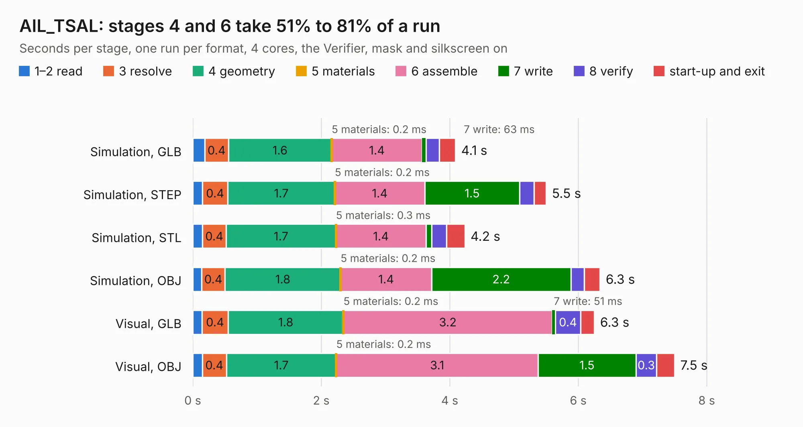

# 763. AIL_TSAL

Board 763 of the 3,121 of [Corpus Testing](../Corpus-Testing.md), on [Corpus Page 8](../CorpusTestingPages/Corpus-Testing-08.md#763-ail_tsal).

| Mode and format | 1–2 read | 3 resolve | 4 geometry | 5 materials | 6 assemble | 7 write | 8 verify | start-up and exit | Total |
|---|---:|---:|---:|---:|---:|---:|---:|---:|---:|
| Simulation, GLB | 0.2 | 0.4 | 1.6 | 0.2&nbsp;ms | 1.4 | 63&nbsp;ms | 0.2 | 0.3 | 4.1 |
| Simulation, STEP | 0.2 | 0.4 | 1.7 | 0.2&nbsp;ms | 1.4 | 1.5 | 0.2 | 0.2 | 5.5 |
| Simulation, STL | 0.2 | 0.4 | 1.7 | 0.3&nbsp;ms | 1.4 | 89&nbsp;ms | 0.2 | 0.3 | 4.2 |
| Simulation, OBJ | 0.1 | 0.4 | 1.8 | 0.2&nbsp;ms | 1.4 | 2.2 | 0.2 | 0.2 | 6.3 |
| Visual, GLB | 0.1 | 0.4 | 1.8 | 0.2&nbsp;ms | 3.2 | 51&nbsp;ms | 0.4 | 0.2 | 6.3 |
| Visual, OBJ | 0.1 | 0.4 | 1.7 | 0.2&nbsp;ms | 3.1 | 1.5 | 0.3 | 0.3 | 7.5 |

<table align="center"><tr><td valign="top">

| Board | Repo: [columbia-fsae/2021_accumulator_electronics](https://github.com/columbia-fsae/2021_accumulator_electronics) Board: `AIL_TSAL.kicad_pcb` |
|---|---|
| Folder | AIL+TSAL Shield / 07-10-2020 |
| Complexity | 195&nbsp;/&nbsp;1000 (size&nbsp;140, features&nbsp;55) |
| KESE&nbsp;features | through vias, rounded, trapezoid or chamfered pads, filled zones, curved board outline |
| Tested | 9th November 2026 |
| Copper&nbsp;layers | 2 |
| File&nbsp;format | KiCad 5 (20171130) |
| Parts,&nbsp;tracks,&nbsp;vias | 27, 128, 27 |
| Triangles,&nbsp;simulation | 379,374 in 31 parts |
| Verifier | PASS in all six runs |

</td><td valign="top">

<table>
<tr><th>File type</th><th>File size</th><th>Peak memory used</th></tr>
<tr><th colspan="3" align="left">Simulation</th></tr>
<tr><td>GLB</td><td align="right">13&nbsp;MB</td><td align="right">263&nbsp;MB</td></tr>
<tr><td>STEP</td><td align="right">65&nbsp;MB</td><td align="right">296&nbsp;MB</td></tr>
<tr><td>STL</td><td align="right">19&nbsp;MB</td><td align="right">277&nbsp;MB</td></tr>
<tr><td>OBJ</td><td align="right">38&nbsp;MB</td><td align="right">278&nbsp;MB</td></tr>
<tr><th colspan="3" align="left">Visual</th></tr>
<tr><td>GLB</td><td align="right">8.8&nbsp;MB</td><td align="right">276&nbsp;MB</td></tr>
<tr><td>OBJ</td><td align="right">26&nbsp;MB</td><td align="right">276&nbsp;MB</td></tr>
</table>

</td></tr></table>

| Previous | Next |
|:---|---:|
| [762. 2021 Accumulator Base](b0762b_2021-accumulator-electronics_2021-Accumulator-Base.md) | [764. Slave Board](b0764b_2021-accumulator-electronics_Slave-Board.md) |
