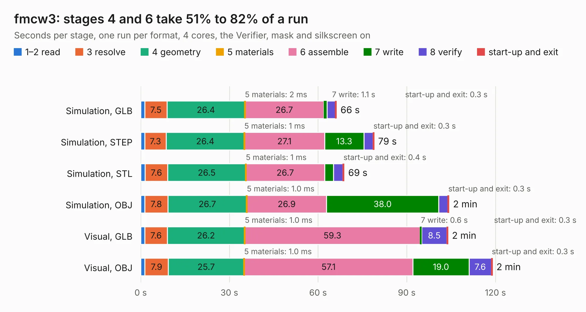

# 763. fmcw3

Board 763 of the 3,138 of [Corpus Testing](../Corpus-Testing.md), on [Corpus Page 8](../CorpusTestingPages/Corpus-Testing-08.md#763-fmcw3).

| Mode and format | 1–2 read | 3 resolve | 4 geometry | 5 materials | 6 assemble | 7 write | 8 verify | start-up and exit | Total |
|---|---:|---:|---:|---:|---:|---:|---:|---:|---:|
| Simulation, GLB | 1.4 | 7.5 | 26.4 | 2&nbsp;ms | 26.7 | 1.1 | 2.9 | 0.3 | 66.2 |
| Simulation, STEP | 1.3 | 7.3 | 26.4 | 1&nbsp;ms | 27.1 | 13.3 | 3.1 | 0.3 | 78.9 |
| Simulation, STL | 1.5 | 7.6 | 26.5 | 1&nbsp;ms | 26.7 | 2.9 | 3.2 | 0.4 | 68.8 |
| Simulation, OBJ | 1.4 | 7.8 | 26.7 | 1.0&nbsp;ms | 26.9 | 38.0 | 3.1 | 0.3 | 104.2 |
| Visual, GLB | 1.4 | 7.6 | 26.2 | 1.0&nbsp;ms | 59.3 | 0.6 | 8.5 | 0.3 | 103.9 |
| Visual, OBJ | 1.4 | 7.9 | 25.7 | 1.0&nbsp;ms | 57.1 | 19.0 | 7.6 | 0.3 | 118.9 |

<table align="center"><tr><td valign="top">

| Board | Repo: [ckflight/fmcw3-kicad](https://github.com/ckflight/fmcw3-kicad) Board: `fmcw3.kicad_pcb` |
|---|---|
| Complexity | 419&nbsp;/&nbsp;1000 (size&nbsp;309, features&nbsp;110) |
| KESE&nbsp;features | through vias, slotted holes, rounded, trapezoid or chamfered pads, arc tracks, filled zones, curved board outline, stack-up, dielectric εr and tanδ |
| Tested | 9th November 2026 |
| Copper&nbsp;layers | 6 |
| File&nbsp;format | KiCad 9 (20241229) |
| Parts,&nbsp;tracks,&nbsp;vias | 366, 3,445, 1,412 |
| Triangles,&nbsp;simulation | 7,718,966 in 413 parts |
| Verifier | PASS in all six runs |

</td><td valign="top">

<table>
<tr><th>File type</th><th>File size</th><th>Peak memory used</th></tr>
<tr><th colspan="3" align="left">Simulation</th></tr>
<tr><td>GLB</td><td align="right">258&nbsp;MB</td><td align="right">2.3&nbsp;GB</td></tr>
<tr><td>STEP</td><td align="right">842&nbsp;MB</td><td align="right">2.8&nbsp;GB</td></tr>
<tr><td>STL</td><td align="right">386&nbsp;MB</td><td align="right">2.3&nbsp;GB</td></tr>
<tr><td>OBJ</td><td align="right">832&nbsp;MB</td><td align="right">4.8&nbsp;GB</td></tr>
<tr><th colspan="3" align="left">Visual</th></tr>
<tr><td>GLB</td><td align="right">140&nbsp;MB</td><td align="right">2.4&nbsp;GB</td></tr>
<tr><td>OBJ</td><td align="right">461&nbsp;MB</td><td align="right">3.0&nbsp;GB</td></tr>
</table>

</td></tr></table>

| Previous | Next |
|:---|---:|
| [762. vme-wren](b0762b_kicad-demo-vme-wren_vme-wren.md) | [764. 2021 Accumulator Base](b0764b_2021-accumulator-electronics_2021-Accumulator-Base.md) |
