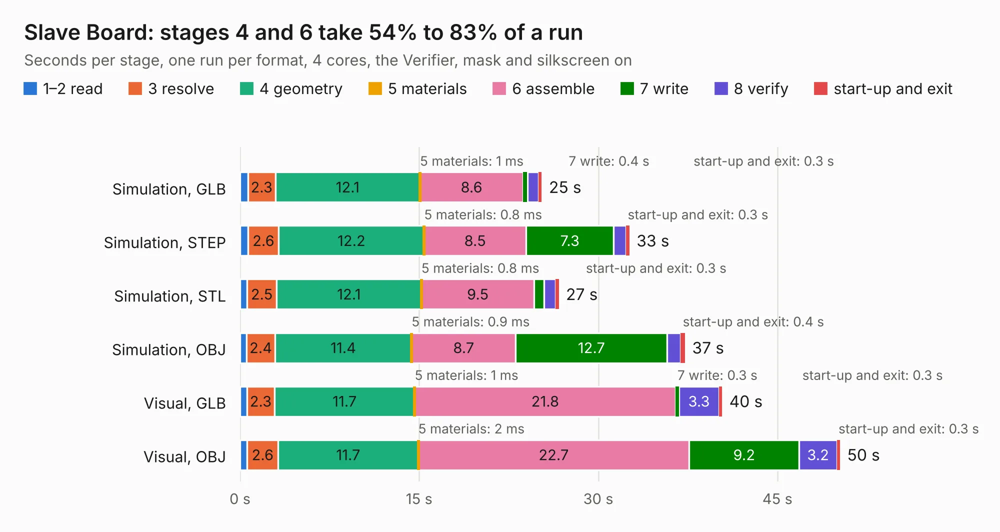

# 764. Slave Board

Board 764 of the 3,120 of [Corpus Testing](../Corpus-Testing.md), on [Corpus Page 8](../CorpusTestingPages/Corpus-Testing-08.md#764-slave-board).

| Mode and format | 1–2 read | 3 resolve | 4 geometry | 5 materials | 6 assemble | 7 write | 8 verify | start-up and exit | Total |
|---|---:|---:|---:|---:|---:|---:|---:|---:|---:|
| Simulation, GLB | 0.7 | 2.3 | 12.1 | 1&nbsp;ms | 8.6 | 0.4 | 0.9 | 0.3 | 25.3 |
| Simulation, STEP | 0.7 | 2.6 | 12.2 | 0.8&nbsp;ms | 8.5 | 7.3 | 1.0 | 0.3 | 32.6 |
| Simulation, STL | 0.6 | 2.5 | 12.1 | 0.8&nbsp;ms | 9.5 | 0.8 | 1.0 | 0.3 | 26.7 |
| Simulation, OBJ | 0.5 | 2.4 | 11.4 | 0.9&nbsp;ms | 8.7 | 12.7 | 1.1 | 0.4 | 37.3 |
| Visual, GLB | 0.6 | 2.3 | 11.7 | 1&nbsp;ms | 21.8 | 0.3 | 3.3 | 0.3 | 40.4 |
| Visual, OBJ | 0.6 | 2.6 | 11.7 | 2&nbsp;ms | 22.7 | 9.2 | 3.2 | 0.3 | 50.2 |

<table align="center"><tr><td valign="top">

| Board | Repo: [columbia-fsae/2021_accumulator_electronics](https://github.com/columbia-fsae/2021_accumulator_electronics) Board: `Slave Board.kicad_pcb` |
|---|---|
| Folder | Battery Monitoring Board / 09-07-2020 BMB |
| Complexity | 252&nbsp;/&nbsp;1000 (size&nbsp;197, features&nbsp;55) |
| KESE&nbsp;features | through vias, rounded, trapezoid or chamfered pads, filled zones, curved board outline |
| Tested | 9th November 2026 |
| Copper&nbsp;layers | 2 |
| File&nbsp;format | KiCad 5 (20171130) |
| Parts,&nbsp;tracks,&nbsp;vias | 148, 1,246, 328 |
| Triangles,&nbsp;simulation | 2,499,576 in 154 parts |
| Verifier | PASS in all six runs |

</td><td valign="top">

<table>
<tr><th>File type</th><th>File size</th><th>Peak memory used</th></tr>
<tr><th colspan="3" align="left">Simulation</th></tr>
<tr><td>GLB</td><td align="right">86&nbsp;MB</td><td align="right">970&nbsp;MB</td></tr>
<tr><td>STEP</td><td align="right">429&nbsp;MB</td><td align="right">1.1&nbsp;GB</td></tr>
<tr><td>STL</td><td align="right">125&nbsp;MB</td><td align="right">903&nbsp;MB</td></tr>
<tr><td>OBJ</td><td align="right">263&nbsp;MB</td><td align="right">1.6&nbsp;GB</td></tr>
<tr><th colspan="3" align="left">Visual</th></tr>
<tr><td>GLB</td><td align="right">65&nbsp;MB</td><td align="right">1.1&nbsp;GB</td></tr>
<tr><td>OBJ</td><td align="right">202&nbsp;MB</td><td align="right">1.4&nbsp;GB</td></tr>
</table>

</td></tr></table>

| Previous | Next |
|:---|---:|
| [763. AIL_TSAL](b0763b_2021-accumulator-electronics_AIL-TSAL.md) | [765. Master_slave Connector](b0765b_2021-accumulator-electronics_Master-slave-Connector.md) |
