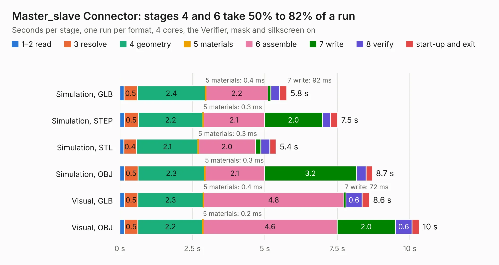

# 766. Master_slave Connector

Board 766 of the 3,128 of [Corpus Testing](../Corpus-Testing.md), on [Corpus Page 8](../CorpusTestingPages/Corpus-Testing-08.md#766-master_slave-connector).

| Mode and format | 1–2 read | 3 resolve | 4 geometry | 5 materials | 6 assemble | 7 write | 8 verify | start-up and exit | Total |
|---|---:|---:|---:|---:|---:|---:|---:|---:|---:|
| Simulation, GLB | 0.1 | 0.5 | 2.4 | 0.4&nbsp;ms | 2.2 | 92&nbsp;ms | 0.3 | 0.3 | 5.8 |
| Simulation, STEP | 0.2 | 0.5 | 2.2 | 0.3&nbsp;ms | 2.1 | 2.0 | 0.3 | 0.2 | 7.5 |
| Simulation, STL | 0.1 | 0.4 | 2.1 | 0.3&nbsp;ms | 2.0 | 0.2 | 0.3 | 0.2 | 5.4 |
| Simulation, OBJ | 0.2 | 0.5 | 2.3 | 0.3&nbsp;ms | 2.1 | 3.2 | 0.3 | 0.2 | 8.7 |
| Visual, GLB | 0.2 | 0.5 | 2.3 | 0.4&nbsp;ms | 4.8 | 72&nbsp;ms | 0.6 | 0.3 | 8.6 |
| Visual, OBJ | 0.2 | 0.5 | 2.2 | 0.2&nbsp;ms | 4.6 | 2.0 | 0.6 | 0.2 | 10.3 |

<table align="center"><tr><td valign="top">

| Board | Repo: [columbia-fsae/2021_accumulator_electronics](https://github.com/columbia-fsae/2021_accumulator_electronics) Board: `Master_slave Connector.kicad_pcb` |
|---|---|
| Folder | BMS M_S Connector / 8-1-2020 |
| Complexity | 193&nbsp;/&nbsp;1000 (size&nbsp;138, features&nbsp;55) |
| KESE&nbsp;features | through vias, rounded, trapezoid or chamfered pads, filled zones, curved board outline |
| Tested | 9th November 2026 |
| Copper&nbsp;layers | 2 |
| File&nbsp;format | KiCad 5 (20171130) |
| Parts,&nbsp;tracks,&nbsp;vias | 8, 202, 61 |
| Triangles,&nbsp;simulation | 669,754 in 18 parts |
| Verifier | PASS in all six runs |

</td><td valign="top">

<table>
<tr><th>File type</th><th>File size</th><th>Peak memory used</th></tr>
<tr><th colspan="3" align="left">Simulation</th></tr>
<tr><td>GLB</td><td align="right">23&nbsp;MB</td><td align="right">397&nbsp;MB</td></tr>
<tr><td>STEP</td><td align="right">107&nbsp;MB</td><td align="right">411&nbsp;MB</td></tr>
<tr><td>STL</td><td align="right">33&nbsp;MB</td><td align="right">371&nbsp;MB</td></tr>
<tr><td>OBJ</td><td align="right">68&nbsp;MB</td><td align="right">480&nbsp;MB</td></tr>
<tr><th colspan="3" align="left">Visual</th></tr>
<tr><td>GLB</td><td align="right">16&nbsp;MB</td><td align="right">408&nbsp;MB</td></tr>
<tr><td>OBJ</td><td align="right">47&nbsp;MB</td><td align="right">441&nbsp;MB</td></tr>
</table>

</td></tr></table>

| Previous | Next |
|:---|---:|
| [765. Slave Board](b0765b_2021-accumulator-electronics_Slave-Board.md) | [767. Inverter ISO Analog](b0767b_2021-accumulator-electronics_Inverter-ISO-Analog.md) |
