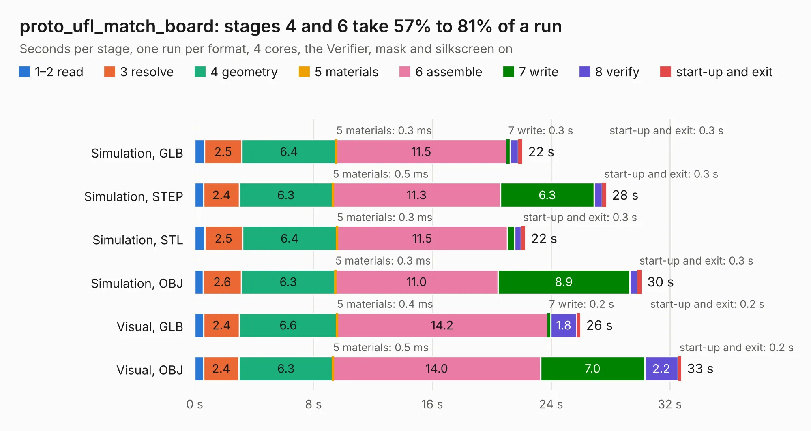

# 766. proto_ufl_match_board

Board 766 of the 3,100 of [Corpus Testing](../Corpus-Testing.md), on [Corpus Page 8](../CorpusTestingPages/Corpus-Testing-08.md#766-proto_ufl_match_board).

| Mode and format | 1–2 read | 3 resolve | 4 geometry | 5 materials | 6 assemble | 7 write | 8 verify | start-up and exit | Total |
|---|---:|---:|---:|---:|---:|---:|---:|---:|---:|
| Simulation, GLB | 0.7 | 2.5 | 6.4 | 0.3&nbsp;ms | 11.5 | 0.3 | 0.5 | 0.3 | 22.1 |
| Simulation, STEP | 0.6 | 2.4 | 6.3 | 0.5&nbsp;ms | 11.3 | 6.3 | 0.6 | 0.3 | 27.7 |
| Simulation, STL | 0.7 | 2.5 | 6.4 | 0.3&nbsp;ms | 11.5 | 0.5 | 0.4 | 0.3 | 22.3 |
| Simulation, OBJ | 0.6 | 2.6 | 6.3 | 0.3&nbsp;ms | 11.0 | 8.9 | 0.5 | 0.3 | 30.1 |
| Visual, GLB | 0.6 | 2.4 | 6.6 | 0.4&nbsp;ms | 14.2 | 0.2 | 1.8 | 0.2 | 26.0 |
| Visual, OBJ | 0.6 | 2.4 | 6.3 | 0.5&nbsp;ms | 14.0 | 7.0 | 2.2 | 0.2 | 32.8 |

<table align="center"><tr><td valign="top">

| Board | Repo: [CoolNamesAllTaken/adsbee](https://github.com/CoolNamesAllTaken/adsbee) Board: `proto_ufl_match_board.kicad_pcb` |
|---|---|
| Folder | kicad / prototyping / proto_ufl_match_board |
| Complexity | 289&nbsp;/&nbsp;1000 (size&nbsp;204, features&nbsp;85) |
| KESE&nbsp;features | through vias, rounded, trapezoid or chamfered pads, filled zones, copper text, stack-up, dielectric εr and tanδ |
| Tested | 9th November 2026 |
| Copper&nbsp;layers | 2 |
| File&nbsp;format | KiCad 7 (20221018) |
| Parts,&nbsp;tracks,&nbsp;vias | 224, 384, 736 |
| Triangles,&nbsp;simulation | 1,600,152 in 13 parts |
| Verifier | PASS in all six runs |

</td><td valign="top">

<table>
<tr><th>File type</th><th>File size</th><th>Peak memory used</th></tr>
<tr><th colspan="3" align="left">Simulation</th></tr>
<tr><td>GLB</td><td align="right">56&nbsp;MB</td><td align="right">762&nbsp;MB</td></tr>
<tr><td>STEP</td><td align="right">246&nbsp;MB</td><td align="right">918&nbsp;MB</td></tr>
<tr><td>STL</td><td align="right">80&nbsp;MB</td><td align="right">739&nbsp;MB</td></tr>
<tr><td>OBJ</td><td align="right">166&nbsp;MB</td><td align="right">1.1&nbsp;GB</td></tr>
<tr><th colspan="3" align="left">Visual</th></tr>
<tr><td>GLB</td><td align="right">45&nbsp;MB</td><td align="right">921&nbsp;MB</td></tr>
<tr><td>OBJ</td><td align="right">135&nbsp;MB</td><td align="right">943&nbsp;MB</td></tr>
</table>

</td></tr></table>

| Previous | Next |
|:---|---:|
| [765. proto_tracking_comparator_board](b0765b_adsbee_proto-tracking-comparator-board.md) | [767. proto_ufl_pi_board](b0767b_adsbee_proto-ufl-pi-board.md) |
