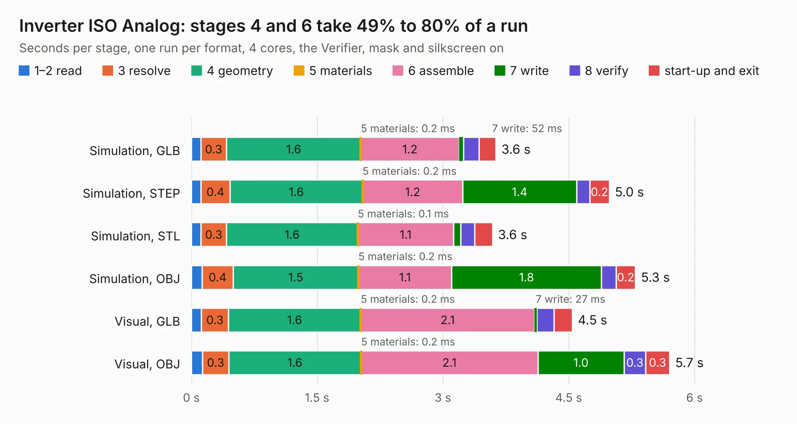

# 768. Inverter ISO Analog

Board 768 of the 3,138 of [Corpus Testing](../Corpus-Testing.md), on [Corpus Page 8](../CorpusTestingPages/Corpus-Testing-08.md#768-inverter-iso-analog).

| Mode and format | 1–2 read | 3 resolve | 4 geometry | 5 materials | 6 assemble | 7 write | 8 verify | start-up and exit | Total |
|---|---:|---:|---:|---:|---:|---:|---:|---:|---:|
| Simulation, GLB | 0.1 | 0.3 | 1.6 | 0.2&nbsp;ms | 1.2 | 52&nbsp;ms | 0.2 | 0.2 | 3.6 |
| Simulation, STEP | 0.1 | 0.4 | 1.6 | 0.2&nbsp;ms | 1.2 | 1.4 | 0.2 | 0.2 | 5.0 |
| Simulation, STL | 0.1 | 0.3 | 1.6 | 0.1&nbsp;ms | 1.1 | 89&nbsp;ms | 0.2 | 0.2 | 3.6 |
| Simulation, OBJ | 0.1 | 0.4 | 1.5 | 0.2&nbsp;ms | 1.1 | 1.8 | 0.2 | 0.2 | 5.3 |
| Visual, GLB | 0.1 | 0.3 | 1.6 | 0.2&nbsp;ms | 2.1 | 27&nbsp;ms | 0.2 | 0.2 | 4.5 |
| Visual, OBJ | 0.1 | 0.3 | 1.6 | 0.2&nbsp;ms | 2.1 | 1.0 | 0.3 | 0.3 | 5.7 |

<table align="center"><tr><td valign="top">

| Board | Repo: [columbia-fsae/2021_accumulator_electronics](https://github.com/columbia-fsae/2021_accumulator_electronics) Board: `Inverter ISO Analog.kicad_pcb` |
|---|---|
| Folder | Inverter ISO Analog |
| Complexity | 146&nbsp;/&nbsp;1000 (size&nbsp;91, features&nbsp;55) |
| KESE&nbsp;features | through vias, rounded, trapezoid or chamfered pads, filled zones, curved board outline |
| Tested | 9th November 2026 |
| Copper&nbsp;layers | 2 |
| File&nbsp;format | KiCad 5 (20171130) |
| Parts,&nbsp;tracks,&nbsp;vias | 6, 18, 2 |
| Triangles,&nbsp;simulation | 315,632 in 16 parts |
| Verifier | PASS in all six runs |

</td><td valign="top">

<table>
<tr><th>File type</th><th>File size</th><th>Peak memory used</th></tr>
<tr><th colspan="3" align="left">Simulation</th></tr>
<tr><td>GLB</td><td align="right">11&nbsp;MB</td><td align="right">235&nbsp;MB</td></tr>
<tr><td>STEP</td><td align="right">48&nbsp;MB</td><td align="right">259&nbsp;MB</td></tr>
<tr><td>STL</td><td align="right">16&nbsp;MB</td><td align="right">243&nbsp;MB</td></tr>
<tr><td>OBJ</td><td align="right">31&nbsp;MB</td><td align="right">262&nbsp;MB</td></tr>
<tr><th colspan="3" align="left">Visual</th></tr>
<tr><td>GLB</td><td align="right">5.5&nbsp;MB</td><td align="right">219&nbsp;MB</td></tr>
<tr><td>OBJ</td><td align="right">16&nbsp;MB</td><td align="right">220&nbsp;MB</td></tr>
</table>

</td></tr></table>

| Previous | Next |
|:---|---:|
| [767. Master_slave Connector](b0767b_2021-accumulator-electronics_Master-slave-Connector.md) | [769. Power Transducer](b0769b_2021-accumulator-electronics_Power-Transducer.md) |
