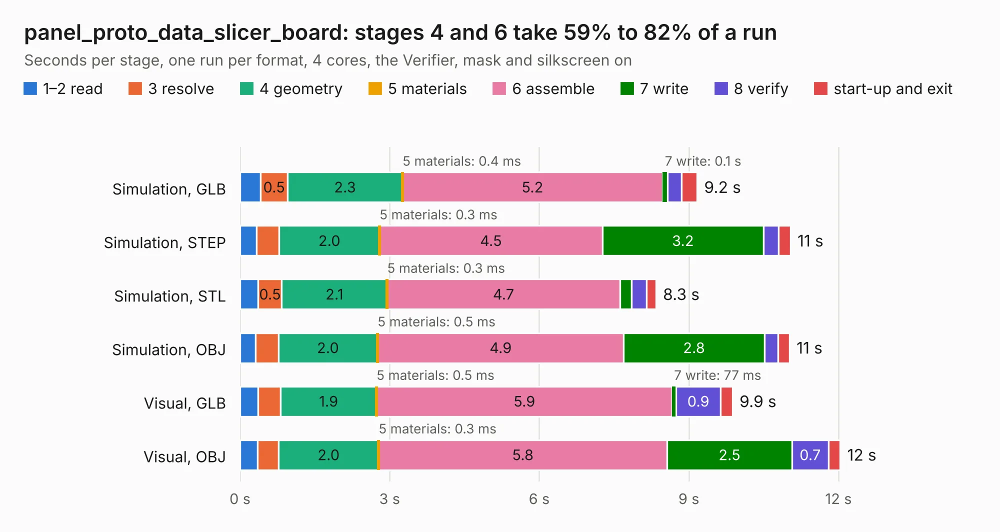

# 768. panel_proto_data_slicer_board

Board 768 of the 3,121 of [Corpus Testing](../Corpus-Testing.md), on [Corpus Page 8](../CorpusTestingPages/Corpus-Testing-08.md#768-panel_proto_data_slicer_board).

| Mode and format | 1–2 read | 3 resolve | 4 geometry | 5 materials | 6 assemble | 7 write | 8 verify | start-up and exit | Total |
|---|---:|---:|---:|---:|---:|---:|---:|---:|---:|
| Simulation, GLB | 0.4 | 0.5 | 2.3 | 0.4&nbsp;ms | 5.2 | 0.1 | 0.3 | 0.3 | 9.2 |
| Simulation, STEP | 0.3 | 0.5 | 2.0 | 0.3&nbsp;ms | 4.5 | 3.2 | 0.3 | 0.2 | 11.0 |
| Simulation, STL | 0.4 | 0.5 | 2.1 | 0.3&nbsp;ms | 4.7 | 0.2 | 0.3 | 0.2 | 8.3 |
| Simulation, OBJ | 0.3 | 0.5 | 2.0 | 0.5&nbsp;ms | 4.9 | 2.8 | 0.3 | 0.2 | 11.0 |
| Visual, GLB | 0.4 | 0.5 | 1.9 | 0.5&nbsp;ms | 5.9 | 77&nbsp;ms | 0.9 | 0.2 | 9.9 |
| Visual, OBJ | 0.4 | 0.4 | 2.0 | 0.3&nbsp;ms | 5.8 | 2.5 | 0.7 | 0.2 | 12.0 |

<table align="center"><tr><td valign="top">

| Board | Repo: [CoolNamesAllTaken/adsbee](https://github.com/CoolNamesAllTaken/adsbee) Board: `panel_proto_data_slicer_board.kicad_pcb` |
|---|---|
| Folder | kicad / prototyping / panel_proto_data_slicer_board |
| Complexity | 234&nbsp;/&nbsp;1000 (size&nbsp;179, features&nbsp;55) |
| KESE&nbsp;features | through vias, rounded, trapezoid or chamfered pads, filled zones, copper text |
| Tested | 9th November 2026 |
| Copper&nbsp;layers | 2 |
| File&nbsp;format | KiCad 8 (20240108) |
| Parts,&nbsp;tracks,&nbsp;vias | 156, 552, 48 |
| Triangles,&nbsp;simulation | 616,084 in 105 parts |
| Note | panel |
| Verifier | PASS in all six runs |

</td><td valign="top">

<table>
<tr><th>File type</th><th>File size</th><th>Peak memory used</th></tr>
<tr><th colspan="3" align="left">Simulation</th></tr>
<tr><td>GLB</td><td align="right">20&nbsp;MB</td><td align="right">400&nbsp;MB</td></tr>
<tr><td>STEP</td><td align="right">116&nbsp;MB</td><td align="right">446&nbsp;MB</td></tr>
<tr><td>STL</td><td align="right">31&nbsp;MB</td><td align="right">402&nbsp;MB</td></tr>
<tr><td>OBJ</td><td align="right">62&nbsp;MB</td><td align="right">470&nbsp;MB</td></tr>
<tr><th colspan="3" align="left">Visual</th></tr>
<tr><td>GLB</td><td align="right">17&nbsp;MB</td><td align="right">550&nbsp;MB</td></tr>
<tr><td>OBJ</td><td align="right">49&nbsp;MB</td><td align="right">531&nbsp;MB</td></tr>
</table>

</td></tr></table>

| Previous | Next |
|:---|---:|
| [767. Power Transducer](b0767b_2021-accumulator-electronics_Power-Transducer.md) | [769. panel_proto_lna_board](b0769b_adsbee_panel-proto-lna-board.md) |
