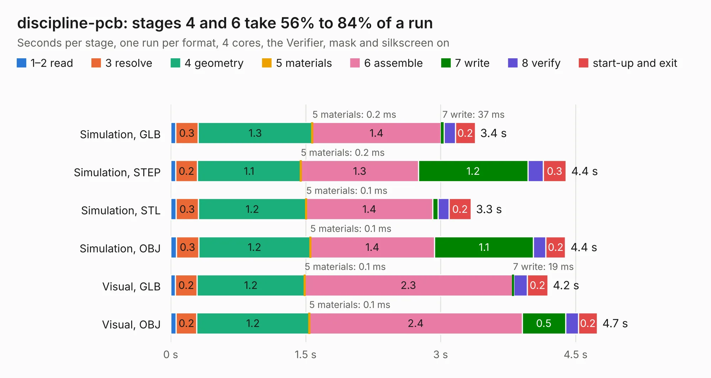

# 769. discipline-pcb

Board 769 of the 3,100 of [Corpus Testing](../Corpus-Testing.md), on [Corpus Page 8](../CorpusTestingPages/Corpus-Testing-08.md#769-discipline-pcb).

| Mode and format | 1–2 read | 3 resolve | 4 geometry | 5 materials | 6 assemble | 7 write | 8 verify | start-up and exit | Total |
|---|---:|---:|---:|---:|---:|---:|---:|---:|---:|
| Simulation, GLB | 54&nbsp;ms | 0.3 | 1.3 | 0.2&nbsp;ms | 1.4 | 37&nbsp;ms | 0.1 | 0.2 | 3.4 |
| Simulation, STEP | 55&nbsp;ms | 0.2 | 1.1 | 0.2&nbsp;ms | 1.3 | 1.2 | 0.2 | 0.3 | 4.4 |
| Simulation, STL | 58&nbsp;ms | 0.3 | 1.2 | 0.1&nbsp;ms | 1.4 | 62&nbsp;ms | 0.1 | 0.2 | 3.3 |
| Simulation, OBJ | 61&nbsp;ms | 0.3 | 1.2 | 0.1&nbsp;ms | 1.4 | 1.1 | 0.1 | 0.2 | 4.4 |
| Visual, GLB | 52&nbsp;ms | 0.2 | 1.2 | 0.1&nbsp;ms | 2.3 | 19&nbsp;ms | 0.1 | 0.2 | 4.2 |
| Visual, OBJ | 61&nbsp;ms | 0.2 | 1.2 | 0.1&nbsp;ms | 2.4 | 0.5 | 0.1 | 0.2 | 4.7 |

<table align="center"><tr><td valign="top">

| Board | Repo: [coseyfannitutti/discipline](https://github.com/coseyfannitutti/discipline) Board: `discipline-pcb.kicad_pcb` |
|---|---|
| Folder | bottom |
| Complexity | 84&nbsp;/&nbsp;1000 (size&nbsp;39, features&nbsp;45) |
| KESE&nbsp;features | through vias, filled zones, curved board outline |
| Tested | 9th November 2026 |
| Copper&nbsp;layers | 2 |
| File&nbsp;format | KiCad 5 (20171130) |
| Parts,&nbsp;tracks,&nbsp;vias | 0, 0, 1 |
| Triangles,&nbsp;simulation | 225,470 in 12 parts |
| Note | no components |
| Verifier | PASS in all six runs |

</td><td valign="top">

<table>
<tr><th>File type</th><th>File size</th><th>Peak memory used</th></tr>
<tr><th colspan="3" align="left">Simulation</th></tr>
<tr><td>GLB</td><td align="right">8.0&nbsp;MB</td><td align="right">204&nbsp;MB</td></tr>
<tr><td>STEP</td><td align="right">49&nbsp;MB</td><td align="right">236&nbsp;MB</td></tr>
<tr><td>STL</td><td align="right">11&nbsp;MB</td><td align="right">215&nbsp;MB</td></tr>
<tr><td>OBJ</td><td align="right">23&nbsp;MB</td><td align="right">208&nbsp;MB</td></tr>
<tr><th colspan="3" align="left">Visual</th></tr>
<tr><td>GLB</td><td align="right">4.0&nbsp;MB</td><td align="right">160&nbsp;MB</td></tr>
<tr><td>OBJ</td><td align="right">11&nbsp;MB</td><td align="right">158&nbsp;MB</td></tr>
</table>

</td></tr></table>

| Previous | Next |
|:---|---:|
| [768. saw_eval_board](b0768b_adsbee_saw-eval-board.md) | [770. discipline-pcb](b0770b_discipline_discipline-pcb.md) |
