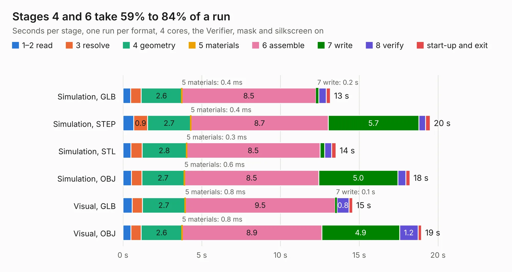

# 770. panel_proto_tracking_comparator_board

Board 770 of the 3,120 of [Corpus Testing](../Corpus-Testing.md), on [Corpus Page 8](../CorpusTestingPages/Corpus-Testing-08.md#770-panel_proto_tracking_comparator_board).

| Mode and format | 1–2 read | 3 resolve | 4 geometry | 5 materials | 6 assemble | 7 write | 8 verify | start-up and exit | Total |
|---|---:|---:|---:|---:|---:|---:|---:|---:|---:|
| Simulation, GLB | 0.5 | 0.7 | 2.6 | 0.4&nbsp;ms | 8.5 | 0.2 | 0.5 | 0.3 | 13.2 |
| Simulation, STEP | 0.7 | 0.9 | 2.7 | 0.4&nbsp;ms | 8.7 | 5.7 | 0.4 | 0.3 | 19.5 |
| Simulation, STL | 0.5 | 0.7 | 2.8 | 0.3&nbsp;ms | 8.5 | 0.3 | 0.4 | 0.3 | 13.5 |
| Simulation, OBJ | 0.5 | 0.7 | 2.7 | 0.6&nbsp;ms | 8.5 | 5.0 | 0.5 | 0.3 | 18.2 |
| Visual, GLB | 0.6 | 0.7 | 2.7 | 0.8&nbsp;ms | 9.5 | 0.1 | 0.8 | 0.2 | 14.6 |
| Visual, OBJ | 0.5 | 0.6 | 2.6 | 0.8&nbsp;ms | 8.9 | 4.9 | 1.2 | 0.2 | 19.0 |

<table align="center"><tr><td valign="top">

| Board | Repo: [CoolNamesAllTaken/adsbee](https://github.com/CoolNamesAllTaken/adsbee) Board: `panel_proto_tracking_comparator_board.kicad_pcb` |
|---|---|
| Folder | kicad / prototyping / panel_proto_tracking_comparator_board |
| Complexity | 211&nbsp;/&nbsp;1000 (size&nbsp;181, features&nbsp;30) |
| KESE&nbsp;features | rounded, trapezoid or chamfered pads, copper drawings, copper text |
| Tested | 9th November 2026 |
| Copper&nbsp;layers | 2 |
| File&nbsp;format | KiCad 8 (20240108) |
| Parts,&nbsp;tracks,&nbsp;vias | 192, 696, 0 |
| Triangles,&nbsp;simulation | 897,184 in 175 parts |
| Note | panel |
| Verifier | PASS in all six runs |

</td><td valign="top">

<table>
<tr><th>File type</th><th>File size</th><th>Peak memory used</th></tr>
<tr><th colspan="3" align="left">Simulation</th></tr>
<tr><td>GLB</td><td align="right">30&nbsp;MB</td><td align="right">551&nbsp;MB</td></tr>
<tr><td>STEP</td><td align="right">182&nbsp;MB</td><td align="right">587&nbsp;MB</td></tr>
<tr><td>STL</td><td align="right">45&nbsp;MB</td><td align="right">551&nbsp;MB</td></tr>
<tr><td>OBJ</td><td align="right">90&nbsp;MB</td><td align="right">645&nbsp;MB</td></tr>
<tr><th colspan="3" align="left">Visual</th></tr>
<tr><td>GLB</td><td align="right">27&nbsp;MB</td><td align="right">620&nbsp;MB</td></tr>
<tr><td>OBJ</td><td align="right">82&nbsp;MB</td><td align="right">612&nbsp;MB</td></tr>
</table>

</td></tr></table>

| Previous | Next |
|:---|---:|
| [769. panel_proto_lna_board](b0769b_adsbee_panel-proto-lna-board.md) | [771. panel_saw_eval_board](b0771b_adsbee_panel-saw-eval-board.md) |
