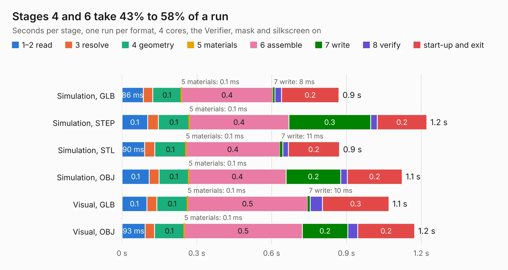

# 770. proto_tracking_comparator_board

Board 770 of the 3,108 of [Corpus Testing](../Corpus-Testing.md), on [Corpus Page 8](../CorpusTestingPages/Corpus-Testing-08.md#770-proto_tracking_comparator_board).

| Mode and format | 1–2 read | 3 resolve | 4 geometry | 5 materials | 6 assemble | 7 write | 8 verify | start-up and exit | Total |
|---|---:|---:|---:|---:|---:|---:|---:|---:|---:|
| Simulation, GLB | 86&nbsp;ms | 38&nbsp;ms | 0.1 | 0.1&nbsp;ms | 0.4 | 8&nbsp;ms | 26&nbsp;ms | 0.2 | 0.9 |
| Simulation, STEP | 0.1 | 43&nbsp;ms | 0.1 | 0.1&nbsp;ms | 0.4 | 0.3 | 27&nbsp;ms | 0.2 | 1.2 |
| Simulation, STL | 90&nbsp;ms | 41&nbsp;ms | 0.1 | 0.1&nbsp;ms | 0.4 | 11&nbsp;ms | 22&nbsp;ms | 0.2 | 0.9 |
| Simulation, OBJ | 0.1 | 40&nbsp;ms | 0.1 | 0.1&nbsp;ms | 0.4 | 0.2 | 26&nbsp;ms | 0.2 | 1.1 |
| Visual, GLB | 0.1 | 40&nbsp;ms | 0.1 | 0.1&nbsp;ms | 0.5 | 10&nbsp;ms | 49&nbsp;ms | 0.3 | 1.1 |
| Visual, OBJ | 93&nbsp;ms | 38&nbsp;ms | 0.1 | 0.1&nbsp;ms | 0.5 | 0.2 | 40&nbsp;ms | 0.2 | 1.2 |

<table align="center"><tr><td valign="top">

| Board | Repo: [CoolNamesAllTaken/adsbee](https://github.com/CoolNamesAllTaken/adsbee) Board: `proto_tracking_comparator_board.kicad_pcb` |
|---|---|
| Folder | kicad / prototyping / proto_tracking_comparator_board |
| Complexity | 126&nbsp;/&nbsp;1000 (size&nbsp;96, features&nbsp;30) |
| KESE&nbsp;features | rounded, trapezoid or chamfered pads, copper drawings, copper text |
| Tested | 9th November 2026 |
| Copper&nbsp;layers | 2 |
| File&nbsp;format | KiCad 8 (20240108) |
| Parts,&nbsp;tracks,&nbsp;vias | 8, 29, 0 |
| Triangles,&nbsp;simulation | 39,648 in 14 parts |
| Verifier | PASS in all six runs |

</td><td valign="top">

<table>
<tr><th>File type</th><th>File size</th><th>Peak memory used</th></tr>
<tr><th colspan="3" align="left">Simulation</th></tr>
<tr><td>GLB</td><td align="right">1.4&nbsp;MB</td><td align="right">74&nbsp;MB</td></tr>
<tr><td>STEP</td><td align="right">8.4&nbsp;MB</td><td align="right">79&nbsp;MB</td></tr>
<tr><td>STL</td><td align="right">2.0&nbsp;MB</td><td align="right">74&nbsp;MB</td></tr>
<tr><td>OBJ</td><td align="right">3.8&nbsp;MB</td><td align="right">82&nbsp;MB</td></tr>
<tr><th colspan="3" align="left">Visual</th></tr>
<tr><td>GLB</td><td align="right">1.2&nbsp;MB</td><td align="right">100&nbsp;MB</td></tr>
<tr><td>OBJ</td><td align="right">3.3&nbsp;MB</td><td align="right">101&nbsp;MB</td></tr>
</table>

</td></tr></table>

| Previous | Next |
|:---|---:|
| [769. proto_lna_board](b0769b_adsbee_proto-lna-board.md) | [771. proto_ufl_match_board](b0771b_adsbee_proto-ufl-match-board.md) |
