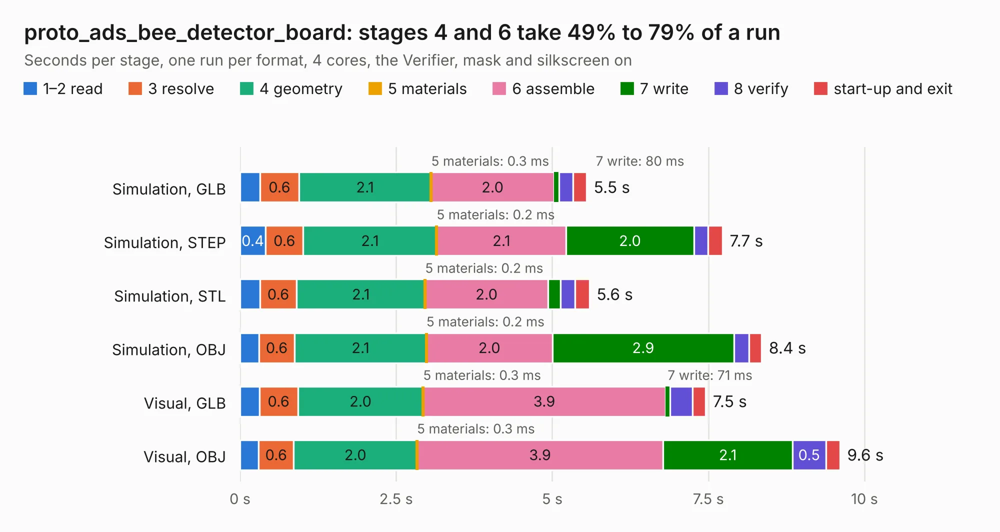

# 773. proto_ads_bee_detector_board

Board 773 of the 3,128 of [Corpus Testing](../Corpus-Testing.md), on [Corpus Page 8](../CorpusTestingPages/Corpus-Testing-08.md#773-proto_ads_bee_detector_board).

| Mode and format | 1–2 read | 3 resolve | 4 geometry | 5 materials | 6 assemble | 7 write | 8 verify | start-up and exit | Total |
|---|---:|---:|---:|---:|---:|---:|---:|---:|---:|
| Simulation, GLB | 0.3 | 0.6 | 2.1 | 0.3&nbsp;ms | 2.0 | 80&nbsp;ms | 0.2 | 0.2 | 5.5 |
| Simulation, STEP | 0.4 | 0.6 | 2.1 | 0.2&nbsp;ms | 2.1 | 2.0 | 0.2 | 0.2 | 7.7 |
| Simulation, STL | 0.3 | 0.6 | 2.1 | 0.2&nbsp;ms | 2.0 | 0.2 | 0.2 | 0.2 | 5.6 |
| Simulation, OBJ | 0.3 | 0.6 | 2.1 | 0.2&nbsp;ms | 2.0 | 2.9 | 0.2 | 0.2 | 8.4 |
| Visual, GLB | 0.3 | 0.6 | 2.0 | 0.3&nbsp;ms | 3.9 | 71&nbsp;ms | 0.4 | 0.2 | 7.5 |
| Visual, OBJ | 0.3 | 0.6 | 2.0 | 0.3&nbsp;ms | 3.9 | 2.1 | 0.5 | 0.2 | 9.6 |

<table align="center"><tr><td valign="top">

| Board | Repo: [CoolNamesAllTaken/adsbee](https://github.com/CoolNamesAllTaken/adsbee) Board: `proto_ads_bee_detector_board.kicad_pcb` |
|---|---|
| Folder | kicad / prototyping / proto_ads_bee_detector_board |
| Complexity | 260&nbsp;/&nbsp;1000 (size&nbsp;160, features&nbsp;100) |
| KESE&nbsp;features | through vias, rounded, trapezoid or chamfered pads, filled zones, copper text, knockout text, stack-up, dielectric εr and tanδ |
| Tested | 9th November 2026 |
| Copper&nbsp;layers | 2 |
| File&nbsp;format | KiCad 7 (20221018) |
| Parts,&nbsp;tracks,&nbsp;vias | 70, 204, 58 |
| Triangles,&nbsp;simulation | 509,420 in 26 parts |
| Verifier | PASS in all six runs |

</td><td valign="top">

<table>
<tr><th>File type</th><th>File size</th><th>Peak memory used</th></tr>
<tr><th colspan="3" align="left">Simulation</th></tr>
<tr><td>GLB</td><td align="right">18&nbsp;MB</td><td align="right">319&nbsp;MB</td></tr>
<tr><td>STEP</td><td align="right">78&nbsp;MB</td><td align="right">383&nbsp;MB</td></tr>
<tr><td>STL</td><td align="right">25&nbsp;MB</td><td align="right">311&nbsp;MB</td></tr>
<tr><td>OBJ</td><td align="right">51&nbsp;MB</td><td align="right">408&nbsp;MB</td></tr>
<tr><th colspan="3" align="left">Visual</th></tr>
<tr><td>GLB</td><td align="right">14&nbsp;MB</td><td align="right">372&nbsp;MB</td></tr>
<tr><td>OBJ</td><td align="right">40&nbsp;MB</td><td align="right">413&nbsp;MB</td></tr>
</table>

</td></tr></table>

| Previous | Next |
|:---|---:|
| [772. panel_saw_eval_board](b0772b_adsbee_panel-saw-eval-board.md) | [774. proto_ads_bee_mcu_board](b0774b_adsbee_proto-ads-bee-mcu-board.md) |
