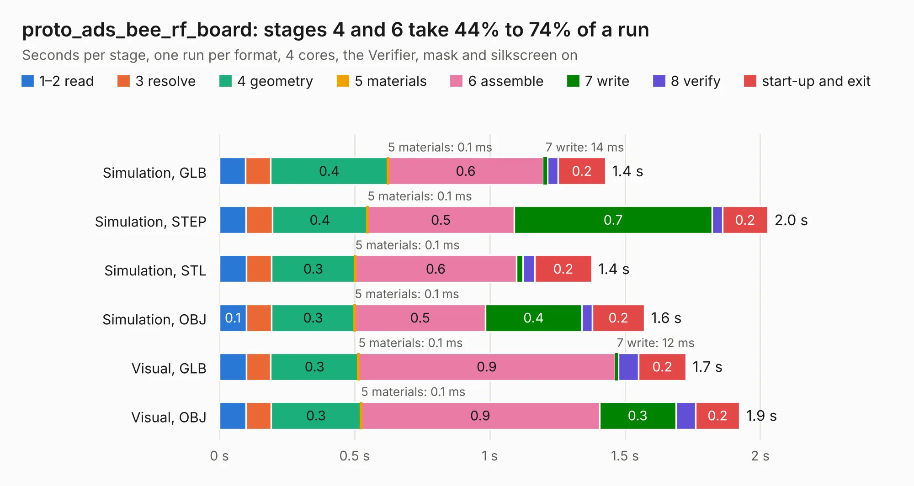

# 774. proto_ads_bee_rf_board

Board 774 of the 3,121 of [Corpus Testing](../Corpus-Testing.md), on [Corpus Page 8](../CorpusTestingPages/Corpus-Testing-08.md#774-proto_ads_bee_rf_board).

| Mode and format | 1–2 read | 3 resolve | 4 geometry | 5 materials | 6 assemble | 7 write | 8 verify | start-up and exit | Total |
|---|---:|---:|---:|---:|---:|---:|---:|---:|---:|
| Simulation, GLB | 96&nbsp;ms | 93&nbsp;ms | 0.4 | 0.1&nbsp;ms | 0.6 | 14&nbsp;ms | 39&nbsp;ms | 0.2 | 1.4 |
| Simulation, STEP | 98&nbsp;ms | 97&nbsp;ms | 0.4 | 0.1&nbsp;ms | 0.5 | 0.7 | 38&nbsp;ms | 0.2 | 2.0 |
| Simulation, STL | 99&nbsp;ms | 93&nbsp;ms | 0.3 | 0.1&nbsp;ms | 0.6 | 25&nbsp;ms | 44&nbsp;ms | 0.2 | 1.4 |
| Simulation, OBJ | 0.1 | 93&nbsp;ms | 0.3 | 0.1&nbsp;ms | 0.5 | 0.4 | 40&nbsp;ms | 0.2 | 1.6 |
| Visual, GLB | 99&nbsp;ms | 91&nbsp;ms | 0.3 | 0.1&nbsp;ms | 0.9 | 12&nbsp;ms | 75&nbsp;ms | 0.2 | 1.7 |
| Visual, OBJ | 98&nbsp;ms | 93&nbsp;ms | 0.3 | 0.1&nbsp;ms | 0.9 | 0.3 | 73&nbsp;ms | 0.2 | 1.9 |

<table align="center"><tr><td valign="top">

| Board | Repo: [CoolNamesAllTaken/adsbee](https://github.com/CoolNamesAllTaken/adsbee) Board: `proto_ads_bee_rf_board.kicad_pcb` |
|---|---|
| Folder | kicad / prototyping / proto_ads_bee_rf_board |
| Complexity | 218&nbsp;/&nbsp;1000 (size&nbsp;118, features&nbsp;100) |
| KESE&nbsp;features | through vias, rounded, trapezoid or chamfered pads, filled zones, copper text, knockout text, stack-up, dielectric εr and tanδ |
| Tested | 9th November 2026 |
| Copper&nbsp;layers | 2 |
| File&nbsp;format | KiCad 7 (20221018) |
| Parts,&nbsp;tracks,&nbsp;vias | 16, 30, 14 |
| Triangles,&nbsp;simulation | 91,664 in 24 parts |
| Verifier | PASS in all six runs |

</td><td valign="top">

<table>
<tr><th>File type</th><th>File size</th><th>Peak memory used</th></tr>
<tr><th colspan="3" align="left">Simulation</th></tr>
<tr><td>GLB</td><td align="right">3.2&nbsp;MB</td><td align="right">183&nbsp;MB</td></tr>
<tr><td>STEP</td><td align="right">15&nbsp;MB</td><td align="right">192&nbsp;MB</td></tr>
<tr><td>STL</td><td align="right">4.6&nbsp;MB</td><td align="right">177&nbsp;MB</td></tr>
<tr><td>OBJ</td><td align="right">8.8&nbsp;MB</td><td align="right">181&nbsp;MB</td></tr>
<tr><th colspan="3" align="left">Visual</th></tr>
<tr><td>GLB</td><td align="right">2.5&nbsp;MB</td><td align="right">154&nbsp;MB</td></tr>
<tr><td>OBJ</td><td align="right">7.0&nbsp;MB</td><td align="right">150&nbsp;MB</td></tr>
</table>

</td></tr></table>

| Previous | Next |
|:---|---:|
| [773. proto_ads_bee_mcu_board](b0773b_adsbee_proto-ads-bee-mcu-board.md) | [775. proto_amp_bodge_board](b0775b_adsbee_proto-amp-bodge-board.md) |
