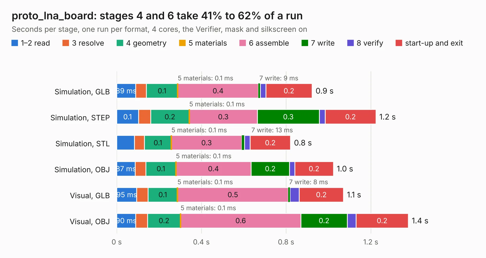

# 774. proto_lna_board

Board 774 of the 3,116 of [Corpus Testing](../Corpus-Testing.md), on [Corpus Page 8](../CorpusTestingPages/Corpus-Testing-08.md#774-proto_lna_board).

| Mode and format | 1–2 read | 3 resolve | 4 geometry | 5 materials | 6 assemble | 7 write | 8 verify | start-up and exit | Total |
|---|---:|---:|---:|---:|---:|---:|---:|---:|---:|
| Simulation, GLB | 89&nbsp;ms | 51&nbsp;ms | 0.1 | 0.1&nbsp;ms | 0.4 | 9&nbsp;ms | 26&nbsp;ms | 0.2 | 0.9 |
| Simulation, STEP | 0.1 | 57&nbsp;ms | 0.2 | 0.1&nbsp;ms | 0.3 | 0.3 | 27&nbsp;ms | 0.2 | 1.2 |
| Simulation, STL | 84&nbsp;ms | 47&nbsp;ms | 0.1 | 0.1&nbsp;ms | 0.3 | 13&nbsp;ms | 26&nbsp;ms | 0.2 | 0.8 |
| Simulation, OBJ | 87&nbsp;ms | 51&nbsp;ms | 0.1 | 0.1&nbsp;ms | 0.4 | 0.2 | 25&nbsp;ms | 0.2 | 1.0 |
| Visual, GLB | 95&nbsp;ms | 54&nbsp;ms | 0.1 | 0.1&nbsp;ms | 0.5 | 8&nbsp;ms | 44&nbsp;ms | 0.2 | 1.1 |
| Visual, OBJ | 90&nbsp;ms | 56&nbsp;ms | 0.2 | 0.1&nbsp;ms | 0.6 | 0.2 | 41&nbsp;ms | 0.2 | 1.4 |

<table align="center"><tr><td valign="top">

| Board | Repo: [CoolNamesAllTaken/adsbee](https://github.com/CoolNamesAllTaken/adsbee) Board: `proto_lna_board.kicad_pcb` |
|---|---|
| Folder | kicad / prototyping / proto_lna_board |
| Complexity | 160&nbsp;/&nbsp;1000 (size&nbsp;105, features&nbsp;55) |
| KESE&nbsp;features | through vias, rounded, trapezoid or chamfered pads, filled zones, copper text |
| Tested | 9th November 2026 |
| Copper&nbsp;layers | 2 |
| File&nbsp;format | KiCad 8 (20240108) |
| Parts,&nbsp;tracks,&nbsp;vias | 12, 20, 6 |
| Triangles,&nbsp;simulation | 41,780 in 21 parts |
| Verifier | PASS in all six runs |

</td><td valign="top">

<table>
<tr><th>File type</th><th>File size</th><th>Peak memory used</th></tr>
<tr><th colspan="3" align="left">Simulation</th></tr>
<tr><td>GLB</td><td align="right">1.5&nbsp;MB</td><td align="right">72&nbsp;MB</td></tr>
<tr><td>STEP</td><td align="right">7.6&nbsp;MB</td><td align="right">75&nbsp;MB</td></tr>
<tr><td>STL</td><td align="right">2.1&nbsp;MB</td><td align="right">72&nbsp;MB</td></tr>
<tr><td>OBJ</td><td align="right">3.9&nbsp;MB</td><td align="right">79&nbsp;MB</td></tr>
<tr><th colspan="3" align="left">Visual</th></tr>
<tr><td>GLB</td><td align="right">1.1&nbsp;MB</td><td align="right">96&nbsp;MB</td></tr>
<tr><td>OBJ</td><td align="right">3.0&nbsp;MB</td><td align="right">97&nbsp;MB</td></tr>
</table>

</td></tr></table>

| Previous | Next |
|:---|---:|
| [773. proto_data_slicer_board](b0773b_adsbee_proto-data-slicer-board.md) | [775. proto_tracking_comparator_board](b0775b_adsbee_proto-tracking-comparator-board.md) |
