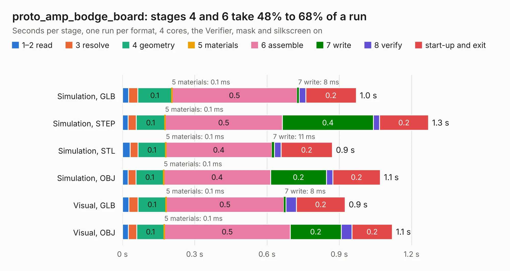

# 777. proto_amp_bodge_board

Board 777 of the 3,131 of [Corpus Testing](../Corpus-Testing.md), on [Corpus Page 8](../CorpusTestingPages/Corpus-Testing-08.md#777-proto_amp_bodge_board).

| Mode and format | 1–2 read | 3 resolve | 4 geometry | 5 materials | 6 assemble | 7 write | 8 verify | start-up and exit | Total |
|---|---:|---:|---:|---:|---:|---:|---:|---:|---:|
| Simulation, GLB | 25&nbsp;ms | 38&nbsp;ms | 0.1 | 0.1&nbsp;ms | 0.5 | 8&nbsp;ms | 27&nbsp;ms | 0.2 | 1.0 |
| Simulation, STEP | 23&nbsp;ms | 34&nbsp;ms | 0.1 | 0.1&nbsp;ms | 0.5 | 0.4 | 25&nbsp;ms | 0.2 | 1.3 |
| Simulation, STL | 32&nbsp;ms | 32&nbsp;ms | 0.1 | 0.1&nbsp;ms | 0.4 | 11&nbsp;ms | 28&nbsp;ms | 0.2 | 0.9 |
| Simulation, OBJ | 23&nbsp;ms | 33&nbsp;ms | 0.1 | 0.1&nbsp;ms | 0.4 | 0.2 | 26&nbsp;ms | 0.2 | 1.1 |
| Visual, GLB | 27&nbsp;ms | 38&nbsp;ms | 0.1 | 0.1&nbsp;ms | 0.5 | 8&nbsp;ms | 44&nbsp;ms | 0.2 | 0.9 |
| Visual, OBJ | 25&nbsp;ms | 34&nbsp;ms | 0.1 | 0.1&nbsp;ms | 0.5 | 0.2 | 45&nbsp;ms | 0.2 | 1.1 |

<table align="center"><tr><td valign="top">

| Board | Repo: [CoolNamesAllTaken/adsbee](https://github.com/CoolNamesAllTaken/adsbee) Board: `proto_amp_bodge_board.kicad_pcb` |
|---|---|
| Folder | kicad / prototyping / proto_amp_bodge_board |
| Complexity | 131&nbsp;/&nbsp;1000 (size&nbsp;96, features&nbsp;35) |
| KESE&nbsp;features | rounded, trapezoid or chamfered pads, copper text, TrueType text |
| Tested | 9th November 2026 |
| Copper&nbsp;layers | 2 |
| File&nbsp;format | KiCad 8 (20240108) |
| Parts,&nbsp;tracks,&nbsp;vias | 6, 33, 0 |
| Triangles,&nbsp;simulation | 46,370 in 13 parts |
| Verifier | PASS in all six runs |

</td><td valign="top">

<table>
<tr><th>File type</th><th>File size</th><th>Peak memory used</th></tr>
<tr><th colspan="3" align="left">Simulation</th></tr>
<tr><td>GLB</td><td align="right">1.6&nbsp;MB</td><td align="right">58&nbsp;MB</td></tr>
<tr><td>STEP</td><td align="right">9.8&nbsp;MB</td><td align="right">63&nbsp;MB</td></tr>
<tr><td>STL</td><td align="right">2.3&nbsp;MB</td><td align="right">58&nbsp;MB</td></tr>
<tr><td>OBJ</td><td align="right">4.4&nbsp;MB</td><td align="right">73&nbsp;MB</td></tr>
<tr><th colspan="3" align="left">Visual</th></tr>
<tr><td>GLB</td><td align="right">1.5&nbsp;MB</td><td align="right">79&nbsp;MB</td></tr>
<tr><td>OBJ</td><td align="right">4.1&nbsp;MB</td><td align="right">79&nbsp;MB</td></tr>
</table>

</td></tr></table>

| Previous | Next |
|:---|---:|
| [776. proto_ads_bee_rf_board](b0776b_adsbee_proto-ads-bee-rf-board.md) | [778. proto_data_slicer_board](b0778b_adsbee_proto-data-slicer-board.md) |
