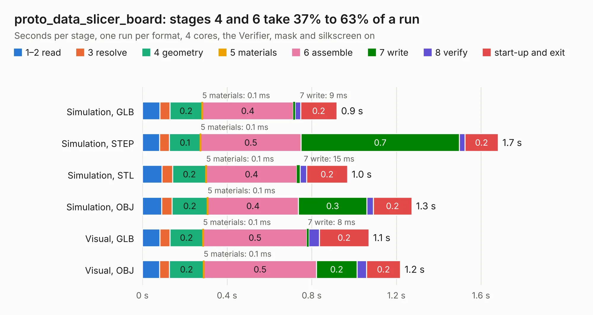

# 777. proto_data_slicer_board

Board 777 of the 3,130 of [Corpus Testing](../Corpus-Testing.md), on [Corpus Page 8](../CorpusTestingPages/Corpus-Testing-08.md#777-proto_data_slicer_board).

| Mode and format | 1–2 read | 3 resolve | 4 geometry | 5 materials | 6 assemble | 7 write | 8 verify | start-up and exit | Total |
|---|---:|---:|---:|---:|---:|---:|---:|---:|---:|
| Simulation, GLB | 83&nbsp;ms | 48&nbsp;ms | 0.2 | 0.1&nbsp;ms | 0.4 | 9&nbsp;ms | 25&nbsp;ms | 0.2 | 0.9 |
| Simulation, STEP | 81&nbsp;ms | 47&nbsp;ms | 0.1 | 0.1&nbsp;ms | 0.5 | 0.7 | 26&nbsp;ms | 0.2 | 1.7 |
| Simulation, STL | 92&nbsp;ms | 51&nbsp;ms | 0.2 | 0.1&nbsp;ms | 0.4 | 15&nbsp;ms | 31&nbsp;ms | 0.2 | 1.0 |
| Simulation, OBJ | 91&nbsp;ms | 49&nbsp;ms | 0.2 | 0.1&nbsp;ms | 0.4 | 0.3 | 30&nbsp;ms | 0.2 | 1.3 |
| Visual, GLB | 83&nbsp;ms | 47&nbsp;ms | 0.2 | 0.1&nbsp;ms | 0.5 | 8&nbsp;ms | 50&nbsp;ms | 0.2 | 1.1 |
| Visual, OBJ | 81&nbsp;ms | 47&nbsp;ms | 0.2 | 0.1&nbsp;ms | 0.5 | 0.2 | 46&nbsp;ms | 0.2 | 1.2 |

<table align="center"><tr><td valign="top">

| Board | Repo: [CoolNamesAllTaken/adsbee](https://github.com/CoolNamesAllTaken/adsbee) Board: `proto_data_slicer_board.kicad_pcb` |
|---|---|
| Folder | kicad / prototyping / proto_data_slicer_board |
| Complexity | 167&nbsp;/&nbsp;1000 (size&nbsp;112, features&nbsp;55) |
| KESE&nbsp;features | through vias, rounded, trapezoid or chamfered pads, filled zones, copper text |
| Tested | 9th November 2026 |
| Copper&nbsp;layers | 2 |
| File&nbsp;format | KiCad 8 (20240108) |
| Parts,&nbsp;tracks,&nbsp;vias | 13, 46, 4 |
| Triangles,&nbsp;simulation | 51,216 in 17 parts |
| Verifier | PASS in all six runs |

</td><td valign="top">

<table>
<tr><th>File type</th><th>File size</th><th>Peak memory used</th></tr>
<tr><th colspan="3" align="left">Simulation</th></tr>
<tr><td>GLB</td><td align="right">1.8&nbsp;MB</td><td align="right">77&nbsp;MB</td></tr>
<tr><td>STEP</td><td align="right">9.4&nbsp;MB</td><td align="right">186&nbsp;MB</td></tr>
<tr><td>STL</td><td align="right">2.6&nbsp;MB</td><td align="right">78&nbsp;MB</td></tr>
<tr><td>OBJ</td><td align="right">4.8&nbsp;MB</td><td align="right">94&nbsp;MB</td></tr>
<tr><th colspan="3" align="left">Visual</th></tr>
<tr><td>GLB</td><td align="right">1.4&nbsp;MB</td><td align="right">113&nbsp;MB</td></tr>
<tr><td>OBJ</td><td align="right">3.8&nbsp;MB</td><td align="right">111&nbsp;MB</td></tr>
</table>

</td></tr></table>

| Previous | Next |
|:---|---:|
| [776. proto_amp_bodge_board](b0776b_adsbee_proto-amp-bodge-board.md) | [778. proto_lna_board](b0778b_adsbee_proto-lna-board.md) |
