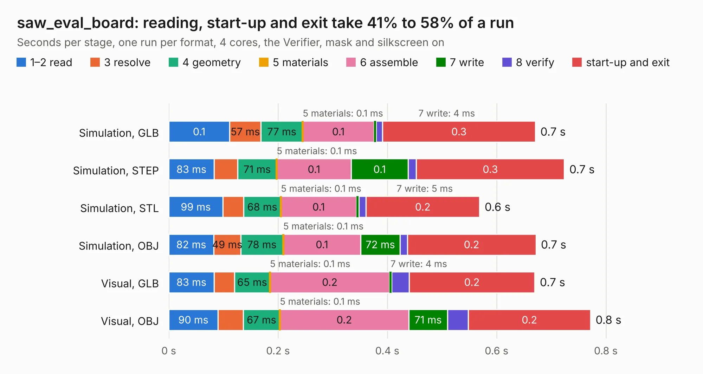

# 780. saw_eval_board

Board 780 of the 3,118 of [Corpus Testing](../Corpus-Testing.md), on [Corpus Page 8](../CorpusTestingPages/Corpus-Testing-08.md#780-saw_eval_board).

| Mode and format | 1–2 read | 3 resolve | 4 geometry | 5 materials | 6 assemble | 7 write | 8 verify | start-up and exit | Total |
|---|---:|---:|---:|---:|---:|---:|---:|---:|---:|
| Simulation, GLB | 0.1 | 57&nbsp;ms | 77&nbsp;ms | 0.1&nbsp;ms | 0.1 | 4&nbsp;ms | 12&nbsp;ms | 0.3 | 0.7 |
| Simulation, STEP | 83&nbsp;ms | 43&nbsp;ms | 71&nbsp;ms | 0.1&nbsp;ms | 0.1 | 0.1 | 15&nbsp;ms | 0.3 | 0.7 |
| Simulation, STL | 99&nbsp;ms | 38&nbsp;ms | 68&nbsp;ms | 0.1&nbsp;ms | 0.1 | 5&nbsp;ms | 13&nbsp;ms | 0.2 | 0.6 |
| Simulation, OBJ | 82&nbsp;ms | 49&nbsp;ms | 78&nbsp;ms | 0.1&nbsp;ms | 0.1 | 72&nbsp;ms | 13&nbsp;ms | 0.2 | 0.7 |
| Visual, GLB | 83&nbsp;ms | 37&nbsp;ms | 65&nbsp;ms | 0.1&nbsp;ms | 0.2 | 4&nbsp;ms | 32&nbsp;ms | 0.2 | 0.7 |
| Visual, OBJ | 90&nbsp;ms | 46&nbsp;ms | 67&nbsp;ms | 0.1&nbsp;ms | 0.2 | 71&nbsp;ms | 38&nbsp;ms | 0.2 | 0.8 |

<table align="center"><tr><td valign="top">

| Board | Repo: [CoolNamesAllTaken/adsbee](https://github.com/CoolNamesAllTaken/adsbee) Board: `saw_eval_board.kicad_pcb` |
|---|---|
| Folder | kicad / prototyping / saw_eval_board |
| Complexity | 137&nbsp;/&nbsp;1000 (size&nbsp;87, features&nbsp;50) |
| KESE&nbsp;features | through vias, filled zones, knockout text |
| Tested | 9th November 2026 |
| Copper&nbsp;layers | 2 |
| File&nbsp;format | KiCad 8 (20240108) |
| Parts,&nbsp;tracks,&nbsp;vias | 3, 4, 8 |
| Triangles,&nbsp;simulation | 12,296 in 11 parts |
| Verifier | PASS in all six runs |

</td><td valign="top">

<table>
<tr><th>File type</th><th>File size</th><th>Peak memory used</th></tr>
<tr><th colspan="3" align="left">Simulation</th></tr>
<tr><td>GLB</td><td align="right">454&nbsp;kB</td><td align="right">66&nbsp;MB</td></tr>
<tr><td>STEP</td><td align="right">1.4&nbsp;MB</td><td align="right">66&nbsp;MB</td></tr>
<tr><td>STL</td><td align="right">616&nbsp;kB</td><td align="right">61&nbsp;MB</td></tr>
<tr><td>OBJ</td><td align="right">1.2&nbsp;MB</td><td align="right">66&nbsp;MB</td></tr>
<tr><th colspan="3" align="left">Visual</th></tr>
<tr><td>GLB</td><td align="right">372&nbsp;kB</td><td align="right">69&nbsp;MB</td></tr>
<tr><td>OBJ</td><td align="right">943&nbsp;kB</td><td align="right">83&nbsp;MB</td></tr>
</table>

</td></tr></table>

| Previous | Next |
|:---|---:|
| [779. proto_ufl_pi_board](b0779b_adsbee_proto-ufl-pi-board.md) | [781. discipline-pcb](b0781b_discipline_bottom_discipline-pcb.md) |
