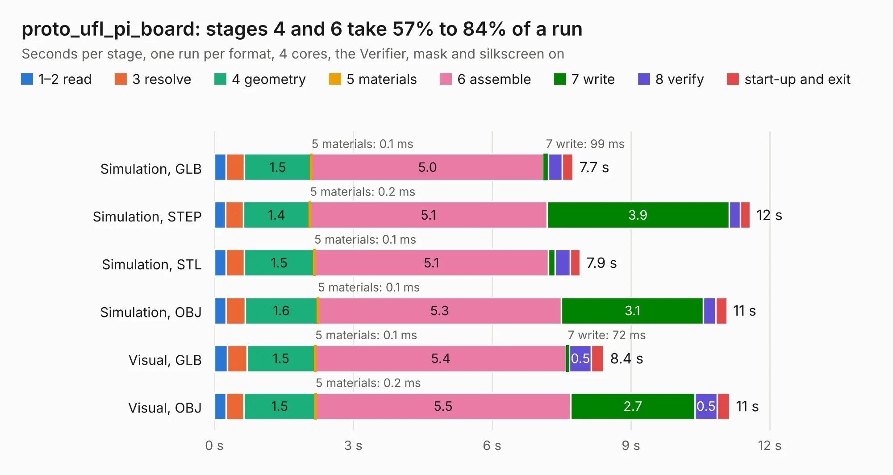

# 781. proto_ufl_pi_board

Board 781 of the 3,128 of [Corpus Testing](../Corpus-Testing.md), on [Corpus Page 8](../CorpusTestingPages/Corpus-Testing-08.md#781-proto_ufl_pi_board).

| Mode and format | 1–2 read | 3 resolve | 4 geometry | 5 materials | 6 assemble | 7 write | 8 verify | start-up and exit | Total |
|---|---:|---:|---:|---:|---:|---:|---:|---:|---:|
| Simulation, GLB | 0.3 | 0.4 | 1.5 | 0.1&nbsp;ms | 5.0 | 99&nbsp;ms | 0.3 | 0.2 | 7.7 |
| Simulation, STEP | 0.2 | 0.4 | 1.4 | 0.2&nbsp;ms | 5.1 | 3.9 | 0.2 | 0.2 | 11.6 |
| Simulation, STL | 0.3 | 0.4 | 1.5 | 0.1&nbsp;ms | 5.1 | 0.1 | 0.3 | 0.2 | 7.9 |
| Simulation, OBJ | 0.3 | 0.4 | 1.6 | 0.1&nbsp;ms | 5.3 | 3.1 | 0.3 | 0.2 | 11.1 |
| Visual, GLB | 0.3 | 0.4 | 1.5 | 0.1&nbsp;ms | 5.4 | 72&nbsp;ms | 0.5 | 0.3 | 8.4 |
| Visual, OBJ | 0.2 | 0.4 | 1.5 | 0.2&nbsp;ms | 5.5 | 2.7 | 0.5 | 0.3 | 11.1 |

<table align="center"><tr><td valign="top">

| Board | Repo: [CoolNamesAllTaken/adsbee](https://github.com/CoolNamesAllTaken/adsbee) Board: `proto_ufl_pi_board.kicad_pcb` |
|---|---|
| Folder | kicad / prototyping / proto_ufl_pi_board |
| Complexity | 209&nbsp;/&nbsp;1000 (size&nbsp;139, features&nbsp;70) |
| KESE&nbsp;features | rounded, trapezoid or chamfered pads, filled zones, copper text, stack-up, dielectric εr and tanδ |
| Tested | 9th November 2026 |
| Copper&nbsp;layers | 2 |
| File&nbsp;format | KiCad 7 (20221018) |
| Parts,&nbsp;tracks,&nbsp;vias | 100, 80, 0 |
| Triangles,&nbsp;simulation | 498,460 in 10 parts |
| Verifier | PASS in all six runs |

</td><td valign="top">

<table>
<tr><th>File type</th><th>File size</th><th>Peak memory used</th></tr>
<tr><th colspan="3" align="left">Simulation</th></tr>
<tr><td>GLB</td><td align="right">17&nbsp;MB</td><td align="right">399&nbsp;MB</td></tr>
<tr><td>STEP</td><td align="right">110&nbsp;MB</td><td align="right">429&nbsp;MB</td></tr>
<tr><td>STL</td><td align="right">25&nbsp;MB</td><td align="right">400&nbsp;MB</td></tr>
<tr><td>OBJ</td><td align="right">50&nbsp;MB</td><td align="right">396&nbsp;MB</td></tr>
<tr><th colspan="3" align="left">Visual</th></tr>
<tr><td>GLB</td><td align="right">16&nbsp;MB</td><td align="right">536&nbsp;MB</td></tr>
<tr><td>OBJ</td><td align="right">47&nbsp;MB</td><td align="right">542&nbsp;MB</td></tr>
</table>

</td></tr></table>

| Previous | Next |
|:---|---:|
| [780. proto_ufl_match_board](b0780b_adsbee_proto-ufl-match-board.md) | [782. saw_eval_board](b0782b_adsbee_saw-eval-board.md) |
