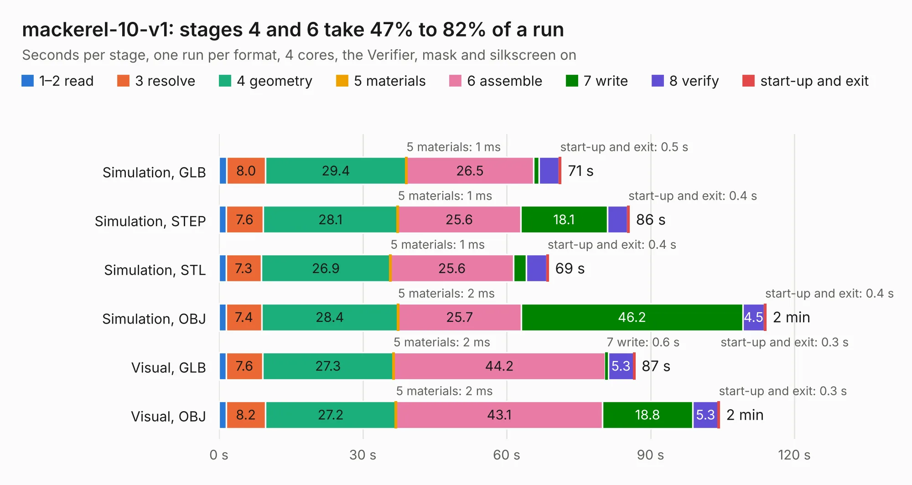

# 781. mackerel-10-v1

Board 781 of the 3,102 of [Corpus Testing](../Corpus-Testing.md), on [Corpus Page 8](../CorpusTestingPages/Corpus-Testing-08.md#781-mackerel-10-v1).

| Mode and format | 1–2 read | 3 resolve | 4 geometry | 5 materials | 6 assemble | 7 write | 8 verify | start-up and exit | Total |
|---|---:|---:|---:|---:|---:|---:|---:|---:|---:|
| Simulation, GLB | 1.7 | 8.0 | 29.4 | 1&nbsp;ms | 26.5 | 1.2 | 4.2 | 0.5 | 71.4 |
| Simulation, STEP | 1.6 | 7.6 | 28.1 | 1&nbsp;ms | 25.6 | 18.1 | 4.2 | 0.4 | 85.6 |
| Simulation, STL | 1.5 | 7.3 | 26.9 | 1&nbsp;ms | 25.6 | 2.6 | 4.3 | 0.4 | 68.7 |
| Simulation, OBJ | 1.5 | 7.4 | 28.4 | 2&nbsp;ms | 25.7 | 46.2 | 4.5 | 0.4 | 114.1 |
| Visual, GLB | 1.5 | 7.6 | 27.3 | 2&nbsp;ms | 44.2 | 0.6 | 5.3 | 0.3 | 86.8 |
| Visual, OBJ | 1.5 | 8.2 | 27.2 | 2&nbsp;ms | 43.1 | 18.8 | 5.3 | 0.3 | 104.4 |

<table align="center"><tr><td valign="top">

| Board | Repo: [crmaykish/mackerel-68k](https://github.com/crmaykish/mackerel-68k) Board: `mackerel-10-v1.kicad_pcb` |
|---|---|
| Folder | hardware / mackerel-10-v1 |
| Complexity | 361&nbsp;/&nbsp;1000 (size&nbsp;266, features&nbsp;95) |
| KESE&nbsp;features | through vias, slotted holes, rounded, trapezoid or chamfered pads, filled zones, curved board outline, stack-up, dielectric εr and tanδ |
| Tested | 9th November 2026 |
| Copper&nbsp;layers | 4 |
| File&nbsp;format | KiCad 8 (20240108) |
| Parts,&nbsp;tracks,&nbsp;vias | 113, 2,261, 200 |
| Triangles,&nbsp;simulation | 7,002,228 in 217 parts |
| Verifier | PASS in all six runs |

</td><td valign="top">

<table>
<tr><th>File type</th><th>File size</th><th>Peak memory used</th></tr>
<tr><th colspan="3" align="left">Simulation</th></tr>
<tr><td>GLB</td><td align="right">235&nbsp;MB</td><td align="right">1.6&nbsp;GB</td></tr>
<tr><td>STEP</td><td align="right">776&nbsp;MB</td><td align="right">2.2&nbsp;GB</td></tr>
<tr><td>STL</td><td align="right">350&nbsp;MB</td><td align="right">1.6&nbsp;GB</td></tr>
<tr><td>OBJ</td><td align="right">743&nbsp;MB</td><td align="right">4.3&nbsp;GB</td></tr>
<tr><th colspan="3" align="left">Visual</th></tr>
<tr><td>GLB</td><td align="right">102&nbsp;MB</td><td align="right">2.2&nbsp;GB</td></tr>
<tr><td>OBJ</td><td align="right">326&nbsp;MB</td><td align="right">2.2&nbsp;GB</td></tr>
</table>

</td></tr></table>

| Previous | Next |
|:---|---:|
| [780. mackerel-08-v1](b0780b_mackerel-68k_mackerel-08-v1.md) | [782. mackerel-30-proto](b0782b_mackerel-68k_mackerel-30-proto.md) |
