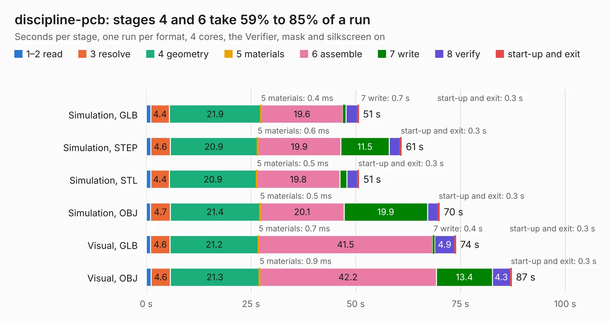

# 784. discipline-pcb

Board 784 of the 3,123 of [Corpus Testing](../Corpus-Testing.md), on [Corpus Page 8](../CorpusTestingPages/Corpus-Testing-08.md#784-discipline-pcb).

| Mode and format | 1–2 read | 3 resolve | 4 geometry | 5 materials | 6 assemble | 7 write | 8 verify | start-up and exit | Total |
|---|---:|---:|---:|---:|---:|---:|---:|---:|---:|
| Simulation, GLB | 1.1 | 4.4 | 21.9 | 0.4&nbsp;ms | 19.6 | 0.7 | 2.7 | 0.3 | 50.7 |
| Simulation, STEP | 1.1 | 4.6 | 20.9 | 0.6&nbsp;ms | 19.9 | 11.5 | 2.7 | 0.3 | 60.9 |
| Simulation, STL | 1.1 | 4.4 | 20.9 | 0.5&nbsp;ms | 19.8 | 1.7 | 2.5 | 0.3 | 50.8 |
| Simulation, OBJ | 1.0 | 4.7 | 21.4 | 0.5&nbsp;ms | 20.1 | 19.9 | 2.6 | 0.3 | 70.0 |
| Visual, GLB | 1.0 | 4.6 | 21.2 | 0.7&nbsp;ms | 41.5 | 0.4 | 4.9 | 0.3 | 73.9 |
| Visual, OBJ | 1.2 | 4.6 | 21.3 | 0.9&nbsp;ms | 42.2 | 13.4 | 4.3 | 0.3 | 87.2 |

<table align="center"><tr><td valign="top">

| Board | Repo: [coseyfannitutti/discipline](https://github.com/coseyfannitutti/discipline) Board: `discipline-pcb.kicad_pcb` |
|---|---|
| Complexity | 255&nbsp;/&nbsp;1000 (size&nbsp;200, features&nbsp;55) |
| KESE&nbsp;features | through vias, slotted holes, filled zones, curved board outline |
| Tested | 9th November 2026 |
| Copper&nbsp;layers | 2 |
| File&nbsp;format | KiCad 5 (20171130) |
| Parts,&nbsp;tracks,&nbsp;vias | 171, 2,199, 77 |
| Triangles,&nbsp;simulation | 4,100,942 in 126 parts |
| Verifier | PASS in all six runs |

</td><td valign="top">

<table>
<tr><th>File type</th><th>File size</th><th>Peak memory used</th></tr>
<tr><th colspan="3" align="left">Simulation</th></tr>
<tr><td>GLB</td><td align="right">141&nbsp;MB</td><td align="right">1.3&nbsp;GB</td></tr>
<tr><td>STEP</td><td align="right">744&nbsp;MB</td><td align="right">1.6&nbsp;GB</td></tr>
<tr><td>STL</td><td align="right">205&nbsp;MB</td><td align="right">1.4&nbsp;GB</td></tr>
<tr><td>OBJ</td><td align="right">439&nbsp;MB</td><td align="right">2.7&nbsp;GB</td></tr>
<tr><th colspan="3" align="left">Visual</th></tr>
<tr><td>GLB</td><td align="right">91&nbsp;MB</td><td align="right">1.5&nbsp;GB</td></tr>
<tr><td>OBJ</td><td align="right">284&nbsp;MB</td><td align="right">1.9&nbsp;GB</td></tr>
</table>

</td></tr></table>

| Previous | Next |
|:---|---:|
| [783. discipline-pcb](b0783b_discipline_bottom_discipline-pcb.md) | [785. discipline-pcb](b0785b_discipline_plate_discipline-pcb.md) |
