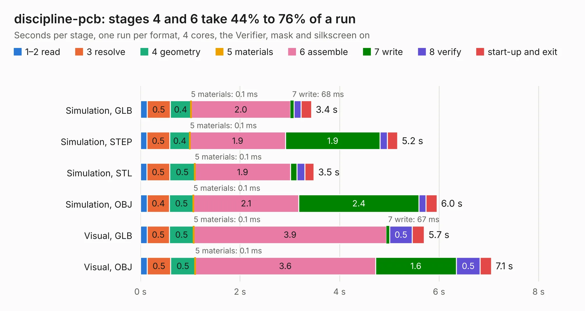

# 785. discipline-pcb

Board 785 of the 3,130 of [Corpus Testing](../Corpus-Testing.md), on [Corpus Page 8](../CorpusTestingPages/Corpus-Testing-08.md#785-discipline-pcb).

| Mode and format | 1–2 read | 3 resolve | 4 geometry | 5 materials | 6 assemble | 7 write | 8 verify | start-up and exit | Total |
|---|---:|---:|---:|---:|---:|---:|---:|---:|---:|
| Simulation, GLB | 0.1 | 0.5 | 0.4 | 0.1&nbsp;ms | 2.0 | 68&nbsp;ms | 0.1 | 0.2 | 3.4 |
| Simulation, STEP | 0.1 | 0.5 | 0.4 | 0.1&nbsp;ms | 1.9 | 1.9 | 0.1 | 0.2 | 5.2 |
| Simulation, STL | 0.1 | 0.5 | 0.5 | 0.1&nbsp;ms | 1.9 | 0.1 | 0.2 | 0.2 | 3.5 |
| Simulation, OBJ | 0.1 | 0.4 | 0.5 | 0.1&nbsp;ms | 2.1 | 2.4 | 0.1 | 0.2 | 6.0 |
| Visual, GLB | 0.1 | 0.5 | 0.5 | 0.1&nbsp;ms | 3.9 | 67&nbsp;ms | 0.5 | 0.2 | 5.7 |
| Visual, OBJ | 0.1 | 0.5 | 0.5 | 0.1&nbsp;ms | 3.6 | 1.6 | 0.5 | 0.2 | 7.1 |

<table align="center"><tr><td valign="top">

| Board | Repo: [coseyfannitutti/discipline](https://github.com/coseyfannitutti/discipline) Board: `discipline-pcb.kicad_pcb` |
|---|---|
| Folder | plate |
| Complexity | 47&nbsp;/&nbsp;1000 (size&nbsp;17, features&nbsp;30) |
| KESE&nbsp;features | filled zones, curved board outline |
| Tested | 9th November 2026 |
| Copper&nbsp;layers | 2 |
| File&nbsp;format | KiCad 5 (20171130) |
| Parts,&nbsp;tracks,&nbsp;vias | 0, 0, 0 |
| Triangles,&nbsp;simulation | 443,680 in 8 parts |
| Note | no components |
| Verifier | PASS in all six runs |

</td><td valign="top">

<table>
<tr><th>File type</th><th>File size</th><th>Peak memory used</th></tr>
<tr><th colspan="3" align="left">Simulation</th></tr>
<tr><td>GLB</td><td align="right">15&nbsp;MB</td><td align="right">365&nbsp;MB</td></tr>
<tr><td>STEP</td><td align="right">112&nbsp;MB</td><td align="right">375&nbsp;MB</td></tr>
<tr><td>STL</td><td align="right">22&nbsp;MB</td><td align="right">357&nbsp;MB</td></tr>
<tr><td>OBJ</td><td align="right">45&nbsp;MB</td><td align="right">362&nbsp;MB</td></tr>
<tr><th colspan="3" align="left">Visual</th></tr>
<tr><td>GLB</td><td align="right">12&nbsp;MB</td><td align="right">347&nbsp;MB</td></tr>
<tr><td>OBJ</td><td align="right">37&nbsp;MB</td><td align="right">350&nbsp;MB</td></tr>
</table>

</td></tr></table>

| Previous | Next |
|:---|---:|
| [784. discipline-pcb](b0784b_discipline_discipline-pcb.md) | [786. BlankMSXCartHSH](b0786b_trh9000_BlankMSXCartHSH.md) |
