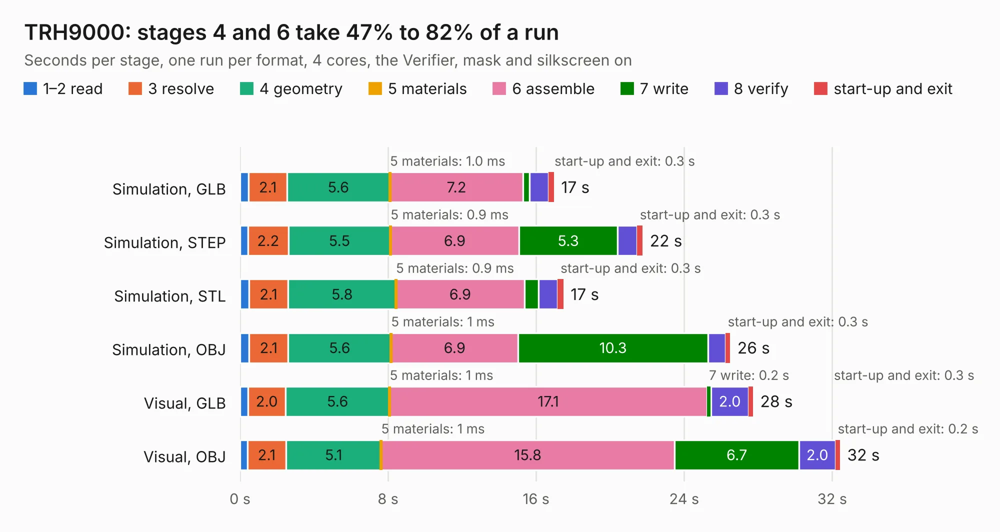

# 785. TRH9000

Board 785 of the 3,118 of [Corpus Testing](../Corpus-Testing.md), on [Corpus Page 8](../CorpusTestingPages/Corpus-Testing-08.md#785-trh9000).

| Mode and format | 1–2 read | 3 resolve | 4 geometry | 5 materials | 6 assemble | 7 write | 8 verify | start-up and exit | Total |
|---|---:|---:|---:|---:|---:|---:|---:|---:|---:|
| Simulation, GLB | 0.5 | 2.1 | 5.6 | 1.0&nbsp;ms | 7.2 | 0.3 | 1.0 | 0.3 | 17.0 |
| Simulation, STEP | 0.4 | 2.2 | 5.5 | 0.9&nbsp;ms | 6.9 | 5.3 | 1.1 | 0.3 | 21.8 |
| Simulation, STL | 0.5 | 2.1 | 5.8 | 0.9&nbsp;ms | 6.9 | 0.8 | 1.0 | 0.3 | 17.5 |
| Simulation, OBJ | 0.5 | 2.1 | 5.6 | 1&nbsp;ms | 6.9 | 10.3 | 0.9 | 0.3 | 26.5 |
| Visual, GLB | 0.4 | 2.0 | 5.6 | 1&nbsp;ms | 17.1 | 0.2 | 2.0 | 0.3 | 27.7 |
| Visual, OBJ | 0.4 | 2.1 | 5.1 | 1&nbsp;ms | 15.8 | 6.7 | 2.0 | 0.2 | 32.4 |

<table align="center"><tr><td valign="top">

| Board | Repo: [cristianoag/trh9000](https://github.com/cristianoag/trh9000) Board: `TRH9000.kicad_pcb` |
|---|---|
| Folder | Hardware / Kicad / TRH9000_1.7 |
| Complexity | 345&nbsp;/&nbsp;1000 (size&nbsp;250, features&nbsp;95) |
| KESE&nbsp;features | through vias, slotted holes, rounded, trapezoid or chamfered pads, filled zones, curved board outline, stack-up, dielectric εr and tanδ |
| Tested | 9th November 2026 |
| Copper&nbsp;layers | 4 |
| File&nbsp;format | KiCad 8 (20240108) |
| Parts,&nbsp;tracks,&nbsp;vias | 64, 2,127, 295 |
| Triangles,&nbsp;simulation | 2,038,064 in 215 parts |
| Verifier | PASS in all six runs |

</td><td valign="top">

<table>
<tr><th>File type</th><th>File size</th><th>Peak memory used</th></tr>
<tr><th colspan="3" align="left">Simulation</th></tr>
<tr><td>GLB</td><td align="right">69&nbsp;MB</td><td align="right">822&nbsp;MB</td></tr>
<tr><td>STEP</td><td align="right">289&nbsp;MB</td><td align="right">844&nbsp;MB</td></tr>
<tr><td>STL</td><td align="right">102&nbsp;MB</td><td align="right">814&nbsp;MB</td></tr>
<tr><td>OBJ</td><td align="right">214&nbsp;MB</td><td align="right">1.3&nbsp;GB</td></tr>
<tr><th colspan="3" align="left">Visual</th></tr>
<tr><td>GLB</td><td align="right">45&nbsp;MB</td><td align="right">858&nbsp;MB</td></tr>
<tr><td>OBJ</td><td align="right">141&nbsp;MB</td><td align="right">995&nbsp;MB</td></tr>
</table>

</td></tr></table>

| Previous | Next |
|:---|---:|
| [784. BlankMSXCartHSH](b0784b_trh9000_BlankMSXCartHSH.md) | [786. trhmsx](b0786b_trhmsx_trhmsx.md) |
