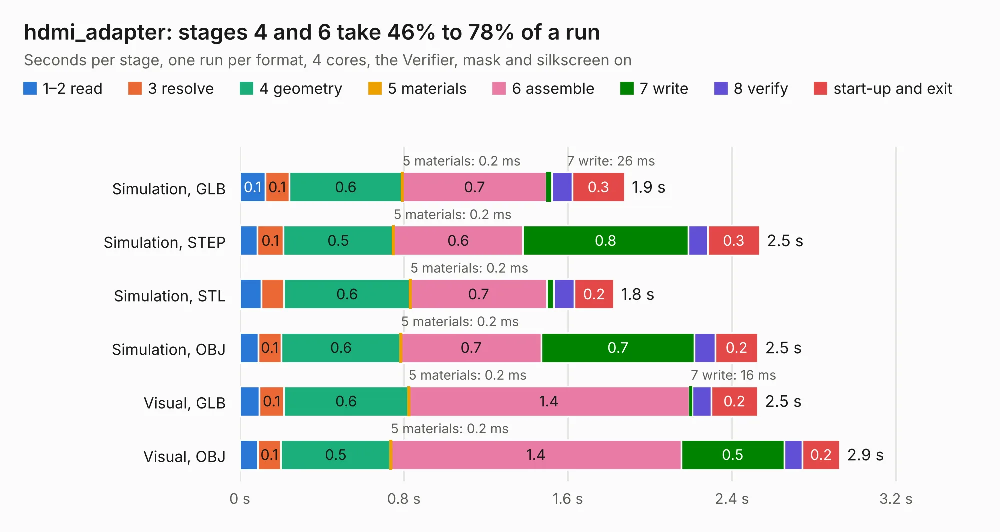

# 785. hdmi_adapter

Board 785 of the 3,105 of [Corpus Testing](../Corpus-Testing.md), on [Corpus Page 8](../CorpusTestingPages/Corpus-Testing-08.md#785-hdmi_adapter).

| Mode and format | 1–2 read | 3 resolve | 4 geometry | 5 materials | 6 assemble | 7 write | 8 verify | start-up and exit | Total |
|---|---:|---:|---:|---:|---:|---:|---:|---:|---:|
| Simulation, GLB | 0.1 | 0.1 | 0.6 | 0.2&nbsp;ms | 0.7 | 26&nbsp;ms | 99&nbsp;ms | 0.3 | 1.9 |
| Simulation, STEP | 86&nbsp;ms | 0.1 | 0.5 | 0.2&nbsp;ms | 0.6 | 0.8 | 95&nbsp;ms | 0.3 | 2.5 |
| Simulation, STL | 0.1 | 0.1 | 0.6 | 0.2&nbsp;ms | 0.7 | 34&nbsp;ms | 0.1 | 0.2 | 1.8 |
| Simulation, OBJ | 89&nbsp;ms | 0.1 | 0.6 | 0.2&nbsp;ms | 0.7 | 0.7 | 0.1 | 0.2 | 2.5 |
| Visual, GLB | 96&nbsp;ms | 0.1 | 0.6 | 0.2&nbsp;ms | 1.4 | 16&nbsp;ms | 91&nbsp;ms | 0.2 | 2.5 |
| Visual, OBJ | 87&nbsp;ms | 0.1 | 0.5 | 0.2&nbsp;ms | 1.4 | 0.5 | 89&nbsp;ms | 0.2 | 2.9 |

<table align="center"><tr><td valign="top">

| Board | Repo: [cropinghigh/zynq_a9_mb](https://github.com/cropinghigh/zynq_a9_mb) Board: `hdmi_adapter.kicad_pcb` |
|---|---|
| Folder | hardware / hdmi_adapter |
| Complexity | 158&nbsp;/&nbsp;1000 (size&nbsp;113, features&nbsp;45) |
| KESE&nbsp;features | through vias, slotted holes, filled zones |
| Tested | 9th November 2026 |
| Copper&nbsp;layers | 2 |
| File&nbsp;format | KiCad 9 (20241229) |
| Parts,&nbsp;tracks,&nbsp;vias | 2, 153, 6 |
| Triangles,&nbsp;simulation | 145,640 in 31 parts |
| Verifier | PASS in all six runs |

</td><td valign="top">

<table>
<tr><th>File type</th><th>File size</th><th>Peak memory used</th></tr>
<tr><th colspan="3" align="left">Simulation</th></tr>
<tr><td>GLB</td><td align="right">4.8&nbsp;MB</td><td align="right">193&nbsp;MB</td></tr>
<tr><td>STEP</td><td align="right">21&nbsp;MB</td><td align="right">204&nbsp;MB</td></tr>
<tr><td>STL</td><td align="right">7.3&nbsp;MB</td><td align="right">196&nbsp;MB</td></tr>
<tr><td>OBJ</td><td align="right">14&nbsp;MB</td><td align="right">193&nbsp;MB</td></tr>
<tr><th colspan="3" align="left">Visual</th></tr>
<tr><td>GLB</td><td align="right">3.1&nbsp;MB</td><td align="right">157&nbsp;MB</td></tr>
<tr><td>OBJ</td><td align="right">8.8&nbsp;MB</td><td align="right">157&nbsp;MB</td></tr>
</table>

</td></tr></table>

| Previous | Next |
|:---|---:|
| [784. mackerel-30-proto](b0784b_mackerel-68k_mackerel-30-proto.md) | [786. zynq_test](b0786b_zynq-a9-mb_zynq-test.md) |
