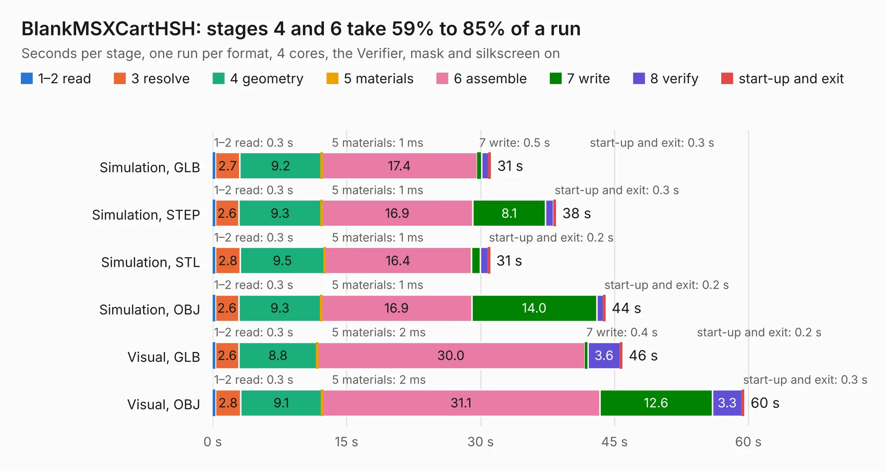

# 786. BlankMSXCartHSH

Board 786 of the 3,123 of [Corpus Testing](../Corpus-Testing.md), on [Corpus Page 8](../CorpusTestingPages/Corpus-Testing-08.md#786-blankmsxcarthsh).

| Mode and format | 1–2 read | 3 resolve | 4 geometry | 5 materials | 6 assemble | 7 write | 8 verify | start-up and exit | Total |
|---|---:|---:|---:|---:|---:|---:|---:|---:|---:|
| Simulation, GLB | 0.3 | 2.7 | 9.2 | 1&nbsp;ms | 17.4 | 0.5 | 0.8 | 0.3 | 31.2 |
| Simulation, STEP | 0.3 | 2.6 | 9.3 | 1&nbsp;ms | 16.9 | 8.1 | 0.9 | 0.3 | 38.4 |
| Simulation, STL | 0.3 | 2.8 | 9.5 | 1&nbsp;ms | 16.4 | 1.0 | 0.9 | 0.2 | 31.1 |
| Simulation, OBJ | 0.3 | 2.6 | 9.3 | 1&nbsp;ms | 16.9 | 14.0 | 0.8 | 0.2 | 44.0 |
| Visual, GLB | 0.3 | 2.6 | 8.8 | 2&nbsp;ms | 30.0 | 0.4 | 3.6 | 0.2 | 45.9 |
| Visual, OBJ | 0.3 | 2.8 | 9.1 | 2&nbsp;ms | 31.1 | 12.6 | 3.3 | 0.3 | 59.5 |

<table align="center"><tr><td valign="top">

| Board | Repo: [cristianoag/trh9000](https://github.com/cristianoag/trh9000) Board: `BlankMSXCartHSH.kicad_pcb` |
|---|---|
| Folder | Hardware / Kicad / MSX_Breadboard_Large_V9990 |
| Complexity | 270&nbsp;/&nbsp;1000 (size&nbsp;215, features&nbsp;55) |
| KESE&nbsp;features | through vias, rounded, trapezoid or chamfered pads, stack-up, dielectric εr and tanδ |
| Tested | 9th November 2026 |
| Copper&nbsp;layers | 2 |
| File&nbsp;format | KiCad 6 (20211014) |
| Parts,&nbsp;tracks,&nbsp;vias | 6, 1,220, 1,034 |
| Triangles,&nbsp;simulation | 2,765,694 in 299 parts |
| Verifier | PASS in all six runs |

</td><td valign="top">

<table>
<tr><th>File type</th><th>File size</th><th>Peak memory used</th></tr>
<tr><th colspan="3" align="left">Simulation</th></tr>
<tr><td>GLB</td><td align="right">93&nbsp;MB</td><td align="right">1.1&nbsp;GB</td></tr>
<tr><td>STEP</td><td align="right">369&nbsp;MB</td><td align="right">1.4&nbsp;GB</td></tr>
<tr><td>STL</td><td align="right">138&nbsp;MB</td><td align="right">1.1&nbsp;GB</td></tr>
<tr><td>OBJ</td><td align="right">288&nbsp;MB</td><td align="right">1.8&nbsp;GB</td></tr>
<tr><th colspan="3" align="left">Visual</th></tr>
<tr><td>GLB</td><td align="right">80&nbsp;MB</td><td align="right">1.5&nbsp;GB</td></tr>
<tr><td>OBJ</td><td align="right">255&nbsp;MB</td><td align="right">1.7&nbsp;GB</td></tr>
</table>

</td></tr></table>

| Previous | Next |
|:---|---:|
| [785. discipline-pcb](b0785b_discipline_plate_discipline-pcb.md) | [787. TRH9000](b0787b_trh9000_TRH9000.md) |
