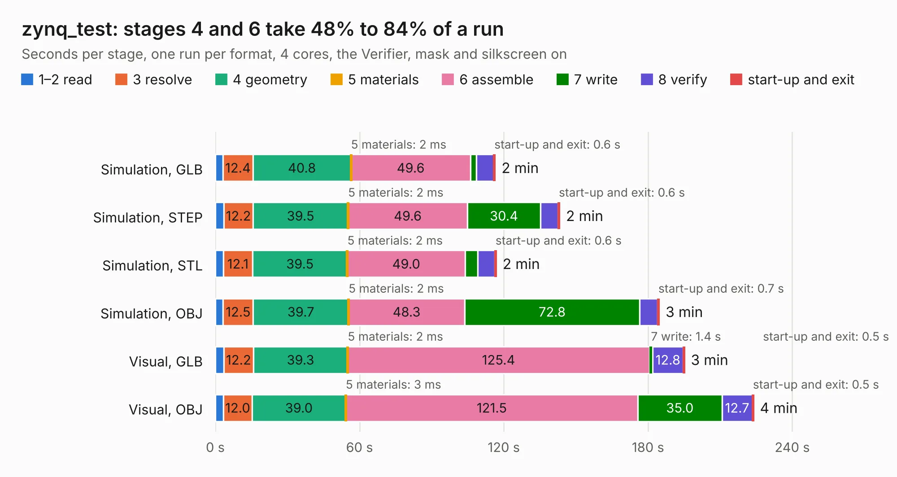

# 787. zynq_test

Board 787 of the 3,108 of [Corpus Testing](../Corpus-Testing.md), on [Corpus Page 8](../CorpusTestingPages/Corpus-Testing-08.md#787-zynq_test).

| Mode and format | 1–2 read | 3 resolve | 4 geometry | 5 materials | 6 assemble | 7 write | 8 verify | start-up and exit | Total |
|---|---:|---:|---:|---:|---:|---:|---:|---:|---:|
| Simulation, GLB | 3.2 | 12.4 | 40.8 | 2&nbsp;ms | 49.6 | 2.6 | 7.1 | 0.6 | 116.4 |
| Simulation, STEP | 3.5 | 12.2 | 39.5 | 2&nbsp;ms | 49.6 | 30.4 | 7.3 | 0.6 | 143.2 |
| Simulation, STL | 3.3 | 12.1 | 39.5 | 2&nbsp;ms | 49.0 | 5.2 | 7.1 | 0.6 | 116.9 |
| Simulation, OBJ | 3.2 | 12.5 | 39.7 | 2&nbsp;ms | 48.3 | 72.8 | 7.5 | 0.7 | 184.6 |
| Visual, GLB | 3.6 | 12.2 | 39.3 | 2&nbsp;ms | 125.4 | 1.4 | 12.8 | 0.5 | 195.2 |
| Visual, OBJ | 3.3 | 12.0 | 39.0 | 3&nbsp;ms | 121.5 | 35.0 | 12.7 | 0.5 | 223.9 |

<table align="center"><tr><td valign="top">

| Board | Repo: [cropinghigh/zynq_a9_mb](https://github.com/cropinghigh/zynq_a9_mb) Board: `zynq_test.kicad_pcb` |
|---|---|
| Folder | hardware |
| Complexity | 490&nbsp;/&nbsp;1000 (size&nbsp;335, features&nbsp;155) |
| KESE&nbsp;features | through vias, slotted holes, custom pads, rounded, trapezoid or chamfered pads, arc tracks, filled zones, copper drawings, copper text, stack-up, dielectric εr and tanδ, copper finish, mask and silkscreen colours |
| Tested | 9th November 2026 |
| Copper&nbsp;layers | 6 |
| File&nbsp;format | KiCad 9 (20241229) |
| Parts,&nbsp;tracks,&nbsp;vias | 471, 18,336, 1,096 |
| Triangles,&nbsp;simulation | 12,610,460 in 489 parts |
| Verifier | PASS in all six runs |

</td><td valign="top">

<table>
<tr><th>File type</th><th>File size</th><th>Peak memory used</th></tr>
<tr><th colspan="3" align="left">Simulation</th></tr>
<tr><td>GLB</td><td align="right">425&nbsp;MB</td><td align="right">2.8&nbsp;GB</td></tr>
<tr><td>STEP</td><td align="right">1.7&nbsp;GB</td><td align="right">4.0&nbsp;GB</td></tr>
<tr><td>STL</td><td align="right">631&nbsp;MB</td><td align="right">2.8&nbsp;GB</td></tr>
<tr><td>OBJ</td><td align="right">1.4&nbsp;GB</td><td align="right">8.0&nbsp;GB</td></tr>
<tr><th colspan="3" align="left">Visual</th></tr>
<tr><td>GLB</td><td align="right">233&nbsp;MB</td><td align="right">3.7&nbsp;GB</td></tr>
<tr><td>OBJ</td><td align="right">753&nbsp;MB</td><td align="right">4.9&nbsp;GB</td></tr>
</table>

</td></tr></table>

| Previous | Next |
|:---|---:|
| [786. hdmi_adapter](b0786b_zynq-a9-mb_hdmi-adapter.md) | [788. aquila_main](b0788b_aquila-avionics_aquila-main.md) |
