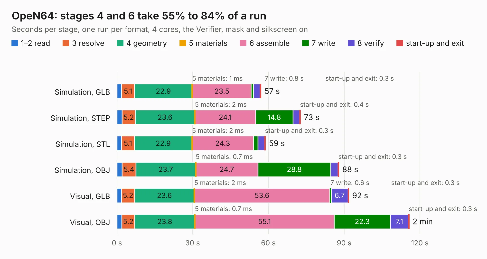

# 788. OpeN64

Board 788 of the 3,103 of [Corpus Testing](../Corpus-Testing.md), on [Corpus Page 8](../CorpusTestingPages/Corpus-Testing-08.md#788-open64).

| Mode and format | 1–2 read | 3 resolve | 4 geometry | 5 materials | 6 assemble | 7 write | 8 verify | start-up and exit | Total |
|---|---:|---:|---:|---:|---:|---:|---:|---:|---:|
| Simulation, GLB | 1.8 | 5.1 | 22.9 | 1&nbsp;ms | 23.5 | 0.8 | 2.6 | 0.3 | 57.0 |
| Simulation, STEP | 2.1 | 5.2 | 23.6 | 2&nbsp;ms | 24.1 | 14.8 | 2.7 | 0.4 | 72.7 |
| Simulation, STL | 1.8 | 5.1 | 22.9 | 2&nbsp;ms | 24.3 | 1.8 | 2.6 | 0.3 | 58.8 |
| Simulation, OBJ | 2.0 | 5.4 | 23.7 | 0.7&nbsp;ms | 24.7 | 28.8 | 2.9 | 0.3 | 87.9 |
| Visual, GLB | 1.8 | 5.2 | 23.6 | 2&nbsp;ms | 53.6 | 0.6 | 6.7 | 0.3 | 91.8 |
| Visual, OBJ | 1.9 | 5.2 | 23.8 | 0.7&nbsp;ms | 55.1 | 22.3 | 7.1 | 0.3 | 115.7 |

<table align="center"><tr><td valign="top">

| Board | Repo: [cy-888/OpeN64](https://github.com/cy-888/OpeN64) Board: `OpeN64.kicad_pcb` |
|---|---|
| Folder | OpeN64 |
| Complexity | 312&nbsp;/&nbsp;1000 (size&nbsp;217, features&nbsp;95) |
| KESE&nbsp;features | through vias, slotted holes, rounded, trapezoid or chamfered pads, filled zones, copper drawings, knockout text, TrueType text |
| Tested | 9th November 2026 |
| Copper&nbsp;layers | 2 |
| File&nbsp;format | KiCad 10 (20260206) |
| Parts,&nbsp;tracks,&nbsp;vias | 273, 2,133, 934 |
| Triangles,&nbsp;simulation | 5,227,676 in 220 parts |
| Verifier | PASS in all six runs |

</td><td valign="top">

<table>
<tr><th>File type</th><th>File size</th><th>Peak memory used</th></tr>
<tr><th colspan="3" align="left">Simulation</th></tr>
<tr><td>GLB</td><td align="right">178&nbsp;MB</td><td align="right">1.7&nbsp;GB</td></tr>
<tr><td>STEP</td><td align="right">1.0&nbsp;GB</td><td align="right">2.2&nbsp;GB</td></tr>
<tr><td>STL</td><td align="right">261&nbsp;MB</td><td align="right">1.7&nbsp;GB</td></tr>
<tr><td>OBJ</td><td align="right">553&nbsp;MB</td><td align="right">3.4&nbsp;GB</td></tr>
<tr><th colspan="3" align="left">Visual</th></tr>
<tr><td>GLB</td><td align="right">137&nbsp;MB</td><td align="right">2.2&nbsp;GB</td></tr>
<tr><td>OBJ</td><td align="right">431&nbsp;MB</td><td align="right">2.7&nbsp;GB</td></tr>
</table>

</td></tr></table>

| Previous | Next |
|:---|---:|
| [787. daq_griffin](b0787b_white-giant-sensing-pcb_daq-griffin.md) | [789. HDMI-to-LH550WF1](b0789b_HDMI-to-MIPI_HDMI-to-LH550WF1.md) |
