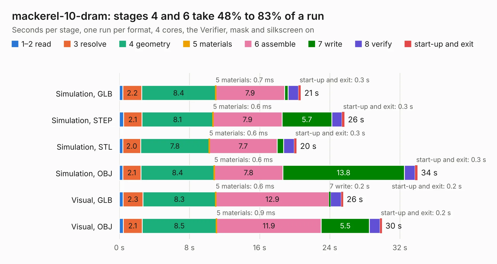

# 789. mackerel-10-dram

Board 789 of the 3,123 of [Corpus Testing](../Corpus-Testing.md), on [Corpus Page 8](../CorpusTestingPages/Corpus-Testing-08.md#789-mackerel-10-dram).

| Mode and format | 1–2 read | 3 resolve | 4 geometry | 5 materials | 6 assemble | 7 write | 8 verify | start-up and exit | Total |
|---|---:|---:|---:|---:|---:|---:|---:|---:|---:|
| Simulation, GLB | 0.4 | 2.2 | 8.4 | 0.7&nbsp;ms | 7.9 | 0.4 | 1.2 | 0.3 | 20.7 |
| Simulation, STEP | 0.5 | 2.1 | 8.1 | 0.6&nbsp;ms | 7.9 | 5.7 | 1.2 | 0.3 | 25.7 |
| Simulation, STL | 0.4 | 2.0 | 7.8 | 0.6&nbsp;ms | 7.7 | 0.7 | 1.2 | 0.3 | 20.2 |
| Simulation, OBJ | 0.4 | 2.1 | 8.4 | 0.6&nbsp;ms | 7.8 | 13.8 | 1.2 | 0.3 | 34.0 |
| Visual, GLB | 0.4 | 2.3 | 8.3 | 0.6&nbsp;ms | 12.9 | 0.2 | 1.2 | 0.2 | 25.5 |
| Visual, OBJ | 0.5 | 2.1 | 8.5 | 0.9&nbsp;ms | 11.9 | 5.5 | 1.2 | 0.2 | 29.9 |

<table align="center"><tr><td valign="top">

| Board | Repo: [crmaykish/mackerel-68k](https://github.com/crmaykish/mackerel-68k) Board: `mackerel-10-dram.kicad_pcb` |
|---|---|
| Folder | hardware / mack-10-proto / mackerel-10-dram |
| Complexity | 304&nbsp;/&nbsp;1000 (size&nbsp;219, features&nbsp;85) |
| KESE&nbsp;features | through vias, rounded, trapezoid or chamfered pads, filled zones, curved board outline, stack-up, dielectric εr and tanδ |
| Tested | 9th November 2026 |
| Copper&nbsp;layers | 4 |
| File&nbsp;format | KiCad 8 (20240108) |
| Parts,&nbsp;tracks,&nbsp;vias | 41, 533, 31 |
| Triangles,&nbsp;simulation | 2,580,718 in 140 parts |
| Verifier | PASS in all six runs |

</td><td valign="top">

<table>
<tr><th>File type</th><th>File size</th><th>Peak memory used</th></tr>
<tr><th colspan="3" align="left">Simulation</th></tr>
<tr><td>GLB</td><td align="right">86&nbsp;MB</td><td align="right">743&nbsp;MB</td></tr>
<tr><td>STEP</td><td align="right">277&nbsp;MB</td><td align="right">928&nbsp;MB</td></tr>
<tr><td>STL</td><td align="right">129&nbsp;MB</td><td align="right">708&nbsp;MB</td></tr>
<tr><td>OBJ</td><td align="right">268&nbsp;MB</td><td align="right">1.7&nbsp;GB</td></tr>
<tr><th colspan="3" align="left">Visual</th></tr>
<tr><td>GLB</td><td align="right">36&nbsp;MB</td><td align="right">1.0&nbsp;GB</td></tr>
<tr><td>OBJ</td><td align="right">111&nbsp;MB</td><td align="right">850&nbsp;MB</td></tr>
</table>

</td></tr></table>

| Previous | Next |
|:---|---:|
| [788. trhmsx](b0788b_trhmsx_trhmsx.md) | [790. mackerel-10-ide](b0790b_mackerel-68k_mackerel-10-ide.md) |
