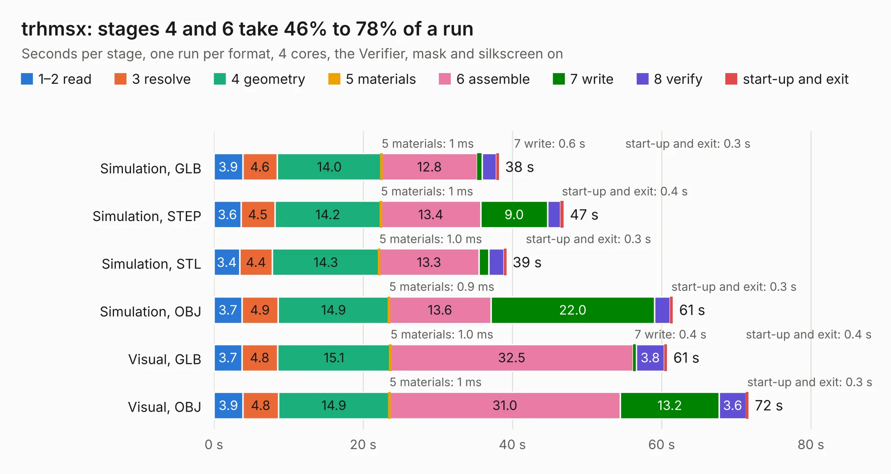

# 789. trhmsx

Board 789 of the 3,131 of [Corpus Testing](../Corpus-Testing.md), on [Corpus Page 8](../CorpusTestingPages/Corpus-Testing-08.md#789-trhmsx).

| Mode and format | 1–2 read | 3 resolve | 4 geometry | 5 materials | 6 assemble | 7 write | 8 verify | start-up and exit | Total |
|---|---:|---:|---:|---:|---:|---:|---:|---:|---:|
| Simulation, GLB | 3.9 | 4.6 | 14.0 | 1&nbsp;ms | 12.8 | 0.6 | 1.9 | 0.3 | 38.2 |
| Simulation, STEP | 3.6 | 4.5 | 14.2 | 1&nbsp;ms | 13.4 | 9.0 | 1.7 | 0.4 | 46.8 |
| Simulation, STL | 3.4 | 4.4 | 14.3 | 1.0&nbsp;ms | 13.3 | 1.4 | 2.0 | 0.3 | 39.2 |
| Simulation, OBJ | 3.7 | 4.9 | 14.9 | 0.9&nbsp;ms | 13.6 | 22.0 | 2.1 | 0.3 | 61.5 |
| Visual, GLB | 3.7 | 4.8 | 15.1 | 1.0&nbsp;ms | 32.5 | 0.4 | 3.8 | 0.4 | 60.7 |
| Visual, OBJ | 3.9 | 4.8 | 14.9 | 1&nbsp;ms | 31.0 | 13.2 | 3.6 | 0.3 | 71.6 |

<table align="center"><tr><td valign="top">

| Board | Repo: [cristianoag/trhmsx](https://github.com/cristianoag/trhmsx) Board: `trhmsx.kicad_pcb` |
|---|---|
| Folder | hardware / trhmsx |
| Complexity | 358&nbsp;/&nbsp;1000 (size&nbsp;263, features&nbsp;95) |
| KESE&nbsp;features | through vias, slotted holes, rounded, trapezoid or chamfered pads, filled zones, curved board outline, stack-up, dielectric εr and tanδ |
| Tested | 9th November 2026 |
| Copper&nbsp;layers | 4 |
| File&nbsp;format | KiCad 8 (20240108) |
| Parts,&nbsp;tracks,&nbsp;vias | 130, 3,267, 305 |
| Triangles,&nbsp;simulation | 3,447,680 in 379 parts |
| Verifier | PASS in all six runs |

</td><td valign="top">

<table>
<tr><th>File type</th><th>File size</th><th>Peak memory used</th></tr>
<tr><th colspan="3" align="left">Simulation</th></tr>
<tr><td>GLB</td><td align="right">120&nbsp;MB</td><td align="right">1.1&nbsp;GB</td></tr>
<tr><td>STEP</td><td align="right">470&nbsp;MB</td><td align="right">1.3&nbsp;GB</td></tr>
<tr><td>STL</td><td align="right">172&nbsp;MB</td><td align="right">1.1&nbsp;GB</td></tr>
<tr><td>OBJ</td><td align="right">370&nbsp;MB</td><td align="right">2.3&nbsp;GB</td></tr>
<tr><th colspan="3" align="left">Visual</th></tr>
<tr><td>GLB</td><td align="right">70&nbsp;MB</td><td align="right">1.4&nbsp;GB</td></tr>
<tr><td>OBJ</td><td align="right">221&nbsp;MB</td><td align="right">1.6&nbsp;GB</td></tr>
</table>

</td></tr></table>

| Previous | Next |
|:---|---:|
| [788. TRH9000](b0788b_trh9000_TRH9000.md) | [790. mackerel-10-dram](b0790b_mackerel-68k_mackerel-10-dram.md) |
