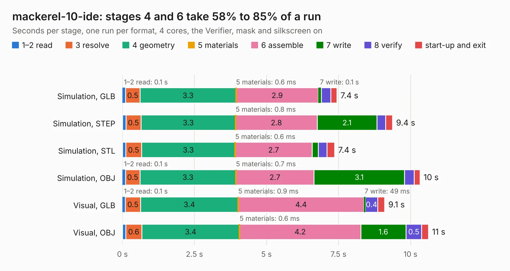

# 790. mackerel-10-ide

Board 790 of the 3,123 of [Corpus Testing](../Corpus-Testing.md), on [Corpus Page 8](../CorpusTestingPages/Corpus-Testing-08.md#790-mackerel-10-ide).

| Mode and format | 1–2 read | 3 resolve | 4 geometry | 5 materials | 6 assemble | 7 write | 8 verify | start-up and exit | Total |
|---|---:|---:|---:|---:|---:|---:|---:|---:|---:|
| Simulation, GLB | 0.1 | 0.5 | 3.3 | 0.6&nbsp;ms | 2.9 | 0.1 | 0.3 | 0.2 | 7.4 |
| Simulation, STEP | 0.1 | 0.5 | 3.3 | 0.8&nbsp;ms | 2.8 | 2.1 | 0.3 | 0.2 | 9.4 |
| Simulation, STL | 0.1 | 0.5 | 3.3 | 0.6&nbsp;ms | 2.7 | 0.2 | 0.3 | 0.3 | 7.4 |
| Simulation, OBJ | 0.1 | 0.5 | 3.3 | 0.7&nbsp;ms | 2.7 | 3.1 | 0.3 | 0.2 | 10.3 |
| Visual, GLB | 0.1 | 0.5 | 3.4 | 0.9&nbsp;ms | 4.4 | 49&nbsp;ms | 0.4 | 0.2 | 9.1 |
| Visual, OBJ | 0.1 | 0.6 | 3.4 | 0.6&nbsp;ms | 4.2 | 1.6 | 0.5 | 0.2 | 10.6 |

<table align="center"><tr><td valign="top">

| Board | Repo: [crmaykish/mackerel-68k](https://github.com/crmaykish/mackerel-68k) Board: `mackerel-10-ide.kicad_pcb` |
|---|---|
| Folder | hardware / mack-10-proto / mackerel-10-ide |
| Complexity | 46&nbsp;/&nbsp;1000 (size&nbsp;36, features&nbsp;10) |
| KESE&nbsp;features | rounded, trapezoid or chamfered pads |
| Tested | 9th November 2026 |
| Copper&nbsp;layers | 2 |
| File&nbsp;format | KiCad 8 (20240108) |
| Parts,&nbsp;tracks,&nbsp;vias | 5, 0, 0 |
| Triangles,&nbsp;simulation | 692,920 in 102 parts |
| Verifier | PASS in all six runs |

</td><td valign="top">

<table>
<tr><th>File type</th><th>File size</th><th>Peak memory used</th></tr>
<tr><th colspan="3" align="left">Simulation</th></tr>
<tr><td>GLB</td><td align="right">20&nbsp;MB</td><td align="right">320&nbsp;MB</td></tr>
<tr><td>STEP</td><td align="right">69&nbsp;MB</td><td align="right">392&nbsp;MB</td></tr>
<tr><td>STL</td><td align="right">35&nbsp;MB</td><td align="right">320&nbsp;MB</td></tr>
<tr><td>OBJ</td><td align="right">69&nbsp;MB</td><td align="right">499&nbsp;MB</td></tr>
<tr><th colspan="3" align="left">Visual</th></tr>
<tr><td>GLB</td><td align="right">12&nbsp;MB</td><td align="right">414&nbsp;MB</td></tr>
<tr><td>OBJ</td><td align="right">37&nbsp;MB</td><td align="right">408&nbsp;MB</td></tr>
</table>

</td></tr></table>

| Previous | Next |
|:---|---:|
| [789. mackerel-10-dram](b0789b_mackerel-68k_mackerel-10-dram.md) | [791. mackerel-10-v1](b0791b_mackerel-68k_hardware-mack-10-proto-mackerel-10-v1_mackerel-10-v1.md) |
