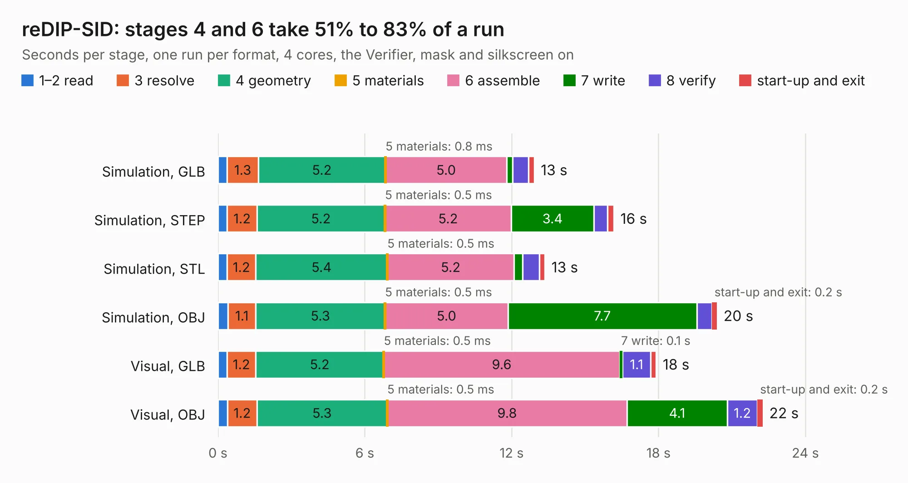

# 790. reDIP-SID

Board 790 of the 3,101 of [Corpus Testing](../Corpus-Testing.md), on [Corpus Page 8](../CorpusTestingPages/Corpus-Testing-08.md#790-redip-sid).

| Mode and format | 1–2 read | 3 resolve | 4 geometry | 5 materials | 6 assemble | 7 write | 8 verify | start-up and exit | Total |
|---|---:|---:|---:|---:|---:|---:|---:|---:|---:|
| Simulation, GLB | 0.4 | 1.3 | 5.2 | 0.8&nbsp;ms | 5.0 | 0.2 | 0.6 | 0.2 | 12.9 |
| Simulation, STEP | 0.4 | 1.2 | 5.2 | 0.5&nbsp;ms | 5.2 | 3.4 | 0.6 | 0.3 | 16.2 |
| Simulation, STL | 0.4 | 1.2 | 5.4 | 0.5&nbsp;ms | 5.2 | 0.3 | 0.7 | 0.2 | 13.4 |
| Simulation, OBJ | 0.4 | 1.1 | 5.3 | 0.5&nbsp;ms | 5.0 | 7.7 | 0.6 | 0.2 | 20.4 |
| Visual, GLB | 0.4 | 1.2 | 5.2 | 0.5&nbsp;ms | 9.6 | 0.1 | 1.1 | 0.2 | 17.9 |
| Visual, OBJ | 0.4 | 1.2 | 5.3 | 0.5&nbsp;ms | 9.8 | 4.1 | 1.2 | 0.2 | 22.3 |

<table align="center"><tr><td valign="top">

| Board | Repo: [daglem/reDIP-SID](https://github.com/daglem/reDIP-SID) Board: `reDIP-SID.kicad_pcb` |
|---|---|
| Folder | hardware |
| Complexity | 364&nbsp;/&nbsp;1000 (size&nbsp;239, features&nbsp;125) |
| KESE&nbsp;features | through vias, slotted holes, custom pads, rounded, trapezoid or chamfered pads, filled zones, copper drawings, curved board outline, stack-up, dielectric εr and tanδ, mask and silkscreen colours |
| Tested | 9th November 2026 |
| Copper&nbsp;layers | 4 |
| File&nbsp;format | KiCad 7 (20221018) |
| Parts,&nbsp;tracks,&nbsp;vias | 68, 1,168, 124 |
| Triangles,&nbsp;simulation | 1,333,082 in 116 parts |
| Verifier | PASS in all six runs |

</td><td valign="top">

<table>
<tr><th>File type</th><th>File size</th><th>Peak memory used</th></tr>
<tr><th colspan="3" align="left">Simulation</th></tr>
<tr><td>GLB</td><td align="right">47&nbsp;MB</td><td align="right">480&nbsp;MB</td></tr>
<tr><td>STEP</td><td align="right">226&nbsp;MB</td><td align="right">582&nbsp;MB</td></tr>
<tr><td>STL</td><td align="right">67&nbsp;MB</td><td align="right">475&nbsp;MB</td></tr>
<tr><td>OBJ</td><td align="right">140&nbsp;MB</td><td align="right">909&nbsp;MB</td></tr>
<tr><th colspan="3" align="left">Visual</th></tr>
<tr><td>GLB</td><td align="right">26&nbsp;MB</td><td align="right">584&nbsp;MB</td></tr>
<tr><td>OBJ</td><td align="right">78&nbsp;MB</td><td align="right">643&nbsp;MB</td></tr>
</table>

</td></tr></table>

| Previous | Next |
|:---|---:|
| [789. SSD2828QN4-breakout](b0789b_HDMI-to-MIPI_SSD2828QN4-breakout.md) | [791. qca7000](b0791b_foccci_qca7000.md) |
