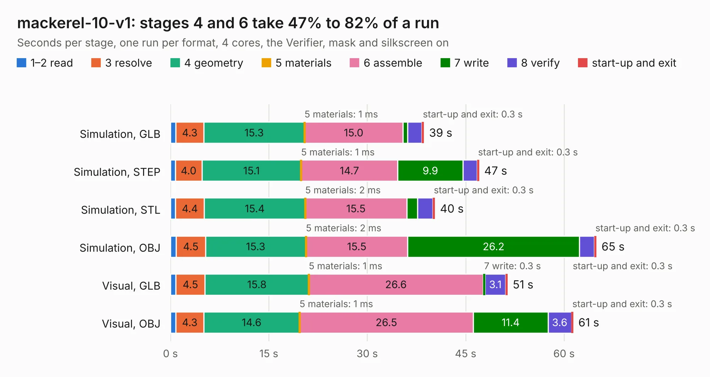

# 791. mackerel-10-v1

Board 791 of the 3,130 of [Corpus Testing](../Corpus-Testing.md), on [Corpus Page 8](../CorpusTestingPages/Corpus-Testing-08.md#791-mackerel-10-v1).

| Mode and format | 1–2 read | 3 resolve | 4 geometry | 5 materials | 6 assemble | 7 write | 8 verify | start-up and exit | Total |
|---|---:|---:|---:|---:|---:|---:|---:|---:|---:|
| Simulation, GLB | 0.8 | 4.3 | 15.3 | 1&nbsp;ms | 15.0 | 0.7 | 2.2 | 0.3 | 38.7 |
| Simulation, STEP | 0.7 | 4.0 | 15.1 | 1&nbsp;ms | 14.7 | 9.9 | 2.2 | 0.3 | 47.1 |
| Simulation, STL | 0.8 | 4.4 | 15.4 | 2&nbsp;ms | 15.5 | 1.6 | 2.4 | 0.3 | 40.3 |
| Simulation, OBJ | 0.9 | 4.5 | 15.3 | 2&nbsp;ms | 15.5 | 26.2 | 2.3 | 0.3 | 64.9 |
| Visual, GLB | 0.8 | 4.5 | 15.8 | 1&nbsp;ms | 26.6 | 0.3 | 3.1 | 0.3 | 51.4 |
| Visual, OBJ | 0.8 | 4.3 | 14.6 | 1&nbsp;ms | 26.5 | 11.4 | 3.6 | 0.3 | 61.4 |

<table align="center"><tr><td valign="top">

| Board | Repo: [crmaykish/mackerel-68k](https://github.com/crmaykish/mackerel-68k) Board: `mackerel-10-v1.kicad_pcb` |
|---|---|
| Folder | hardware / mack-10-proto / mackerel-10-v1 |
| Complexity | 342&nbsp;/&nbsp;1000 (size&nbsp;247, features&nbsp;95) |
| KESE&nbsp;features | through vias, slotted holes, rounded, trapezoid or chamfered pads, filled zones, curved board outline, stack-up, dielectric εr and tanδ |
| Tested | 9th November 2026 |
| Copper&nbsp;layers | 4 |
| File&nbsp;format | KiCad 8 (20240108) |
| Parts,&nbsp;tracks,&nbsp;vias | 61, 1,430, 118 |
| Triangles,&nbsp;simulation | 4,120,696 in 142 parts |
| Verifier | PASS in all six runs |

</td><td valign="top">

<table>
<tr><th>File type</th><th>File size</th><th>Peak memory used</th></tr>
<tr><th colspan="3" align="left">Simulation</th></tr>
<tr><td>GLB</td><td align="right">137&nbsp;MB</td><td align="right">1.1&nbsp;GB</td></tr>
<tr><td>STEP</td><td align="right">460&nbsp;MB</td><td align="right">1.4&nbsp;GB</td></tr>
<tr><td>STL</td><td align="right">206&nbsp;MB</td><td align="right">1.1&nbsp;GB</td></tr>
<tr><td>OBJ</td><td align="right">434&nbsp;MB</td><td align="right">2.6&nbsp;GB</td></tr>
<tr><th colspan="3" align="left">Visual</th></tr>
<tr><td>GLB</td><td align="right">62&nbsp;MB</td><td align="right">1.2&nbsp;GB</td></tr>
<tr><td>OBJ</td><td align="right">195&nbsp;MB</td><td align="right">1.4&nbsp;GB</td></tr>
</table>

</td></tr></table>

| Previous | Next |
|:---|---:|
| [790. mackerel-10-ide](b0790b_mackerel-68k_mackerel-10-ide.md) | [792. mackerel-08-v1](b0792b_mackerel-68k_mackerel-08-v1.md) |
