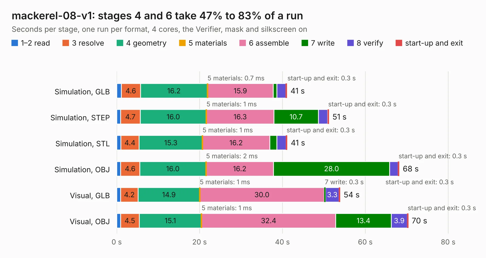

# 792. mackerel-08-v1

Board 792 of the 3,128 of [Corpus Testing](../Corpus-Testing.md), on [Corpus Page 8](../CorpusTestingPages/Corpus-Testing-08.md#792-mackerel-08-v1).

| Mode and format | 1–2 read | 3 resolve | 4 geometry | 5 materials | 6 assemble | 7 write | 8 verify | start-up and exit | Total |
|---|---:|---:|---:|---:|---:|---:|---:|---:|---:|
| Simulation, GLB | 1.1 | 4.6 | 16.2 | 0.7&nbsp;ms | 15.9 | 0.9 | 2.2 | 0.3 | 41.1 |
| Simulation, STEP | 1.0 | 4.7 | 16.0 | 1&nbsp;ms | 16.3 | 10.7 | 2.2 | 0.3 | 51.2 |
| Simulation, STL | 1.0 | 4.4 | 15.3 | 1&nbsp;ms | 16.2 | 1.7 | 2.2 | 0.3 | 41.2 |
| Simulation, OBJ | 1.0 | 4.6 | 16.0 | 2&nbsp;ms | 16.2 | 28.0 | 2.0 | 0.3 | 68.2 |
| Visual, GLB | 0.9 | 4.2 | 14.9 | 1&nbsp;ms | 30.0 | 0.3 | 3.3 | 0.3 | 53.9 |
| Visual, OBJ | 0.9 | 4.5 | 15.1 | 1&nbsp;ms | 32.4 | 13.4 | 3.9 | 0.3 | 70.4 |

<table align="center"><tr><td valign="top">

| Board | Repo: [crmaykish/mackerel-68k](https://github.com/crmaykish/mackerel-68k) Board: `mackerel-08-v1.kicad_pcb` |
|---|---|
| Folder | hardware / mackerel-08-v1 |
| Complexity | 352&nbsp;/&nbsp;1000 (size&nbsp;257, features&nbsp;95) |
| KESE&nbsp;features | through vias, slotted holes, rounded, trapezoid or chamfered pads, filled zones, curved board outline, stack-up, dielectric εr and tanδ |
| Tested | 9th November 2026 |
| Copper&nbsp;layers | 4 |
| File&nbsp;format | KiCad 8 (20240108) |
| Parts,&nbsp;tracks,&nbsp;vias | 80, 2,060, 208 |
| Triangles,&nbsp;simulation | 5,252,394 in 146 parts |
| Verifier | PASS in all six runs |

</td><td valign="top">

<table>
<tr><th>File type</th><th>File size</th><th>Peak memory used</th></tr>
<tr><th colspan="3" align="left">Simulation</th></tr>
<tr><td>GLB</td><td align="right">175&nbsp;MB</td><td align="right">1.3&nbsp;GB</td></tr>
<tr><td>STEP</td><td align="right">584&nbsp;MB</td><td align="right">1.8&nbsp;GB</td></tr>
<tr><td>STL</td><td align="right">263&nbsp;MB</td><td align="right">1.3&nbsp;GB</td></tr>
<tr><td>OBJ</td><td align="right">554&nbsp;MB</td><td align="right">3.3&nbsp;GB</td></tr>
<tr><th colspan="3" align="left">Visual</th></tr>
<tr><td>GLB</td><td align="right">83&nbsp;MB</td><td align="right">1.5&nbsp;GB</td></tr>
<tr><td>OBJ</td><td align="right">264&nbsp;MB</td><td align="right">1.8&nbsp;GB</td></tr>
</table>

</td></tr></table>

| Previous | Next |
|:---|---:|
| [791. mackerel-10-v1](b0791b_mackerel-68k_hardware-mack-10-proto-mackerel-10-v1_mackerel-10-v1.md) | [793. mackerel-10-v1](b0793b_mackerel-68k_hardware-mackerel-10-v1_mackerel-10-v1.md) |
