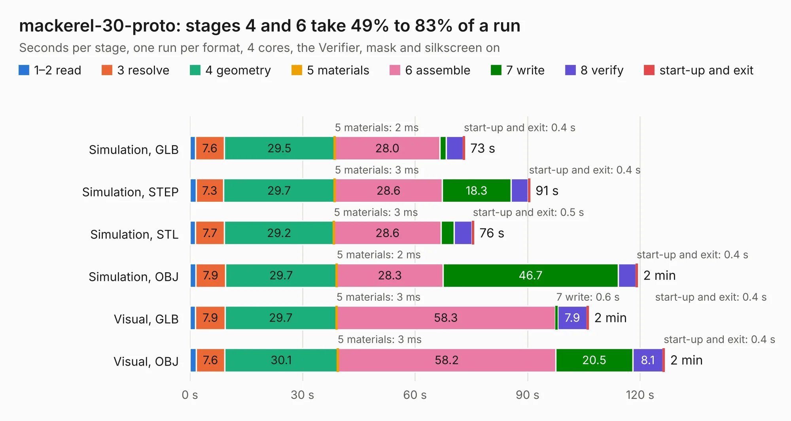

# 794. mackerel-30-proto

Board 794 of the 3,130 of [Corpus Testing](../Corpus-Testing.md), on [Corpus Page 8](../CorpusTestingPages/Corpus-Testing-08.md#794-mackerel-30-proto).

| Mode and format | 1–2 read | 3 resolve | 4 geometry | 5 materials | 6 assemble | 7 write | 8 verify | start-up and exit | Total |
|---|---:|---:|---:|---:|---:|---:|---:|---:|---:|
| Simulation, GLB | 1.5 | 7.6 | 29.5 | 2&nbsp;ms | 28.0 | 1.6 | 4.5 | 0.4 | 73.2 |
| Simulation, STEP | 1.6 | 7.3 | 29.7 | 3&nbsp;ms | 28.6 | 18.3 | 4.6 | 0.4 | 90.6 |
| Simulation, STL | 1.5 | 7.7 | 29.2 | 3&nbsp;ms | 28.6 | 3.5 | 4.8 | 0.5 | 75.7 |
| Simulation, OBJ | 1.6 | 7.9 | 29.7 | 2&nbsp;ms | 28.3 | 46.7 | 4.7 | 0.4 | 119.3 |
| Visual, GLB | 1.5 | 7.9 | 29.7 | 3&nbsp;ms | 58.3 | 0.6 | 7.9 | 0.4 | 106.2 |
| Visual, OBJ | 1.7 | 7.6 | 30.1 | 3&nbsp;ms | 58.2 | 20.5 | 8.1 | 0.4 | 126.5 |

<table align="center"><tr><td valign="top">

| Board | Repo: [crmaykish/mackerel-68k](https://github.com/crmaykish/mackerel-68k) Board: `mackerel-30-proto.kicad_pcb` |
|---|---|
| Folder | hardware / mackerel-30-proto |
| Complexity | 368&nbsp;/&nbsp;1000 (size&nbsp;273, features&nbsp;95) |
| KESE&nbsp;features | through vias, slotted holes, rounded, trapezoid or chamfered pads, filled zones, curved board outline, stack-up, dielectric εr and tanδ |
| Tested | 9th November 2026 |
| Copper&nbsp;layers | 4 |
| File&nbsp;format | KiCad 8 (20240108) |
| Parts,&nbsp;tracks,&nbsp;vias | 130, 2,615, 294 |
| Triangles,&nbsp;simulation | 8,393,056 in 304 parts |
| Verifier | PASS in all six runs |

</td><td valign="top">

<table>
<tr><th>File type</th><th>File size</th><th>Peak memory used</th></tr>
<tr><th colspan="3" align="left">Simulation</th></tr>
<tr><td>GLB</td><td align="right">281&nbsp;MB</td><td align="right">1.9&nbsp;GB</td></tr>
<tr><td>STEP</td><td align="right">930&nbsp;MB</td><td align="right">2.6&nbsp;GB</td></tr>
<tr><td>STL</td><td align="right">420&nbsp;MB</td><td align="right">1.9&nbsp;GB</td></tr>
<tr><td>OBJ</td><td align="right">892&nbsp;MB</td><td align="right">5.2&nbsp;GB</td></tr>
<tr><th colspan="3" align="left">Visual</th></tr>
<tr><td>GLB</td><td align="right">129&nbsp;MB</td><td align="right">2.3&nbsp;GB</td></tr>
<tr><td>OBJ</td><td align="right">417&nbsp;MB</td><td align="right">2.8&nbsp;GB</td></tr>
</table>

</td></tr></table>

| Previous | Next |
|:---|---:|
| [793. mackerel-10-v1](b0793b_mackerel-68k_hardware-mackerel-10-v1_mackerel-10-v1.md) | [795. hdmi_adapter](b0795b_zynq-a9-mb_hdmi-adapter.md) |
