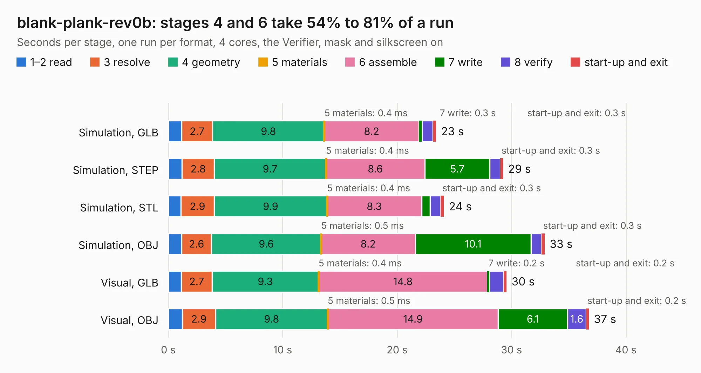

# 796. blank-plank-rev0b

Board 796 of the 3,108 of [Corpus Testing](../Corpus-Testing.md), on [Corpus Page 8](../CorpusTestingPages/Corpus-Testing-08.md#796-blank-plank-rev0b).

| Mode and format | 1–2 read | 3 resolve | 4 geometry | 5 materials | 6 assemble | 7 write | 8 verify | start-up and exit | Total |
|---|---:|---:|---:|---:|---:|---:|---:|---:|---:|
| Simulation, GLB | 1.2 | 2.7 | 9.8 | 0.4&nbsp;ms | 8.2 | 0.3 | 0.9 | 0.3 | 23.4 |
| Simulation, STEP | 1.2 | 2.8 | 9.7 | 0.4&nbsp;ms | 8.6 | 5.7 | 0.9 | 0.3 | 29.3 |
| Simulation, STL | 1.1 | 2.9 | 9.9 | 0.4&nbsp;ms | 8.3 | 0.7 | 0.9 | 0.3 | 24.1 |
| Simulation, OBJ | 1.2 | 2.6 | 9.6 | 0.5&nbsp;ms | 8.2 | 10.1 | 0.9 | 0.3 | 32.9 |
| Visual, GLB | 1.1 | 2.7 | 9.3 | 0.4&nbsp;ms | 14.8 | 0.2 | 1.3 | 0.2 | 29.6 |
| Visual, OBJ | 1.2 | 2.9 | 9.8 | 0.5&nbsp;ms | 14.9 | 6.1 | 1.6 | 0.2 | 36.8 |

<table align="center"><tr><td valign="top">

| Board | Repo: [DangerousPrototypes/BusPirate5-hardware](https://github.com/DangerousPrototypes/BusPirate5-hardware) Board: `blank-plank-rev0b.kicad_pcb` |
|---|---|
| Folder | adapter-blank-plank-1REV0B |
| Complexity | 258&nbsp;/&nbsp;1000 (size&nbsp;148, features&nbsp;110) |
| KESE&nbsp;features | through vias, rounded, trapezoid or chamfered pads, filled zones, copper drawings, curved board outline, knockout text, stack-up, dielectric εr and tanδ |
| Tested | 9th November 2026 |
| Copper&nbsp;layers | 2 |
| File&nbsp;format | KiCad 8 (20240108) |
| Parts,&nbsp;tracks,&nbsp;vias | 908, 21, 4 |
| Triangles,&nbsp;simulation | 1,992,666 in 22 parts |
| Note | mostly unrouted |
| Verifier | PASS in all six runs |

</td><td valign="top">

<table>
<tr><th>File type</th><th>File size</th><th>Peak memory used</th></tr>
<tr><th colspan="3" align="left">Simulation</th></tr>
<tr><td>GLB</td><td align="right">70&nbsp;MB</td><td align="right">894&nbsp;MB</td></tr>
<tr><td>STEP</td><td align="right">303&nbsp;MB</td><td align="right">971&nbsp;MB</td></tr>
<tr><td>STL</td><td align="right">100&nbsp;MB</td><td align="right">877&nbsp;MB</td></tr>
<tr><td>OBJ</td><td align="right">214&nbsp;MB</td><td align="right">1.4&nbsp;GB</td></tr>
<tr><th colspan="3" align="left">Visual</th></tr>
<tr><td>GLB</td><td align="right">39&nbsp;MB</td><td align="right">970&nbsp;MB</td></tr>
<tr><td>OBJ</td><td align="right">117&nbsp;MB</td><td align="right">976&nbsp;MB</td></tr>
</table>

</td></tr></table>

| Previous | Next |
|:---|---:|
| [795. qca7000](b0795b_foccci_qca7000.md) | [797. flash-zif-rev3](b0797b_BusPirate5-hardware_flash-zif-rev3.md) |
