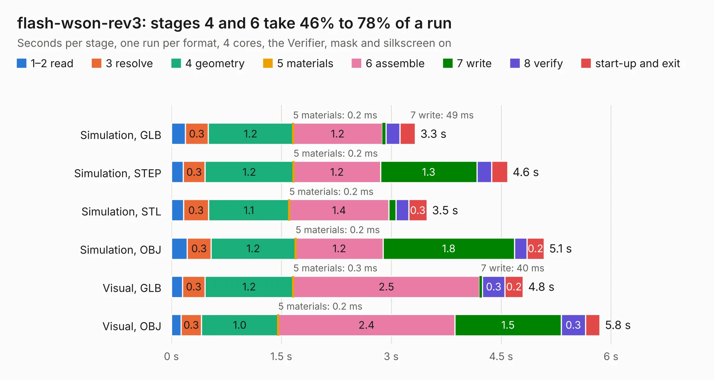

# 797. flash-wson-rev3

Board 797 of the 3,102 of [Corpus Testing](../Corpus-Testing.md), on [Corpus Page 8](../CorpusTestingPages/Corpus-Testing-08.md#797-flash-wson-rev3).

| Mode and format | 1–2 read | 3 resolve | 4 geometry | 5 materials | 6 assemble | 7 write | 8 verify | start-up and exit | Total |
|---|---:|---:|---:|---:|---:|---:|---:|---:|---:|
| Simulation, GLB | 0.2 | 0.3 | 1.2 | 0.2&nbsp;ms | 1.2 | 49&nbsp;ms | 0.2 | 0.2 | 3.3 |
| Simulation, STEP | 0.2 | 0.3 | 1.2 | 0.2&nbsp;ms | 1.2 | 1.3 | 0.2 | 0.2 | 4.6 |
| Simulation, STL | 0.2 | 0.3 | 1.1 | 0.2&nbsp;ms | 1.4 | 95&nbsp;ms | 0.2 | 0.3 | 3.5 |
| Simulation, OBJ | 0.2 | 0.3 | 1.2 | 0.2&nbsp;ms | 1.2 | 1.8 | 0.2 | 0.2 | 5.1 |
| Visual, GLB | 0.2 | 0.3 | 1.2 | 0.3&nbsp;ms | 2.5 | 40&nbsp;ms | 0.3 | 0.2 | 4.8 |
| Visual, OBJ | 0.1 | 0.3 | 1.0 | 0.2&nbsp;ms | 2.4 | 1.5 | 0.3 | 0.2 | 5.8 |

<table align="center"><tr><td valign="top">

| Board | Repo: [DangerousPrototypes/BusPirate5-hardware](https://github.com/DangerousPrototypes/BusPirate5-hardware) Board: `flash-wson-rev3.kicad_pcb` |
|---|---|
| Folder | adapter-flash-wson-1REV3 |
| Complexity | 204&nbsp;/&nbsp;1000 (size&nbsp;134, features&nbsp;70) |
| KESE&nbsp;features | through vias, rounded, trapezoid or chamfered pads, filled zones, curved board outline, knockout text |
| Tested | 9th November 2026 |
| Copper&nbsp;layers | 2 |
| File&nbsp;format | KiCad 7 (20221018) |
| Parts,&nbsp;tracks,&nbsp;vias | 10, 143, 41 |
| Triangles,&nbsp;simulation | 302,386 in 25 parts |
| Verifier | PASS in all six runs |

</td><td valign="top">

<table>
<tr><th>File type</th><th>File size</th><th>Peak memory used</th></tr>
<tr><th colspan="3" align="left">Simulation</th></tr>
<tr><td>GLB</td><td align="right">10&nbsp;MB</td><td align="right">237&nbsp;MB</td></tr>
<tr><td>STEP</td><td align="right">48&nbsp;MB</td><td align="right">275&nbsp;MB</td></tr>
<tr><td>STL</td><td align="right">15&nbsp;MB</td><td align="right">238&nbsp;MB</td></tr>
<tr><td>OBJ</td><td align="right">30&nbsp;MB</td><td align="right">241&nbsp;MB</td></tr>
<tr><th colspan="3" align="left">Visual</th></tr>
<tr><td>GLB</td><td align="right">8.8&nbsp;MB</td><td align="right">270&nbsp;MB</td></tr>
<tr><td>OBJ</td><td align="right">26&nbsp;MB</td><td align="right">271&nbsp;MB</td></tr>
</table>

</td></tr></table>

| Previous | Next |
|:---|---:|
| [796. flash-sop-lotes-rev3](b0796b_BusPirate5-hardware_flash-sop-lotes-rev3.md) | [798. bp5-ir-toy-v3-rev3](b0798b_BusPirate5-hardware_bp5-ir-toy-v3-rev3.md) |
