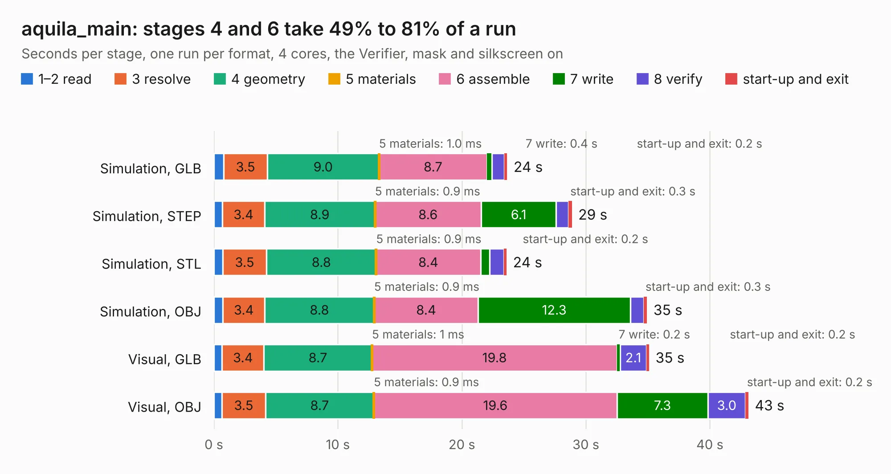

# 797. aquila_main

Board 797 of the 3,129 of [Corpus Testing](../Corpus-Testing.md), on [Corpus Page 8](../CorpusTestingPages/Corpus-Testing-08.md#797-aquila_main).

| Mode and format | 1–2 read | 3 resolve | 4 geometry | 5 materials | 6 assemble | 7 write | 8 verify | start-up and exit | Total |
|---|---:|---:|---:|---:|---:|---:|---:|---:|---:|
| Simulation, GLB | 0.8 | 3.5 | 9.0 | 1.0&nbsp;ms | 8.7 | 0.4 | 1.0 | 0.2 | 23.7 |
| Simulation, STEP | 0.7 | 3.4 | 8.9 | 0.9&nbsp;ms | 8.6 | 6.1 | 1.0 | 0.3 | 28.9 |
| Simulation, STL | 0.7 | 3.5 | 8.8 | 0.9&nbsp;ms | 8.4 | 0.7 | 1.1 | 0.2 | 23.6 |
| Simulation, OBJ | 0.7 | 3.4 | 8.8 | 0.9&nbsp;ms | 8.4 | 12.3 | 1.1 | 0.3 | 34.9 |
| Visual, GLB | 0.7 | 3.4 | 8.7 | 1&nbsp;ms | 19.8 | 0.2 | 2.1 | 0.2 | 35.1 |
| Visual, OBJ | 0.7 | 3.5 | 8.7 | 0.9&nbsp;ms | 19.6 | 7.3 | 3.0 | 0.2 | 43.1 |

<table align="center"><tr><td valign="top">

| Board | Repo: [cuspaceflight/aquila-avionics](https://github.com/cuspaceflight/aquila-avionics) Board: `aquila_main.kicad_pcb` |
|---|---|
| Folder | schematics / aquila_main |
| Complexity | 313&nbsp;/&nbsp;1000 (size&nbsp;213, features&nbsp;100) |
| KESE&nbsp;features | through vias, rounded, trapezoid or chamfered pads, arc tracks, filled zones, copper drawings, stack-up, dielectric εr and tanδ |
| Tested | 9th November 2026 |
| Copper&nbsp;layers | 4 |
| File&nbsp;format | KiCad 6 (20211014) |
| Parts,&nbsp;tracks,&nbsp;vias | 130, 870, 472 |
| Triangles,&nbsp;simulation | 2,961,764 in 147 parts |
| Verifier | PASS in all six runs |

</td><td valign="top">

<table>
<tr><th>File type</th><th>File size</th><th>Peak memory used</th></tr>
<tr><th colspan="3" align="left">Simulation</th></tr>
<tr><td>GLB</td><td align="right">101&nbsp;MB</td><td align="right">1.1&nbsp;GB</td></tr>
<tr><td>STEP</td><td align="right">371&nbsp;MB</td><td align="right">1.2&nbsp;GB</td></tr>
<tr><td>STL</td><td align="right">148&nbsp;MB</td><td align="right">1.1&nbsp;GB</td></tr>
<tr><td>OBJ</td><td align="right">313&nbsp;MB</td><td align="right">2.0&nbsp;GB</td></tr>
<tr><th colspan="3" align="left">Visual</th></tr>
<tr><td>GLB</td><td align="right">59&nbsp;MB</td><td align="right">1.3&nbsp;GB</td></tr>
<tr><td>OBJ</td><td align="right">185&nbsp;MB</td><td align="right">1.3&nbsp;GB</td></tr>
</table>

</td></tr></table>

| Previous | Next |
|:---|---:|
| [796. zynq_test](b0796b_zynq-a9-mb_zynq-test.md) | [798. daq_griffin](b0798b_white-giant-sensing-pcb_daq-griffin.md) |
