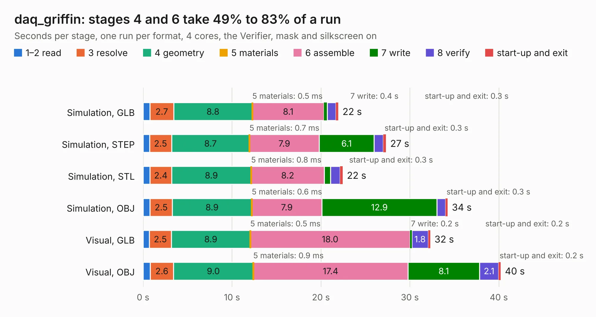

# 799 daq_griffin

Board 799 of the 3,138 of [Corpus Testing](../Corpus-Testing.md), on [Corpus Page 8](../CorpusTestingPages/Corpus-Testing-08.md#799-daq_griffin).

| Mode and format | 1–2 read | 3 resolve | 4 geometry | 5 materials | 6 assemble | 7 write | 8 verify | start-up and exit | Total |
|---|---:|---:|---:|---:|---:|---:|---:|---:|---:|
| Simulation, GLB | 0.8 | 2.7 | 8.8 | 0.5&nbsp;ms | 8.1 | 0.4 | 1.0 | 0.3 | 21.9 |
| Simulation, STEP | 0.7 | 2.5 | 8.7 | 0.7&nbsp;ms | 7.9 | 6.1 | 1.0 | 0.3 | 27.3 |
| Simulation, STL | 0.8 | 2.4 | 8.9 | 0.8&nbsp;ms | 8.2 | 0.7 | 1.1 | 0.3 | 22.4 |
| Simulation, OBJ | 0.8 | 2.5 | 8.9 | 0.6&nbsp;ms | 7.9 | 12.9 | 1.0 | 0.3 | 34.2 |
| Visual, GLB | 0.7 | 2.5 | 8.9 | 0.5&nbsp;ms | 18.0 | 0.2 | 1.8 | 0.2 | 32.3 |
| Visual, OBJ | 0.8 | 2.6 | 9.0 | 0.9&nbsp;ms | 17.4 | 8.1 | 2.1 | 0.2 | 40.2 |

<table align="center"><tr><td valign="top">

| Board | Repo: [cuspaceflight/white-giant-sensing-pcb](https://github.com/cuspaceflight/white-giant-sensing-pcb) Board: `daq_griffin.kicad_pcb` |
|---|---|
| Folder | daq_griffin |
| Complexity | 311&nbsp;/&nbsp;1000 (size&nbsp;211, features&nbsp;100) |
| KESE&nbsp;features | through vias, custom pads, rounded, trapezoid or chamfered pads, filled zones, copper drawings, stack-up, dielectric εr and tanδ |
| Tested | 9th November 2026 |
| Copper&nbsp;layers | 4 |
| File&nbsp;format | KiCad 8 (20240108) |
| Parts,&nbsp;tracks,&nbsp;vias | 220, 962, 166 |
| Triangles,&nbsp;simulation | 2,543,048 in 175 parts |
| Verifier | PASS in all six runs |

</td><td valign="top">

<table>
<tr><th>File type</th><th>File size</th><th>Peak memory used</th></tr>
<tr><th colspan="3" align="left">Simulation</th></tr>
<tr><td>GLB</td><td align="right">84&nbsp;MB</td><td align="right">827&nbsp;MB</td></tr>
<tr><td>STEP</td><td align="right">332&nbsp;MB</td><td align="right">930&nbsp;MB</td></tr>
<tr><td>STL</td><td align="right">127&nbsp;MB</td><td align="right">788&nbsp;MB</td></tr>
<tr><td>OBJ</td><td align="right">266&nbsp;MB</td><td align="right">1.7&nbsp;GB</td></tr>
<tr><th colspan="3" align="left">Visual</th></tr>
<tr><td>GLB</td><td align="right">53&nbsp;MB</td><td align="right">1.2&nbsp;GB</td></tr>
<tr><td>OBJ</td><td align="right">163&nbsp;MB</td><td align="right">1.2&nbsp;GB</td></tr>
</table>

</td></tr></table>

| Previous | Next |
|:---|---:|
| [798 aquila_main](b0798b_aquila-avionics_aquila-main.md) | [800 OpeN64](b0800b_OpeN64_OpeN64.md) |
