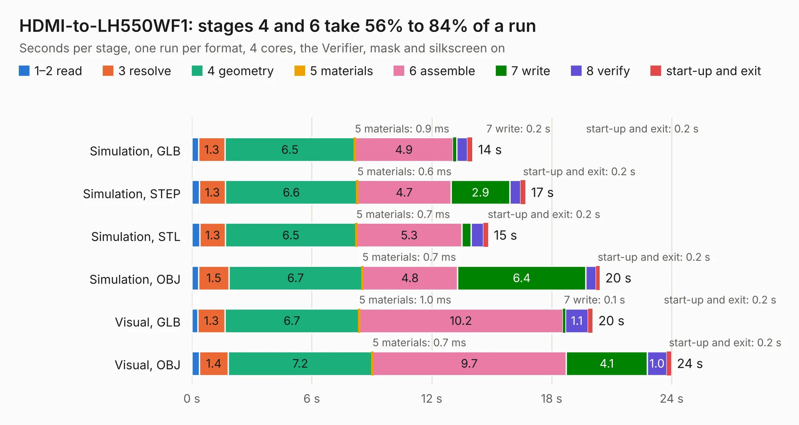

# 800. HDMI-to-LH550WF1

Board 800 of the 3,126 of [Corpus Testing](../Corpus-Testing.md), on [Corpus Page 8](../CorpusTestingPages/Corpus-Testing-08.md#800-hdmi-to-lh550wf1).

| Mode and format | 1–2 read | 3 resolve | 4 geometry | 5 materials | 6 assemble | 7 write | 8 verify | start-up and exit | Total |
|---|---:|---:|---:|---:|---:|---:|---:|---:|---:|
| Simulation, GLB | 0.3 | 1.3 | 6.5 | 0.9&nbsp;ms | 4.9 | 0.2 | 0.5 | 0.2 | 14.0 |
| Simulation, STEP | 0.4 | 1.3 | 6.6 | 0.6&nbsp;ms | 4.7 | 2.9 | 0.5 | 0.2 | 16.7 |
| Simulation, STL | 0.4 | 1.3 | 6.5 | 0.7&nbsp;ms | 5.3 | 0.4 | 0.6 | 0.2 | 14.8 |
| Simulation, OBJ | 0.3 | 1.5 | 6.7 | 0.7&nbsp;ms | 4.8 | 6.4 | 0.5 | 0.2 | 20.4 |
| Visual, GLB | 0.3 | 1.3 | 6.7 | 1.0&nbsp;ms | 10.2 | 0.1 | 1.1 | 0.2 | 20.0 |
| Visual, OBJ | 0.4 | 1.4 | 7.2 | 0.7&nbsp;ms | 9.7 | 4.1 | 1.0 | 0.2 | 24.0 |

<table align="center"><tr><td valign="top">

| Board | Repo: [cyrozap/HDMI-to-MIPI](https://github.com/cyrozap/HDMI-to-MIPI) Board: `HDMI-to-LH550WF1.kicad_pcb` |
|---|---|
| Folder | HDMI-to-LH550WF1 |
| Complexity | 314&nbsp;/&nbsp;1000 (size&nbsp;269, features&nbsp;45) |
| KESE&nbsp;features | through vias, filled zones, copper text |
| Tested | 9th November 2026 |
| Copper&nbsp;layers | 4 |
| File&nbsp;format | KiCad 4 (4) |
| Parts,&nbsp;tracks,&nbsp;vias | 139, 1,897, 159 |
| Triangles,&nbsp;simulation | 1,463,414 in 125 parts |
| Verifier | PASS in all six runs |

</td><td valign="top">

<table>
<tr><th>File type</th><th>File size</th><th>Peak memory used</th></tr>
<tr><th colspan="3" align="left">Simulation</th></tr>
<tr><td>GLB</td><td align="right">52&nbsp;MB</td><td align="right">601&nbsp;MB</td></tr>
<tr><td>STEP</td><td align="right">222&nbsp;MB</td><td align="right">714&nbsp;MB</td></tr>
<tr><td>STL</td><td align="right">73&nbsp;MB</td><td align="right">599&nbsp;MB</td></tr>
<tr><td>OBJ</td><td align="right">156&nbsp;MB</td><td align="right">1.0&nbsp;GB</td></tr>
<tr><th colspan="3" align="left">Visual</th></tr>
<tr><td>GLB</td><td align="right">34&nbsp;MB</td><td align="right">769&nbsp;MB</td></tr>
<tr><td>OBJ</td><td align="right">102&nbsp;MB</td><td align="right">804&nbsp;MB</td></tr>
</table>

</td></tr></table>

| Previous | Next |
|:---|---:|
| [799. OpeN64](b0799b_OpeN64_OpeN64.md) | [801. LH550WF1-breakout](b0801b_HDMI-to-MIPI_LH550WF1-breakout.md) |
