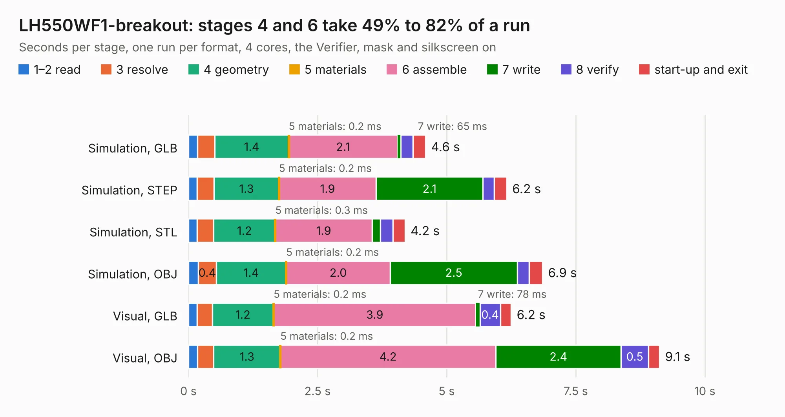

# 800. LH550WF1-breakout

Board 800 of the 3,122 of [Corpus Testing](../Corpus-Testing.md), on [Corpus Page 8](../CorpusTestingPages/Corpus-Testing-08.md#800-lh550wf1-breakout).

| Mode and format | 1–2 read | 3 resolve | 4 geometry | 5 materials | 6 assemble | 7 write | 8 verify | start-up and exit | Total |
|---|---:|---:|---:|---:|---:|---:|---:|---:|---:|
| Simulation, GLB | 0.2 | 0.3 | 1.4 | 0.2&nbsp;ms | 2.1 | 65&nbsp;ms | 0.2 | 0.2 | 4.6 |
| Simulation, STEP | 0.2 | 0.3 | 1.3 | 0.2&nbsp;ms | 1.9 | 2.1 | 0.2 | 0.2 | 6.2 |
| Simulation, STL | 0.2 | 0.3 | 1.2 | 0.3&nbsp;ms | 1.9 | 0.2 | 0.2 | 0.2 | 4.2 |
| Simulation, OBJ | 0.2 | 0.4 | 1.4 | 0.2&nbsp;ms | 2.0 | 2.5 | 0.2 | 0.3 | 6.9 |
| Visual, GLB | 0.2 | 0.3 | 1.2 | 0.2&nbsp;ms | 3.9 | 78&nbsp;ms | 0.4 | 0.2 | 6.2 |
| Visual, OBJ | 0.2 | 0.3 | 1.3 | 0.2&nbsp;ms | 4.2 | 2.4 | 0.5 | 0.2 | 9.1 |

<table align="center"><tr><td valign="top">

| Board | Repo: [cyrozap/HDMI-to-MIPI](https://github.com/cyrozap/HDMI-to-MIPI) Board: `LH550WF1-breakout.kicad_pcb` |
|---|---|
| Folder | LH550WF1-breakout |
| Complexity | 185&nbsp;/&nbsp;1000 (size&nbsp;150, features&nbsp;35) |
| KESE&nbsp;features | through vias, filled zones |
| Tested | 9th November 2026 |
| Copper&nbsp;layers | 2 |
| File&nbsp;format | KiCad 4 (4) |
| Parts,&nbsp;tracks,&nbsp;vias | 2, 1,462, 47 |
| Triangles,&nbsp;simulation | 423,170 in 28 parts |
| Verifier | PASS in all six runs |

</td><td valign="top">

<table>
<tr><th>File type</th><th>File size</th><th>Peak memory used</th></tr>
<tr><th colspan="3" align="left">Simulation</th></tr>
<tr><td>GLB</td><td align="right">14&nbsp;MB</td><td align="right">295&nbsp;MB</td></tr>
<tr><td>STEP</td><td align="right">83&nbsp;MB</td><td align="right">330&nbsp;MB</td></tr>
<tr><td>STL</td><td align="right">21&nbsp;MB</td><td align="right">294&nbsp;MB</td></tr>
<tr><td>OBJ</td><td align="right">42&nbsp;MB</td><td align="right">343&nbsp;MB</td></tr>
<tr><th colspan="3" align="left">Visual</th></tr>
<tr><td>GLB</td><td align="right">12&nbsp;MB</td><td align="right">357&nbsp;MB</td></tr>
<tr><td>OBJ</td><td align="right">35&nbsp;MB</td><td align="right">384&nbsp;MB</td></tr>
</table>

</td></tr></table>

| Previous | Next |
|:---|---:|
| [799. HDMI-to-LH550WF1](b0799b_HDMI-to-MIPI_HDMI-to-LH550WF1.md) | [801. SSD2828QN4-breakout](b0801b_HDMI-to-MIPI_SSD2828QN4-breakout.md) |
