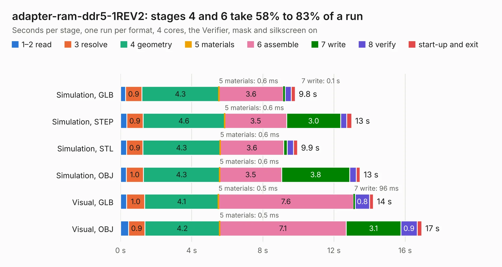

# 802. adapter-ram-ddr5-1REV2

Board 802 of the 3,103 of [Corpus Testing](../Corpus-Testing.md), on [Corpus Page 8](../CorpusTestingPages/Corpus-Testing-08.md#802-adapter-ram-ddr5-1rev2).

| Mode and format | 1–2 read | 3 resolve | 4 geometry | 5 materials | 6 assemble | 7 write | 8 verify | start-up and exit | Total |
|---|---:|---:|---:|---:|---:|---:|---:|---:|---:|
| Simulation, GLB | 0.3 | 0.9 | 4.3 | 0.6&nbsp;ms | 3.6 | 0.1 | 0.3 | 0.2 | 9.8 |
| Simulation, STEP | 0.3 | 0.9 | 4.6 | 0.6&nbsp;ms | 3.5 | 3.0 | 0.3 | 0.3 | 13.0 |
| Simulation, STL | 0.3 | 0.9 | 4.3 | 0.6&nbsp;ms | 3.6 | 0.2 | 0.4 | 0.2 | 9.9 |
| Simulation, OBJ | 0.3 | 1.0 | 4.3 | 0.6&nbsp;ms | 3.5 | 3.8 | 0.4 | 0.2 | 13.5 |
| Visual, GLB | 0.3 | 1.0 | 4.1 | 0.5&nbsp;ms | 7.6 | 96&nbsp;ms | 0.8 | 0.2 | 14.2 |
| Visual, OBJ | 0.4 | 0.9 | 4.2 | 0.5&nbsp;ms | 7.1 | 3.1 | 0.9 | 0.3 | 16.9 |

<table align="center"><tr><td valign="top">

| Board | Repo: [DangerousPrototypes/BusPirate5-hardware](https://github.com/DangerousPrototypes/BusPirate5-hardware) Board: `adapter-ram-ddr5-1REV2.kicad_pcb` |
|---|---|
| Folder | adapter-ram-ddr5-1REV2 |
| Complexity | 256&nbsp;/&nbsp;1000 (size&nbsp;146, features&nbsp;110) |
| KESE&nbsp;features | through vias, slotted holes, rounded, trapezoid or chamfered pads, filled zones, curved board outline, knockout text, stack-up, dielectric εr and tanδ |
| Tested | 9th November 2026 |
| Copper&nbsp;layers | 2 |
| File&nbsp;format | KiCad 9 (20241229) |
| Parts,&nbsp;tracks,&nbsp;vias | 21, 165, 59 |
| Triangles,&nbsp;simulation | 690,766 in 213 parts |
| Verifier | PASS in all six runs |

</td><td valign="top">

<table>
<tr><th>File type</th><th>File size</th><th>Peak memory used</th></tr>
<tr><th colspan="3" align="left">Simulation</th></tr>
<tr><td>GLB</td><td align="right">25&nbsp;MB</td><td align="right">429&nbsp;MB</td></tr>
<tr><td>STEP</td><td align="right">118&nbsp;MB</td><td align="right">461&nbsp;MB</td></tr>
<tr><td>STL</td><td align="right">35&nbsp;MB</td><td align="right">436&nbsp;MB</td></tr>
<tr><td>OBJ</td><td align="right">72&nbsp;MB</td><td align="right">533&nbsp;MB</td></tr>
<tr><th colspan="3" align="left">Visual</th></tr>
<tr><td>GLB</td><td align="right">20&nbsp;MB</td><td align="right">497&nbsp;MB</td></tr>
<tr><td>OBJ</td><td align="right">60&nbsp;MB</td><td align="right">526&nbsp;MB</td></tr>
</table>

</td></tr></table>

| Previous | Next |
|:---|---:|
| [801. wago kf141v adapter](b0801b_BusPirate5-hardware_wago-kf141v-adapter.md) | [803. rs232-dual-adapter](b0803b_BusPirate5-hardware_rs232-dual-adapter.md) |
