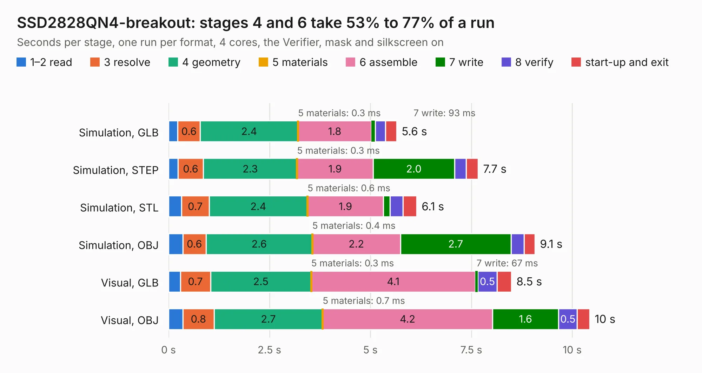

# 802. SSD2828QN4-breakout

Board 802 of the 3,124 of [Corpus Testing](../Corpus-Testing.md), on [Corpus Page 8](../CorpusTestingPages/Corpus-Testing-08.md#802-ssd2828qn4-breakout).

| Mode and format | 1–2 read | 3 resolve | 4 geometry | 5 materials | 6 assemble | 7 write | 8 verify | start-up and exit | Total |
|---|---:|---:|---:|---:|---:|---:|---:|---:|---:|
| Simulation, GLB | 0.2 | 0.6 | 2.4 | 0.3&nbsp;ms | 1.8 | 93&nbsp;ms | 0.3 | 0.3 | 5.6 |
| Simulation, STEP | 0.2 | 0.6 | 2.3 | 0.3&nbsp;ms | 1.9 | 2.0 | 0.3 | 0.3 | 7.7 |
| Simulation, STL | 0.3 | 0.7 | 2.4 | 0.6&nbsp;ms | 1.9 | 0.2 | 0.3 | 0.3 | 6.1 |
| Simulation, OBJ | 0.4 | 0.6 | 2.6 | 0.4&nbsp;ms | 2.2 | 2.7 | 0.3 | 0.3 | 9.1 |
| Visual, GLB | 0.3 | 0.7 | 2.5 | 0.3&nbsp;ms | 4.1 | 67&nbsp;ms | 0.5 | 0.4 | 8.5 |
| Visual, OBJ | 0.4 | 0.8 | 2.7 | 0.7&nbsp;ms | 4.2 | 1.6 | 0.5 | 0.3 | 10.4 |

<table align="center"><tr><td valign="top">

| Board | Repo: [cyrozap/HDMI-to-MIPI](https://github.com/cyrozap/HDMI-to-MIPI) Board: `SSD2828QN4-breakout.kicad_pcb` |
|---|---|
| Folder | SSD2828QN4-breakout |
| Complexity | 207&nbsp;/&nbsp;1000 (size&nbsp;207, features&nbsp;0) |
| Tested | 9th November 2026 |
| Copper&nbsp;layers | 2 |
| File&nbsp;format | KiCad 4 (4) |
| Parts,&nbsp;tracks,&nbsp;vias | 18, 1,423, 0 |
| Triangles,&nbsp;simulation | 357,258 in 69 parts |
| Verifier | PASS in all six runs |

</td><td valign="top">

<table>
<tr><th>File type</th><th>File size</th><th>Peak memory used</th></tr>
<tr><th colspan="3" align="left">Simulation</th></tr>
<tr><td>GLB</td><td align="right">12&nbsp;MB</td><td align="right">262&nbsp;MB</td></tr>
<tr><td>STEP</td><td align="right">64&nbsp;MB</td><td align="right">302&nbsp;MB</td></tr>
<tr><td>STL</td><td align="right">18&nbsp;MB</td><td align="right">271&nbsp;MB</td></tr>
<tr><td>OBJ</td><td align="right">37&nbsp;MB</td><td align="right">305&nbsp;MB</td></tr>
<tr><th colspan="3" align="left">Visual</th></tr>
<tr><td>GLB</td><td align="right">7.9&nbsp;MB</td><td align="right">275&nbsp;MB</td></tr>
<tr><td>OBJ</td><td align="right">23&nbsp;MB</td><td align="right">285&nbsp;MB</td></tr>
</table>

</td></tr></table>

| Previous | Next |
|:---|---:|
| [801. LH550WF1-breakout](b0801b_HDMI-to-MIPI_LH550WF1-breakout.md) | [803. reDIP-SID](b0803b_reDIP-SID_reDIP-SID.md) |
