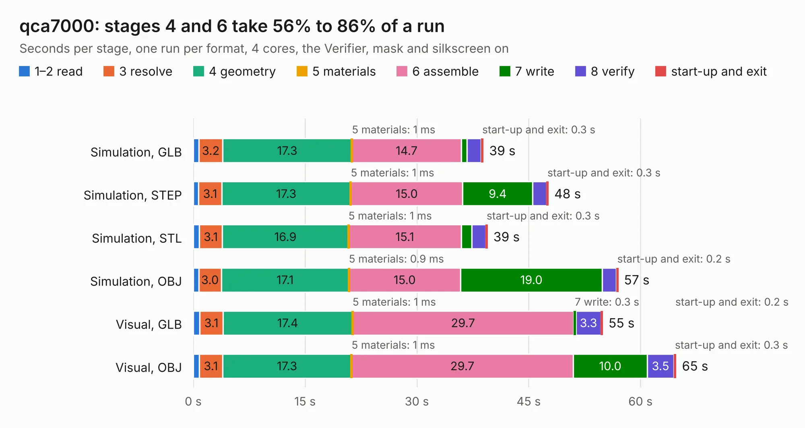

# 803. qca7000

Board 803 of the 3,119 of [Corpus Testing](../Corpus-Testing.md), on [Corpus Page 8](../CorpusTestingPages/Corpus-Testing-08.md#803-qca7000).

| Mode and format | 1–2 read | 3 resolve | 4 geometry | 5 materials | 6 assemble | 7 write | 8 verify | start-up and exit | Total |
|---|---:|---:|---:|---:|---:|---:|---:|---:|---:|
| Simulation, GLB | 0.8 | 3.2 | 17.3 | 1&nbsp;ms | 14.7 | 0.8 | 1.9 | 0.3 | 38.9 |
| Simulation, STEP | 0.7 | 3.1 | 17.3 | 1&nbsp;ms | 15.0 | 9.4 | 1.8 | 0.3 | 47.7 |
| Simulation, STL | 0.8 | 3.1 | 16.9 | 1&nbsp;ms | 15.1 | 1.4 | 1.9 | 0.3 | 39.5 |
| Simulation, OBJ | 0.7 | 3.0 | 17.1 | 0.9&nbsp;ms | 15.0 | 19.0 | 1.9 | 0.2 | 57.0 |
| Visual, GLB | 0.9 | 3.1 | 17.4 | 1&nbsp;ms | 29.7 | 0.3 | 3.3 | 0.2 | 54.9 |
| Visual, OBJ | 0.8 | 3.1 | 17.3 | 1&nbsp;ms | 29.7 | 10.0 | 3.5 | 0.3 | 64.8 |

<table align="center"><tr><td valign="top">

| Board | Repo: [damienmaguire/foccci](https://github.com/damienmaguire/foccci) Board: `qca7000.kicad_pcb` |
|---|---|
| Folder | pcb |
| Complexity | 379&nbsp;/&nbsp;1000 (size&nbsp;269, features&nbsp;110) |
| KESE&nbsp;features | through vias, custom pads, rounded, trapezoid or chamfered pads, filled zones, copper drawings, copper text, stack-up, dielectric εr and tanδ |
| Tested | 9th November 2026 |
| Copper&nbsp;layers | 4 |
| File&nbsp;format | KiCad 7 (20221018) |
| Parts,&nbsp;tracks,&nbsp;vias | 195, 1,854, 411 |
| Triangles,&nbsp;simulation | 4,480,960 in 225 parts |
| Verifier | PASS in all six runs |

</td><td valign="top">

<table>
<tr><th>File type</th><th>File size</th><th>Peak memory used</th></tr>
<tr><th colspan="3" align="left">Simulation</th></tr>
<tr><td>GLB</td><td align="right">151&nbsp;MB</td><td align="right">1.3&nbsp;GB</td></tr>
<tr><td>STEP</td><td align="right">622&nbsp;MB</td><td align="right">1.6&nbsp;GB</td></tr>
<tr><td>STL</td><td align="right">224&nbsp;MB</td><td align="right">1.3&nbsp;GB</td></tr>
<tr><td>OBJ</td><td align="right">473&nbsp;MB</td><td align="right">2.8&nbsp;GB</td></tr>
<tr><th colspan="3" align="left">Visual</th></tr>
<tr><td>GLB</td><td align="right">82&nbsp;MB</td><td align="right">1.4&nbsp;GB</td></tr>
<tr><td>OBJ</td><td align="right">259&nbsp;MB</td><td align="right">1.7&nbsp;GB</td></tr>
</table>

</td></tr></table>

| Previous | Next |
|:---|---:|
| [802. reDIP-SID](b0802b_reDIP-SID_reDIP-SID.md) | [804. blank-plank-rev0b](b0804b_BusPirate5-hardware_blank-plank-rev0b.md) |
