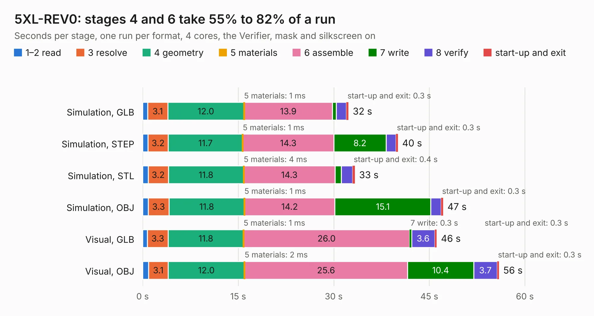

# 807. 5XL-REV0

Board 807 of the 3,101 of [Corpus Testing](../Corpus-Testing.md), on [Corpus Page 8](../CorpusTestingPages/Corpus-Testing-08.md#807-5xl-rev0).

| Mode and format | 1–2 read | 3 resolve | 4 geometry | 5 materials | 6 assemble | 7 write | 8 verify | start-up and exit | Total |
|---|---:|---:|---:|---:|---:|---:|---:|---:|---:|
| Simulation, GLB | 0.8 | 3.1 | 12.0 | 1&nbsp;ms | 13.9 | 0.6 | 1.6 | 0.3 | 32.3 |
| Simulation, STEP | 0.9 | 3.2 | 11.7 | 1&nbsp;ms | 14.3 | 8.2 | 1.5 | 0.3 | 40.1 |
| Simulation, STL | 0.9 | 3.2 | 11.8 | 4&nbsp;ms | 14.3 | 1.0 | 1.8 | 0.4 | 33.3 |
| Simulation, OBJ | 0.9 | 3.3 | 11.8 | 1&nbsp;ms | 14.2 | 15.1 | 1.6 | 0.3 | 47.2 |
| Visual, GLB | 0.8 | 3.3 | 11.8 | 1&nbsp;ms | 26.0 | 0.3 | 3.6 | 0.3 | 46.2 |
| Visual, OBJ | 0.9 | 3.1 | 12.0 | 2&nbsp;ms | 25.6 | 10.4 | 3.7 | 0.3 | 55.9 |

<table align="center"><tr><td valign="top">

| Board | Repo: [DangerousPrototypes/BusPirate5-hardware](https://github.com/DangerousPrototypes/BusPirate5-hardware) Board: `5XL-REV0.kicad_pcb` |
|---|---|
| Folder | bus_pirate_pcb / 5XL-REV0 |
| Complexity | 388&nbsp;/&nbsp;1000 (size&nbsp;268, features&nbsp;120) |
| KESE&nbsp;features | through vias, slotted holes, custom pads, rounded, trapezoid or chamfered pads, filled zones, copper drawings, curved board outline, stack-up, dielectric εr and tanδ |
| Tested | 9th November 2026 |
| Copper&nbsp;layers | 4 |
| File&nbsp;format | KiCad 8 (20240108) |
| Parts,&nbsp;tracks,&nbsp;vias | 216, 2,471, 536 |
| Triangles,&nbsp;simulation | 2,905,454 in 218 parts |
| Verifier | PASS in all six runs |

</td><td valign="top">

<table>
<tr><th>File type</th><th>File size</th><th>Peak memory used</th></tr>
<tr><th colspan="3" align="left">Simulation</th></tr>
<tr><td>GLB</td><td align="right">99&nbsp;MB</td><td align="right">1.0&nbsp;GB</td></tr>
<tr><td>STEP</td><td align="right">432&nbsp;MB</td><td align="right">1.3&nbsp;GB</td></tr>
<tr><td>STL</td><td align="right">145&nbsp;MB</td><td align="right">1.0&nbsp;GB</td></tr>
<tr><td>OBJ</td><td align="right">309&nbsp;MB</td><td align="right">1.9&nbsp;GB</td></tr>
<tr><th colspan="3" align="left">Visual</th></tr>
<tr><td>GLB</td><td align="right">70&nbsp;MB</td><td align="right">1.2&nbsp;GB</td></tr>
<tr><td>OBJ</td><td align="right">221&nbsp;MB</td><td align="right">1.5&nbsp;GB</td></tr>
</table>

</td></tr></table>

| Previous | Next |
|:---|---:|
| [806. BusPirate-5-rev8](b0806b_BusPirate5-hardware_BusPirate-5-rev8.md) | [808. 6-REV2b](b0808b_BusPirate5-hardware_6-REV2b.md) |
