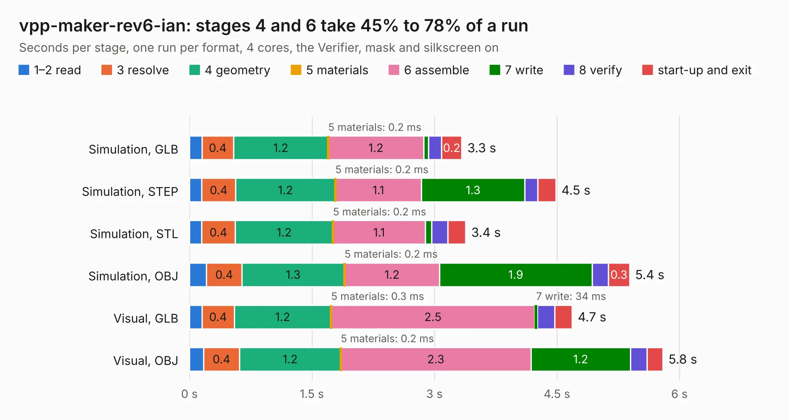

# 808. vpp-maker-rev6-ian

Board 808 of the 3,106 of [Corpus Testing](../Corpus-Testing.md), on [Corpus Page 8](../CorpusTestingPages/Corpus-Testing-08.md#808-vpp-maker-rev6-ian).

| Mode and format | 1–2 read | 3 resolve | 4 geometry | 5 materials | 6 assemble | 7 write | 8 verify | start-up and exit | Total |
|---|---:|---:|---:|---:|---:|---:|---:|---:|---:|
| Simulation, GLB | 0.2 | 0.4 | 1.2 | 0.2&nbsp;ms | 1.2 | 58&nbsp;ms | 0.2 | 0.2 | 3.3 |
| Simulation, STEP | 0.2 | 0.4 | 1.2 | 0.2&nbsp;ms | 1.1 | 1.3 | 0.2 | 0.2 | 4.5 |
| Simulation, STL | 0.1 | 0.4 | 1.2 | 0.2&nbsp;ms | 1.1 | 79&nbsp;ms | 0.2 | 0.2 | 3.4 |
| Simulation, OBJ | 0.2 | 0.4 | 1.3 | 0.2&nbsp;ms | 1.2 | 1.9 | 0.2 | 0.3 | 5.4 |
| Visual, GLB | 0.2 | 0.4 | 1.2 | 0.3&nbsp;ms | 2.5 | 34&nbsp;ms | 0.2 | 0.2 | 4.7 |
| Visual, OBJ | 0.2 | 0.4 | 1.2 | 0.2&nbsp;ms | 2.3 | 1.2 | 0.2 | 0.2 | 5.8 |

<table align="center"><tr><td valign="top">

| Board | Repo: [DangerousPrototypes/BusPirate5-hardware](https://github.com/DangerousPrototypes/BusPirate5-hardware) Board: `vpp-maker-rev6-ian.kicad_pcb` |
|---|---|
| Folder | adapter-vpp-maker-1REV6 |
| Complexity | 209&nbsp;/&nbsp;1000 (size&nbsp;139, features&nbsp;70) |
| KESE&nbsp;features | through vias, rounded, trapezoid or chamfered pads, filled zones, curved board outline, knockout text |
| Tested | 9th November 2026 |
| Copper&nbsp;layers | 2 |
| File&nbsp;format | KiCad 8 (20240108) |
| Parts,&nbsp;tracks,&nbsp;vias | 23, 115, 34 |
| Triangles,&nbsp;simulation | 301,980 in 31 parts |
| Verifier | PASS in all six runs |

</td><td valign="top">

<table>
<tr><th>File type</th><th>File size</th><th>Peak memory used</th></tr>
<tr><th colspan="3" align="left">Simulation</th></tr>
<tr><td>GLB</td><td align="right">10&nbsp;MB</td><td align="right">237&nbsp;MB</td></tr>
<tr><td>STEP</td><td align="right">44&nbsp;MB</td><td align="right">262&nbsp;MB</td></tr>
<tr><td>STL</td><td align="right">15&nbsp;MB</td><td align="right">260&nbsp;MB</td></tr>
<tr><td>OBJ</td><td align="right">30&nbsp;MB</td><td align="right">239&nbsp;MB</td></tr>
<tr><th colspan="3" align="left">Visual</th></tr>
<tr><td>GLB</td><td align="right">7.8&nbsp;MB</td><td align="right">233&nbsp;MB</td></tr>
<tr><td>OBJ</td><td align="right">23&nbsp;MB</td><td align="right">241&nbsp;MB</td></tr>
</table>

</td></tr></table>

| Previous | Next |
|:---|---:|
| [807. stemma-qwiic-grove-gravity-bog-plank-1REV1](b0807b_BusPirate5-hardware_stemma-qwiic-grove-gravity-bog-plank-1REV1.md) | [809. REV10a](b0809b_BusPirate5-hardware_REV10a.md) |
