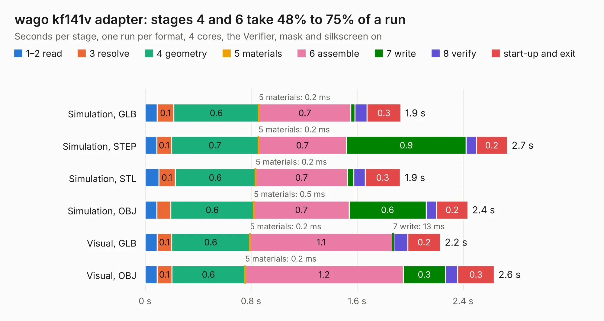

# 808. wago kf141v adapter

Board 808 of the 3,116 of [Corpus Testing](../Corpus-Testing.md), on [Corpus Page 8](../CorpusTestingPages/Corpus-Testing-08.md#808-wago-kf141v-adapter).

| Mode and format | 1–2 read | 3 resolve | 4 geometry | 5 materials | 6 assemble | 7 write | 8 verify | start-up and exit | Total |
|---|---:|---:|---:|---:|---:|---:|---:|---:|---:|
| Simulation, GLB | 91&nbsp;ms | 0.1 | 0.6 | 0.2&nbsp;ms | 0.7 | 31&nbsp;ms | 90&nbsp;ms | 0.3 | 1.9 |
| Simulation, STEP | 89&nbsp;ms | 0.1 | 0.7 | 0.2&nbsp;ms | 0.7 | 0.9 | 76&nbsp;ms | 0.2 | 2.7 |
| Simulation, STL | 0.1 | 0.1 | 0.6 | 0.2&nbsp;ms | 0.7 | 47&nbsp;ms | 85&nbsp;ms | 0.3 | 1.9 |
| Simulation, OBJ | 90&nbsp;ms | 0.1 | 0.6 | 0.5&nbsp;ms | 0.7 | 0.6 | 79&nbsp;ms | 0.2 | 2.4 |
| Visual, GLB | 92&nbsp;ms | 0.1 | 0.6 | 0.2&nbsp;ms | 1.1 | 13&nbsp;ms | 0.1 | 0.2 | 2.2 |
| Visual, OBJ | 91&nbsp;ms | 0.1 | 0.6 | 0.2&nbsp;ms | 1.2 | 0.3 | 92&nbsp;ms | 0.3 | 2.6 |

<table align="center"><tr><td valign="top">

| Board | Repo: [DangerousPrototypes/BusPirate5-hardware](https://github.com/DangerousPrototypes/BusPirate5-hardware) Board: `wago kf141v adapter.kicad_pcb` |
|---|---|
| Folder | adapter-kf141v-quick-connect-1REV0 |
| Complexity | 95&nbsp;/&nbsp;1000 (size&nbsp;85, features&nbsp;10) |
| KESE&nbsp;features | curved board outline |
| Tested | 9th November 2026 |
| Copper&nbsp;layers | 2 |
| File&nbsp;format | KiCad 7 (20221018) |
| Parts,&nbsp;tracks,&nbsp;vias | 2, 30, 0 |
| Triangles,&nbsp;simulation | 132,656 in 20 parts |
| Verifier | PASS in all six runs |

</td><td valign="top">

<table>
<tr><th>File type</th><th>File size</th><th>Peak memory used</th></tr>
<tr><th colspan="3" align="left">Simulation</th></tr>
<tr><td>GLB</td><td align="right">4.1&nbsp;MB</td><td align="right">186&nbsp;MB</td></tr>
<tr><td>STEP</td><td align="right">15&nbsp;MB</td><td align="right">196&nbsp;MB</td></tr>
<tr><td>STL</td><td align="right">6.6&nbsp;MB</td><td align="right">181&nbsp;MB</td></tr>
<tr><td>OBJ</td><td align="right">13&nbsp;MB</td><td align="right">186&nbsp;MB</td></tr>
<tr><th colspan="3" align="left">Visual</th></tr>
<tr><td>GLB</td><td align="right">2.3&nbsp;MB</td><td align="right">154&nbsp;MB</td></tr>
<tr><td>OBJ</td><td align="right">6.5&nbsp;MB</td><td align="right">155&nbsp;MB</td></tr>
</table>

</td></tr></table>

| Previous | Next |
|:---|---:|
| [807. wago kf141r adapter](b0807b_BusPirate5-hardware_wago-kf141r-adapter.md) | [809. adapter-ram-ddr5-1REV2](b0809b_BusPirate5-hardware_adapter-ram-ddr5-1REV2.md) |
