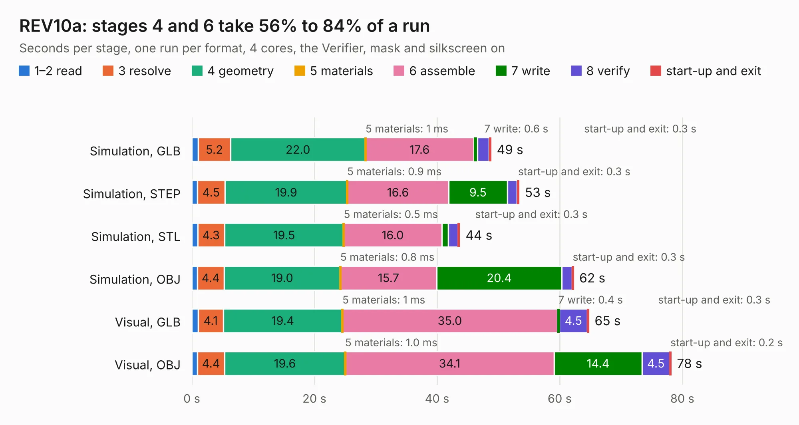

# 809. REV10a

Board 809 of the 3,106 of [Corpus Testing](../Corpus-Testing.md), on [Corpus Page 8](../CorpusTestingPages/Corpus-Testing-08.md#809-rev10a).

| Mode and format | 1–2 read | 3 resolve | 4 geometry | 5 materials | 6 assemble | 7 write | 8 verify | start-up and exit | Total |
|---|---:|---:|---:|---:|---:|---:|---:|---:|---:|
| Simulation, GLB | 1.1 | 5.2 | 22.0 | 1&nbsp;ms | 17.6 | 0.6 | 1.9 | 0.3 | 48.8 |
| Simulation, STEP | 0.9 | 4.5 | 19.9 | 0.9&nbsp;ms | 16.6 | 9.5 | 1.6 | 0.3 | 53.4 |
| Simulation, STL | 1.0 | 4.3 | 19.5 | 0.5&nbsp;ms | 16.0 | 1.1 | 1.6 | 0.3 | 43.7 |
| Simulation, OBJ | 0.9 | 4.4 | 19.0 | 0.8&nbsp;ms | 15.7 | 20.4 | 1.7 | 0.3 | 62.3 |
| Visual, GLB | 1.0 | 4.1 | 19.4 | 1&nbsp;ms | 35.0 | 0.4 | 4.5 | 0.3 | 64.8 |
| Visual, OBJ | 0.9 | 4.4 | 19.6 | 1.0&nbsp;ms | 34.1 | 14.4 | 4.5 | 0.2 | 78.2 |

<table align="center"><tr><td valign="top">

| Board | Repo: [DangerousPrototypes/BusPirate5-hardware](https://github.com/DangerousPrototypes/BusPirate5-hardware) Board: `REV10a.kicad_pcb` |
|---|---|
| Folder | bus_pirate_pcb / 5-REV10A |
| Complexity | 387&nbsp;/&nbsp;1000 (size&nbsp;267, features&nbsp;120) |
| KESE&nbsp;features | through vias, slotted holes, custom pads, rounded, trapezoid or chamfered pads, filled zones, copper drawings, curved board outline, stack-up, dielectric εr and tanδ |
| Tested | 9th November 2026 |
| Copper&nbsp;layers | 4 |
| File&nbsp;format | KiCad 7 (20221018) |
| Parts,&nbsp;tracks,&nbsp;vias | 210, 2,417, 547 |
| Triangles,&nbsp;simulation | 3,375,460 in 212 parts |
| Verifier | PASS in all six runs |

</td><td valign="top">

<table>
<tr><th>File type</th><th>File size</th><th>Peak memory used</th></tr>
<tr><th colspan="3" align="left">Simulation</th></tr>
<tr><td>GLB</td><td align="right">116&nbsp;MB</td><td align="right">1.1&nbsp;GB</td></tr>
<tr><td>STEP</td><td align="right">556&nbsp;MB</td><td align="right">1.4&nbsp;GB</td></tr>
<tr><td>STL</td><td align="right">169&nbsp;MB</td><td align="right">1.1&nbsp;GB</td></tr>
<tr><td>OBJ</td><td align="right">363&nbsp;MB</td><td align="right">2.3&nbsp;GB</td></tr>
<tr><th colspan="3" align="left">Visual</th></tr>
<tr><td>GLB</td><td align="right">77&nbsp;MB</td><td align="right">1.2&nbsp;GB</td></tr>
<tr><td>OBJ</td><td align="right">243&nbsp;MB</td><td align="right">1.7&nbsp;GB</td></tr>
</table>

</td></tr></table>

| Previous | Next |
|:---|---:|
| [808. vpp-maker-rev6-ian](b0808b_BusPirate5-hardware_vpp-maker-rev6-ian.md) | [810. BusPirate-5-rev8](b0810b_BusPirate5-hardware_BusPirate-5-rev8.md) |
