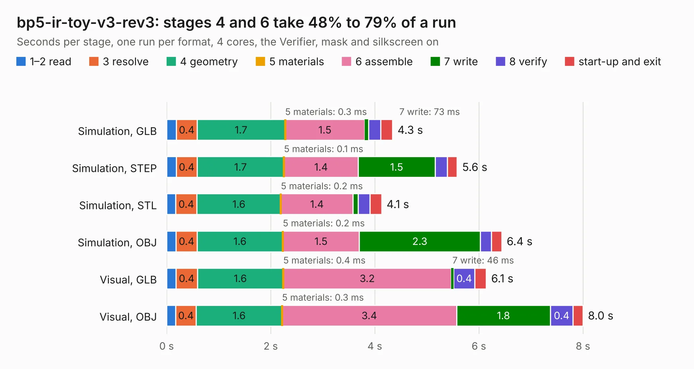

# 809. bp5-ir-toy-v3-rev3

Board 809 of the 3,122 of [Corpus Testing](../Corpus-Testing.md), on [Corpus Page 8](../CorpusTestingPages/Corpus-Testing-08.md#809-bp5-ir-toy-v3-rev3).

| Mode and format | 1–2 read | 3 resolve | 4 geometry | 5 materials | 6 assemble | 7 write | 8 verify | start-up and exit | Total |
|---|---:|---:|---:|---:|---:|---:|---:|---:|---:|
| Simulation, GLB | 0.2 | 0.4 | 1.7 | 0.3&nbsp;ms | 1.5 | 73&nbsp;ms | 0.2 | 0.2 | 4.3 |
| Simulation, STEP | 0.2 | 0.4 | 1.7 | 0.1&nbsp;ms | 1.4 | 1.5 | 0.2 | 0.2 | 5.6 |
| Simulation, STL | 0.2 | 0.4 | 1.6 | 0.2&nbsp;ms | 1.4 | 96&nbsp;ms | 0.2 | 0.2 | 4.1 |
| Simulation, OBJ | 0.2 | 0.4 | 1.6 | 0.2&nbsp;ms | 1.5 | 2.3 | 0.2 | 0.2 | 6.4 |
| Visual, GLB | 0.2 | 0.4 | 1.6 | 0.4&nbsp;ms | 3.2 | 46&nbsp;ms | 0.4 | 0.2 | 6.1 |
| Visual, OBJ | 0.2 | 0.4 | 1.6 | 0.3&nbsp;ms | 3.4 | 1.8 | 0.4 | 0.2 | 8.0 |

<table align="center"><tr><td valign="top">

| Board | Repo: [DangerousPrototypes/BusPirate5-hardware](https://github.com/DangerousPrototypes/BusPirate5-hardware) Board: `bp5-ir-toy-v3-rev3.kicad_pcb` |
|---|---|
| Folder | adapter-ir-toy-3REV3 |
| Complexity | 203&nbsp;/&nbsp;1000 (size&nbsp;148, features&nbsp;55) |
| KESE&nbsp;features | through vias, rounded, trapezoid or chamfered pads, filled zones, curved board outline |
| Tested | 9th November 2026 |
| Copper&nbsp;layers | 2 |
| File&nbsp;format | KiCad 8 (20240108) |
| Parts,&nbsp;tracks,&nbsp;vias | 35, 168, 37 |
| Triangles,&nbsp;simulation | 445,936 in 35 parts |
| Verifier | PASS in all six runs |

</td><td valign="top">

<table>
<tr><th>File type</th><th>File size</th><th>Peak memory used</th></tr>
<tr><th colspan="3" align="left">Simulation</th></tr>
<tr><td>GLB</td><td align="right">15&nbsp;MB</td><td align="right">277&nbsp;MB</td></tr>
<tr><td>STEP</td><td align="right">75&nbsp;MB</td><td align="right">321&nbsp;MB</td></tr>
<tr><td>STL</td><td align="right">22&nbsp;MB</td><td align="right">280&nbsp;MB</td></tr>
<tr><td>OBJ</td><td align="right">45&nbsp;MB</td><td align="right">355&nbsp;MB</td></tr>
<tr><th colspan="3" align="left">Visual</th></tr>
<tr><td>GLB</td><td align="right">12&nbsp;MB</td><td align="right">322&nbsp;MB</td></tr>
<tr><td>OBJ</td><td align="right">34&nbsp;MB</td><td align="right">320&nbsp;MB</td></tr>
</table>

</td></tr></table>

| Previous | Next |
|:---|---:|
| [808. flash-wson-rev3](b0808b_BusPirate5-hardware_flash-wson-rev3.md) | [810. wago kf141r adapter](b0810b_BusPirate5-hardware_wago-kf141r-adapter.md) |
