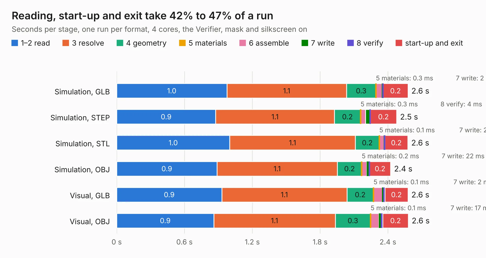

# 814. 7-REV2-vout-protection

Board 814 of the 3,101 of [Corpus Testing](../Corpus-Testing.md), on [Corpus Page 8](../CorpusTestingPages/Corpus-Testing-08.md#814-7-rev2-vout-protection).

| Mode and format | 1–2 read | 3 resolve | 4 geometry | 5 materials | 6 assemble | 7 write | 8 verify | start-up and exit | Total |
|---|---:|---:|---:|---:|---:|---:|---:|---:|---:|
| Simulation, GLB | 1.0 | 1.1 | 0.3 | 0.3&nbsp;ms | 58&nbsp;ms | 2&nbsp;ms | 4&nbsp;ms | 0.2 | 2.6 |
| Simulation, STEP | 0.9 | 1.1 | 0.2 | 0.3&nbsp;ms | 44&nbsp;ms | 38&nbsp;ms | 4&nbsp;ms | 0.2 | 2.5 |
| Simulation, STL | 1.0 | 1.1 | 0.2 | 0.1&nbsp;ms | 44&nbsp;ms | 2&nbsp;ms | 4&nbsp;ms | 0.2 | 2.6 |
| Simulation, OBJ | 0.9 | 1.1 | 0.2 | 0.2&nbsp;ms | 44&nbsp;ms | 22&nbsp;ms | 3&nbsp;ms | 0.2 | 2.4 |
| Visual, GLB | 0.9 | 1.1 | 0.2 | 0.1&nbsp;ms | 81&nbsp;ms | 2&nbsp;ms | 18&nbsp;ms | 0.2 | 2.6 |
| Visual, OBJ | 0.9 | 1.1 | 0.3 | 0.1&nbsp;ms | 74&nbsp;ms | 17&nbsp;ms | 17&nbsp;ms | 0.2 | 2.6 |

<table align="center"><tr><td valign="top">

| Board | Repo: [DangerousPrototypes/BusPirate5-hardware](https://github.com/DangerousPrototypes/BusPirate5-hardware) Board: `7-REV2-vout-protection.kicad_pcb` |
|---|---|
| Folder | bus_pirate_pcb / development / 7-REV2-prototype3b-side-leds |
| Complexity | 393&nbsp;/&nbsp;1000 (size&nbsp;273, features&nbsp;120) |
| KESE&nbsp;features | through vias, slotted holes, custom pads, rounded, trapezoid or chamfered pads, filled zones, copper drawings, curved board outline, stack-up, dielectric εr and tanδ |
| Tested | 9th November 2026 |
| Copper&nbsp;layers | 4 |
| File&nbsp;format | KiCad 9 (20241229) |
| Parts,&nbsp;tracks,&nbsp;vias | 265, 3,201, 529 |
| Triangles,&nbsp;simulation | 4,188 in 6 parts |
| Verifier | PASS in all six runs |

</td><td valign="top">

<table>
<tr><th>File type</th><th>File size</th><th>Peak memory used</th></tr>
<tr><th colspan="3" align="left">Simulation</th></tr>
<tr><td>GLB</td><td align="right">114&nbsp;kB</td><td align="right">133&nbsp;MB</td></tr>
<tr><td>STEP</td><td align="right">586&nbsp;kB</td><td align="right">134&nbsp;MB</td></tr>
<tr><td>STL</td><td align="right">210&nbsp;kB</td><td align="right">133&nbsp;MB</td></tr>
<tr><td>OBJ</td><td align="right">375&nbsp;kB</td><td align="right">133&nbsp;MB</td></tr>
<tr><th colspan="3" align="left">Visual</th></tr>
<tr><td>GLB</td><td align="right">133&nbsp;kB</td><td align="right">133&nbsp;MB</td></tr>
<tr><td>OBJ</td><td align="right">327&nbsp;kB</td><td align="right">133&nbsp;MB</td></tr>
</table>

</td></tr></table>

| Previous | Next |
|:---|---:|
| [813. 7-REV2-vout-protection](b0813b_BusPirate5-hardware_bus-pirate-pcb-development-7-REV2-prototype3a_7-REV2-vout-protection.md) | [815. programming_pin_mount.v1.0](b0815b_BusPirate5-hardware_programming-pin-mount-v1-0.md) |
