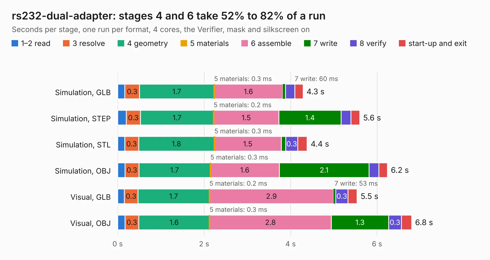

# 815. rs232-dual-adapter

Board 815 of the 3,138 of [Corpus Testing](../Corpus-Testing.md), on [Corpus Page 8](../CorpusTestingPages/Corpus-Testing-08.md#815-rs232-dual-adapter).

| Mode and format | 1–2 read | 3 resolve | 4 geometry | 5 materials | 6 assemble | 7 write | 8 verify | start-up and exit | Total |
|---|---:|---:|---:|---:|---:|---:|---:|---:|---:|
| Simulation, GLB | 0.2 | 0.3 | 1.7 | 0.3&nbsp;ms | 1.6 | 60&nbsp;ms | 0.2 | 0.2 | 4.3 |
| Simulation, STEP | 0.2 | 0.3 | 1.7 | 0.2&nbsp;ms | 1.5 | 1.4 | 0.2 | 0.2 | 5.6 |
| Simulation, STL | 0.2 | 0.3 | 1.8 | 0.3&nbsp;ms | 1.5 | 0.1 | 0.3 | 0.2 | 4.4 |
| Simulation, OBJ | 0.2 | 0.3 | 1.7 | 0.3&nbsp;ms | 1.6 | 2.1 | 0.2 | 0.2 | 6.2 |
| Visual, GLB | 0.2 | 0.3 | 1.7 | 0.2&nbsp;ms | 2.9 | 53&nbsp;ms | 0.3 | 0.2 | 5.5 |
| Visual, OBJ | 0.2 | 0.3 | 1.6 | 0.3&nbsp;ms | 2.8 | 1.3 | 0.3 | 0.2 | 6.8 |

<table align="center"><tr><td valign="top">

| Board | Repo: [DangerousPrototypes/BusPirate5-hardware](https://github.com/DangerousPrototypes/BusPirate5-hardware) Board: `rs232-dual-adapter.kicad_pcb` |
|---|---|
| Folder | adapter-rs232-dual-1REV0 |
| Complexity | 238&nbsp;/&nbsp;1000 (size&nbsp;138, features&nbsp;100) |
| KESE&nbsp;features | through vias, rounded, trapezoid or chamfered pads, filled zones, curved board outline, knockout text, stack-up, dielectric εr and tanδ |
| Tested | 9th November 2026 |
| Copper&nbsp;layers | 2 |
| File&nbsp;format | KiCad 8 (20240108) |
| Parts,&nbsp;tracks,&nbsp;vias | 18, 168, 22 |
| Triangles,&nbsp;simulation | 414,134 in 52 parts |
| Verifier | PASS in all six runs |

</td><td valign="top">

<table>
<tr><th>File type</th><th>File size</th><th>Peak memory used</th></tr>
<tr><th colspan="3" align="left">Simulation</th></tr>
<tr><td>GLB</td><td align="right">14&nbsp;MB</td><td align="right">273&nbsp;MB</td></tr>
<tr><td>STEP</td><td align="right">62&nbsp;MB</td><td align="right">314&nbsp;MB</td></tr>
<tr><td>STL</td><td align="right">21&nbsp;MB</td><td align="right">276&nbsp;MB</td></tr>
<tr><td>OBJ</td><td align="right">41&nbsp;MB</td><td align="right">335&nbsp;MB</td></tr>
<tr><th colspan="3" align="left">Visual</th></tr>
<tr><td>GLB</td><td align="right">10&nbsp;MB</td><td align="right">309&nbsp;MB</td></tr>
<tr><td>OBJ</td><td align="right">29&nbsp;MB</td><td align="right">314&nbsp;MB</td></tr>
</table>

</td></tr></table>

| Previous | Next |
|:---|---:|
| [814. adapter-ram-ddr5-1REV2](b0814b_BusPirate5-hardware_adapter-ram-ddr5-1REV2.md) | [816. sim-rev3c](b0816b_BusPirate5-hardware_sim-rev3c.md) |
