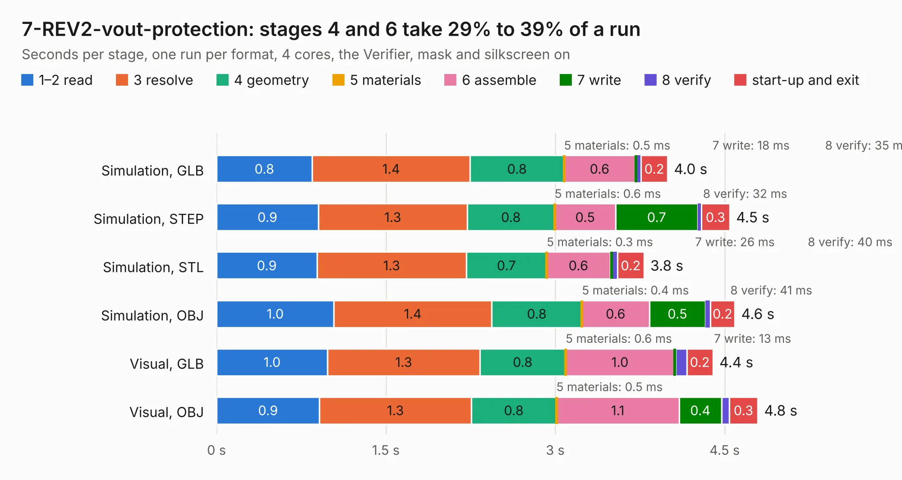

# 816. 7-REV2-vout-protection

Board 816 of the 3,104 of [Corpus Testing](../Corpus-Testing.md), on [Corpus Page 8](../CorpusTestingPages/Corpus-Testing-08.md#816-7-rev2-vout-protection).

| Mode and format | 1–2 read | 3 resolve | 4 geometry | 5 materials | 6 assemble | 7 write | 8 verify | start-up and exit | Total |
|---|---:|---:|---:|---:|---:|---:|---:|---:|---:|
| Simulation, GLB | 0.8 | 1.4 | 0.8 | 0.5&nbsp;ms | 0.6 | 18&nbsp;ms | 35&nbsp;ms | 0.2 | 4.0 |
| Simulation, STEP | 0.9 | 1.3 | 0.8 | 0.6&nbsp;ms | 0.5 | 0.7 | 32&nbsp;ms | 0.3 | 4.5 |
| Simulation, STL | 0.9 | 1.3 | 0.7 | 0.3&nbsp;ms | 0.6 | 26&nbsp;ms | 40&nbsp;ms | 0.2 | 3.8 |
| Simulation, OBJ | 1.0 | 1.4 | 0.8 | 0.4&nbsp;ms | 0.6 | 0.5 | 41&nbsp;ms | 0.2 | 4.6 |
| Visual, GLB | 1.0 | 1.3 | 0.8 | 0.6&nbsp;ms | 1.0 | 13&nbsp;ms | 98&nbsp;ms | 0.2 | 4.4 |
| Visual, OBJ | 0.9 | 1.3 | 0.8 | 0.5&nbsp;ms | 1.1 | 0.4 | 67&nbsp;ms | 0.3 | 4.8 |

<table align="center"><tr><td valign="top">

| Board | Repo: [DangerousPrototypes/BusPirate5-hardware](https://github.com/DangerousPrototypes/BusPirate5-hardware) Board: `7-REV2-vout-protection.kicad_pcb` |
|---|---|
| Folder | bus_pirate_pcb / development / 7-REV2-prototype3a |
| Complexity | 393&nbsp;/&nbsp;1000 (size&nbsp;273, features&nbsp;120) |
| KESE&nbsp;features | through vias, slotted holes, custom pads, rounded, trapezoid or chamfered pads, filled zones, copper drawings, curved board outline, stack-up, dielectric εr and tanδ |
| Tested | 9th November 2026 |
| Copper&nbsp;layers | 4 |
| File&nbsp;format | KiCad 9 (20241229) |
| Parts,&nbsp;tracks,&nbsp;vias | 265, 3,158, 537 |
| Triangles,&nbsp;simulation | 89,118 in 26 parts |
| Verifier | PASS in all six runs |

</td><td valign="top">

<table>
<tr><th>File type</th><th>File size</th><th>Peak memory used</th></tr>
<tr><th colspan="3" align="left">Simulation</th></tr>
<tr><td>GLB</td><td align="right">3.0&nbsp;MB</td><td align="right">233&nbsp;MB</td></tr>
<tr><td>STEP</td><td align="right">6.4&nbsp;MB</td><td align="right">239&nbsp;MB</td></tr>
<tr><td>STL</td><td align="right">4.5&nbsp;MB</td><td align="right">237&nbsp;MB</td></tr>
<tr><td>OBJ</td><td align="right">8.9&nbsp;MB</td><td align="right">228&nbsp;MB</td></tr>
<tr><th colspan="3" align="left">Visual</th></tr>
<tr><td>GLB</td><td align="right">2.4&nbsp;MB</td><td align="right">212&nbsp;MB</td></tr>
<tr><td>OBJ</td><td align="right">6.7&nbsp;MB</td><td align="right">213&nbsp;MB</td></tr>
</table>

</td></tr></table>

| Previous | Next |
|:---|---:|
| [815. 7-REV1B](b0815b_BusPirate5-hardware_7-REV1B.md) | [817. 7-REV2-vout-protection](b0817b_BusPirate5-hardware_bus-pirate-pcb-development-7-REV2-prototype3b-side-leds_7-REV2-vout-protection.md) |
