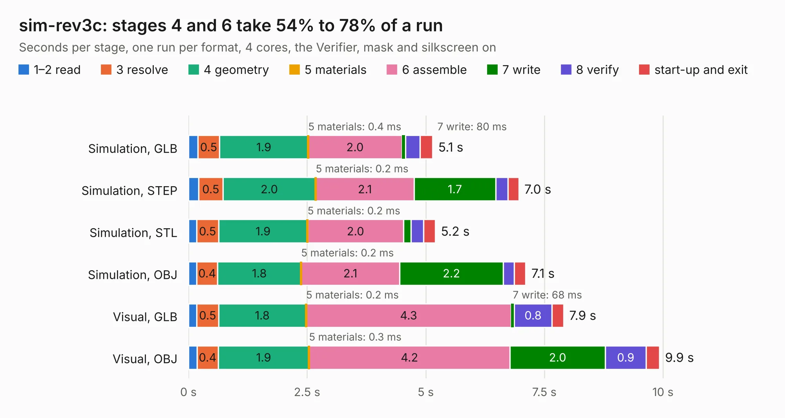

# 816 sim-rev3c

Board 816 of the 3,138 of [Corpus Testing](../Corpus-Testing.md), on [Corpus Page 8](../CorpusTestingPages/Corpus-Testing-08.md#816-sim-rev3c).

| Mode and format | 1–2 read | 3 resolve | 4 geometry | 5 materials | 6 assemble | 7 write | 8 verify | start-up and exit | Total |
|---|---:|---:|---:|---:|---:|---:|---:|---:|---:|
| Simulation, GLB | 0.2 | 0.5 | 1.9 | 0.4&nbsp;ms | 2.0 | 80&nbsp;ms | 0.3 | 0.3 | 5.1 |
| Simulation, STEP | 0.2 | 0.5 | 2.0 | 0.2&nbsp;ms | 2.1 | 1.7 | 0.3 | 0.2 | 7.0 |
| Simulation, STL | 0.2 | 0.5 | 1.9 | 0.2&nbsp;ms | 2.0 | 0.2 | 0.3 | 0.2 | 5.2 |
| Simulation, OBJ | 0.2 | 0.4 | 1.8 | 0.2&nbsp;ms | 2.1 | 2.2 | 0.2 | 0.2 | 7.1 |
| Visual, GLB | 0.2 | 0.5 | 1.8 | 0.2&nbsp;ms | 4.3 | 68&nbsp;ms | 0.8 | 0.2 | 7.9 |
| Visual, OBJ | 0.2 | 0.4 | 1.9 | 0.3&nbsp;ms | 4.2 | 2.0 | 0.9 | 0.3 | 9.9 |

<table align="center"><tr><td valign="top">

| Board | Repo: [DangerousPrototypes/BusPirate5-hardware](https://github.com/DangerousPrototypes/BusPirate5-hardware) Board: `sim-rev3c.kicad_pcb` |
|---|---|
| Folder | adapter-sim-iccard-1REV3C |
| Complexity | 248&nbsp;/&nbsp;1000 (size&nbsp;148, features&nbsp;100) |
| KESE&nbsp;features | through vias, rounded, trapezoid or chamfered pads, filled zones, curved board outline, knockout text, stack-up, dielectric εr and tanδ |
| Tested | 9th November 2026 |
| Copper&nbsp;layers | 2 |
| File&nbsp;format | KiCad 7 (20221018) |
| Parts,&nbsp;tracks,&nbsp;vias | 12, 262, 97 |
| Triangles,&nbsp;simulation | 450,316 in 27 parts |
| Verifier | PASS in all six runs |

</td><td valign="top">

<table>
<tr><th>File type</th><th>File size</th><th>Peak memory used</th></tr>
<tr><th colspan="3" align="left">Simulation</th></tr>
<tr><td>GLB</td><td align="right">16&nbsp;MB</td><td align="right">291&nbsp;MB</td></tr>
<tr><td>STEP</td><td align="right">78&nbsp;MB</td><td align="right">353&nbsp;MB</td></tr>
<tr><td>STL</td><td align="right">23&nbsp;MB</td><td align="right">294&nbsp;MB</td></tr>
<tr><td>OBJ</td><td align="right">46&nbsp;MB</td><td align="right">360&nbsp;MB</td></tr>
<tr><th colspan="3" align="left">Visual</th></tr>
<tr><td>GLB</td><td align="right">14&nbsp;MB</td><td align="right">370&nbsp;MB</td></tr>
<tr><td>OBJ</td><td align="right">40&nbsp;MB</td><td align="right">391&nbsp;MB</td></tr>
</table>

</td></tr></table>

| Previous | Next |
|:---|---:|
| [815 rs232-dual-adapter](b0815b_BusPirate5-hardware_rs232-dual-adapter.md) | [817 stemma-qwiic-grove-gravity-bog-plank-1REV1](b0817b_BusPirate5-hardware_stemma-qwiic-grove-gravity-bog-plank-1REV1.md) |
